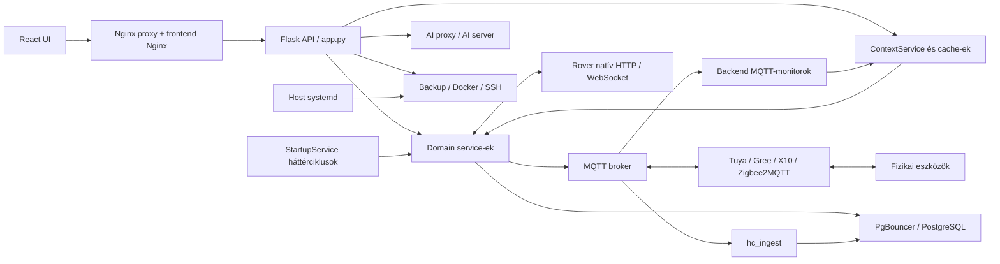

# HC – Teljes rendszerű refaktorálási audit

**Dátum:** 2026-10-19–22; utolsó kiegészítés: 2026-10-22, Europe/Budapest.  
**Vizsgált munkapéldány:** `/srv/docker/homecontrol`.  
**Státusz:** az elérhető körben lezárt audit: forrás, élő PostgreSQL, izolált restore/integritás/tesztek, böngésző, kiesés, host- és függőségvizsgálat. Implementáció nem történt. Lefedettség: J.; élő DB: K.; kiegészítő vizsgálatok: L–N.; a hat utolsó auditpont státusza M.7, az új eredmények és a közben változott források pontosítása N.5.

Az audit során nem módosítottam az éles HC forráskódját, konfigurációját, alkalmazási adatait, DB-sémáját vagy szolgáltatásbeállítását. A projektben kizárólag ez az auditdokumentum módosult. Éles HC-alkalmazási API-kérést, MQTT-publikálást és eszközparancsot nem indítottam; a Docker-leltár és a daemon-ping csak olvasás volt. Az élő PostgreSQL lekérdezései rövid `READ ONLY` tranzakciókban futottak; az olvasás a normál statisztikákat és cache-t érintheti. A folytatásban valódi mentést kizárólag külön, hálózatilag izolált teszt-DB-be állítottam vissza, és ott futott alkalmazás, író teszt, kiesés/restart és böngészőpróba. A tesztkörnyezet és ideiglenes fájlok az L–M. fejezetben elkülönülnek az éles rendszertől. Titokértékeket nem tartalmaz a jelentés.

## A. Vezetői összefoglaló

### Általános állapot

A HC funkcionálisan gazdag, alapvetően megfelelő technológiákra épülő, moduláris monolit köré szervezett házautomatizálási rendszer. A Flask, React, PostgreSQL, PgBouncer és MQTT megtartása indokolt. Az eszközbridge-ek külön folyamatai valódi protokoll- és hibahatárokat adnak; összevonásuk önmagában nem javítaná a rendszert.

A fő probléma a különböző időszakokban kialakult végrehajtási és állapotkezelési megoldások együttélése. Egyes vezérlésekben a küldés és a fizikai eredmény összemosódik, a háttérciklusok egymást késleltethetik, az indulási kód üzleti adatokat is átír, a mentési és cache-megoldások pedig több párhuzamos változatban élnek. Ezek fontosabbak a fájlméretnél vagy a stílus egységesítésénél.

Pozitívum a domain service-ek létezése, az injektálható I/O, a sok célzott teszt, az öntözés fizikai visszaigazolási szándéka, a szezonális tiltások, valamint a rover frissesség-, lease-, bootazonosság- és parancsismétlés-kezelése. A legutóbbi rover-egyszerűsítés tudatos termékdöntés: az egykezelős mód és a korábbi HC-zárolások elhagyása nem önmagában hiba.

**A kiegészítő futásokban 374 különálló backendteszt és 83 frontendteszt sikeres; a frontend build és a helyi mentésből végzett PostgreSQL-restore is sikerült.** A korábbi 224 kiválasztott teszt részben átfed ezekkel, ezért nem adom hozzájuk. Ettől külön 20 hibafeltáró próba konkrét hibás viselkedést vagy hibamintát igazolt; az öntözési versenyhelyzetet a folytatás valódi teszt-DB-n is megerősítette. Az audit nem állítja minden eset éles előfordulását. A **48 megállapítás** elsődleges besorolása: **20 P1, 26 P2 és 2 P3**; P0-t alátámasztó bizonyítékot nem találtam.

A második kör a restore részleges végrehajtását, a jogosultságok elvesztését, a diff útvonal-ellenőrzését, a hibás „legutóbbi mentés” jelzést, az AI-gép késleltetett áramtalanítását, a Tuya MQTT-helyreállítását és az ingest batch-hibánál bekövetkező adatvesztését tárta fel (HC-27–33). A már jelzett Tuya-parancssorrendi problémát is reprodukáltam: a sorba tett ON→OFF műveletpár OFF→ON sorrendben hajtható végre (HC-12). A 306 fájlos forrásleltár a folytatás elején is változatlan volt.

A lezáró kör a metrikanevek producer→ingest→DB→UI egyezését, az eszközhozzárendelések érvénytelenedését, a késleltetett ventilátorindítás célazonosságát és a restore-smoke tényleges bizonyító erejét vizsgálta (HC-34–37). A rover olvasási, parancs-, kézi és konfigurációs szerződését további 113 meglévő teszttel ellenőriztem. Ezek alapján a rover-protokoll teljes újraírását továbbra sem indokolja a vizsgálat.

Az utólag kért élő DB-audit a `homecontrol` PostgreSQL-adatbázis 51 HC- és 13 public táblájának katalógusát, 154 indexét, a constraint-eket, nézeteket, függvényeket, triggereket és működési statisztikákat vizsgálta. A 31 280 soros történeti mintában nem találtam típus-/tartomány-/metrikahivatkozási hibát. Hat aktív Tuya eszköznél viszont a `current_a` állapot és történet is hiányzik; az összesítések költségét tényleges SQL-statisztika támasztja alá. Új megállapítások: hiányzó alap-sémaforrás (HC-38), túl széles runtime/SQL Lab DB-jogosultság (HC-39), minden értékeléskor tartósan írt szivattyúdiagnosztika (HC-40).

A további vizsgálat 725/725 mentési checksumot, 6 515 691 történeti mérési sort, a visszaállított DB fizikai struktúráját és a HA SQLite-adatbázist ellenőrizte hiba nélkül az L.-ben megadott feltételekkel. Új problémák: névtelen, publikált MQTT-busz (HC-41), Gitea-hiba miatt elmaradó kötelező heti mentési kísérlet (HC-42), ismert advisory-tartományokba eső függőségverziók (HC-43). A rövid párhuzamos API-próbában scheduler-timeoutok is voltak; ezek okát és üzemi gyakoriságát nem tekintem bizonyítottnak. Az aktuális távoli Gitea/restic, privilegizált hálózati/PgBouncer-adatok és felügyelt hardverpróbák korlátainak aktuális állapota az M.7-ben szerepel.

A hat utolsó pont folytatása eredeti owner/ACL-kezelésű DB-restore-t, 20 perces / 2288 sikeres kéréses izolált terhelést, három böngészőmotoron 75 nézetmegnyitást és 15 munkafolyamat-ellenőrzést, hat valódi brokeres hibaforgatókönyvet, valamint 15 image OS-csomag- és licencleltárát hozta. Új megállapítás a backend Docker-/hostjogosultsága (HC-44) és a friss gépes restore-ból hiányzó systemd-telepítés (HC-45). A felhasználói és rendszerszintű mentés/logkarbantartás kettős ütemezése is igazolódott (HC-19). Részletek és bizonyítási határok: M.

A 2026-10-21–22-i utóellenőrzés további három konkrét hibát igazolt: újrahasznált stagingből rossz DB-dump választása (HC-46), a restore eltérő célkönyvtárának figyelmen kívül hagyása a secretalkalmazásnál (HC-47), metrikasorokkal megsokszorozott About-darabszámok (HC-48). A korábbi About-timeout értelmezése pontosodott: a teljes DB-t kiszolgáló szolgáltatásfüggvény karbantartott másolaton 1,48 s alatt sikeres. A közben megváltozott forrásokat és új AI-képkezelés 28+4 sikeres tesztjét külön pillanatfelvételként kezeli N.4; a korábbi teljes suite és image-scan nem automatikusan az új kiadás bizonyítéka.

### Az öt legjelentősebb probléma

1. **Az öntözési visszaigazolás elavult MQTT-állapotot is elfogad.** Egy egynapos, retained `CLOSED` minta megszakadt monitorkapcsolat mellett is sikeres zárást eredményezett az izolált próbában. Lásd HC-01.
2. **A leállítás és helyreállítás útvonala nem elég független.** Egy ütemezési kivétel kihagyja a lejárt sessionök ellenőrzését; a `starting` és `stop_failed` állapotok kezelése hiányos, az indításfoglalás nem atomi. Ventilátor-hozzárendelés cseréje után egy korábbi késleltetett ON túlélheti az új célra küldött OFF-ot. HC-02–04, HC-36.
3. **Az égésbiztonsági kiegészítő sikertelen MQTT-küldés után is teljesítettnek tekintheti a leállítást.** Emiatt a következő ciklus nem próbálkozik újra. HC-05; kapcsolódó állapotkezelés: HC-06.
4. **A rendszerindítás sémakezelés címén működési adatokat is módosít.** Beállítások, eszközaktivitás és korábbi scheduler-módok automatikus átírása nehezíti a kiszámítható újraindítást és rollbacket. HC-07.
5. **A konfigurációexport és a mentés/helyreállítás szerződése nem egységes.** A Gitea-exportból szükséges infrastruktúra hiányzik, miközben egy létező Xiaomi-hitelesítési backup fájlt nem zár ki; a webes és ütemezett mentés külön végrehajtó. Restore-hiba előtt már átíródhat fájl, a késleltetett áramtalanítás pedig nem ellenőrzi újra a mentést. HC-17–19, HC-27–31, HC-42/45–47.

A HC-41 MQTT- és HC-44 Docker-/hosthozzáférési határ rendezése szintén az első biztonsági kör része; a fizikai stopútvonalak megőrzése miatt fokozatos átállást igényel.

### Az öt legnagyobb egyszerűsítési lehetőség

1. A `DatabaseRuntime → RepositoryRegistry → SqlRepository → DatabaseService` lánc rövidítése, a lekérdezésmérés és tranzakciókezelés megtartásával. HC-15.
2. Egyetlen mentésvégrehajtó és közös exportleltár használata a webes indítás, timer és restore-dokumentáció mögött. HC-17–19.
3. A bizonyíthatóan elérhetetlen legacy öntözési végrehajtó eltávolítása; a történeti adatok és a jelenleg használt kompatibilitási végpontok megőrzése. HC-20.
4. Egyértelmű cache-tulajdonos minden olvasási modellhez; következetes invalidálás és párhuzamos frissítés kezelése. HC-10, HC-22.
5. Az ütemezési döntés, a parancsküldés és az auditnapló felelősségének tisztázása; az általános új keretrendszer helyett a meglévő vezérlési út javítása. HC-02, HC-08–09.

### Javasolt stratégia

Először a bizonyított működési kockázatokat kell lefedni hibainjektálásos tesztekkel és célzott javításokkal. Ezután következhet az export/mentés rendezése, az indulási migrációk leválasztása, majd a viselkedést nem változtató egyszerűsítés. A teljesítményjavításokat mért lekérdezésszám és késleltetés alapján kell kiválasztani.

Nem javaslok teljes újraírást, mikroszolgáltatásokra bontást, új adatbázist, üzenetbuszt vagy frontend állapotkezelő frameworköt. A biztonsági és helyreállítási feladatokat el kell különíteni az új funkcióktól és a kozmetikai átszervezéstől.

### Bizonyosság és prioritás

- **B:** közvetlenül igazolható a kódból vagy a konfigurációból.
- **R:** izolált próbában reprodukált viselkedés; a helyettesített I/O korlátját külön jelölöm.
- **É:** az élő adatbázis katalógusából, összesített adatellenőrzéséből vagy meglévő működési statisztikájából igazolt pillanatfelvétel; nem kontrollált terhelésmérés.
- **M:** éles gyakorisága, erőforrásköltsége vagy üzemi hatása csak méréssel igazolható.
- **P0:** azonnali beavatkozást igénylő, bizonyított kritikus veszély vagy üzemzavar. A kódaudit önmagában is indokolhatna ilyet, de a jelen vizsgálat nem igazolt ilyen sürgősséget; ez nem az éles rendszer biztonsági tanúsítása.
- **P1:** a következő változtatások előtt kezelendő vezérlési, helyreállítási vagy adatvédelmi kockázat.
- **P2:** érdemi megbízhatósági/karbantarthatósági javítás, az első biztonsági kör után.
- **P3:** kisebb, méréstől vagy használati bizonyítéktól függő egyszerűsítés.

## B. Jelenlegi architektúra

### B.1. Leltár és vizsgálati határ

| Terület | Megtalált méret | Szerep |
|---|---:|---|
| `infra/backend` | 60 alkalmazásmodul, 25 116 Python-sor; 42 `test_*.py` | API, vezérlés, read model, ütemezés, adminisztráció |
| `infra/frontend/src` | 82 fájl, 26 955 sor JS/JSX/MJS/CSS | React felület, polling, WebSocket, helyi szerkesztőállapot |
| `infra/db` | 57 számozott SQL-fájl, 3257 sor | Sémaváltozások, adatjavítások, policyk, indexek |
| `apps` | 12 saját Python-fájl, 7152 sor; a vendor token extractor ezen felül | MQTT-ingest, Tuya/Gree/X10/Growatt, AI |
| `scripts` | 26 shell/Python-fájl, 2759 sor, plusz systemd unitok | Mentés, restore, export, karbantartás és ellenőrzés |
| `homeassistant` | Külön Compose és konfiguráció | HA-integráció; opcionális Growatt-adatforrás |
| `docs`, gyökérbeli átadások | Domain- és forgatókönyv-leírások, protokollszerződések | Architektúra és üzemi tudás |
| `backups`, `restore_staging`, `secrets`, runtime data | Nem alkalmazáskód | Archiválás, helyreállítás, titkok és futásidejű állapot |

A sorszámok a vizsgált munkapéldányra vonatkoznak, nem verzióazonosítók. A könyvtár nem hozzáférhető normál Git working treeként; a runbook is külön snapshotalapú Gitea-workflowt ír le. Ezért commitot és Git-diffet nem állítok bizonyítékként. 306 kiválasztott forrás-/konfigurációfájlhoz készült SHA-256-alapú induló leltár és záró összehasonlítás.

A teljes projektstruktúrát, belépési pontokat, service-kapcsolatokat, API-regisztrációt, bridge-eket, migrációkat, mentési scripteket és tesztstruktúrát feltérképeztem. A kritikus útvonalakat részletesen követtem. Ez nem minden sor formális verifikációja. Az éles PostgreSQL adatkönyvtárát és a távoli rover firmware/fizikai eszközállapot helyességét nem vizsgáltam közvetlenül. A folytatás a mentést külön könyvtárba/DB-be bontotta, a titkosított secret bundle-t memóriában dekódolta, és a firmware-fixture-t read-only tesztbemenetként használta; részletek L. A helyi projekt továbbra sem Git working tree; az L.-ben vizsgált offsite Git külön, olvasási másolat.

### B.2. Komponensek és felelősségek

| Komponens | Belépés / fő hely | Felelősség és függőségek |
|---|---|---|
| HTTP frontend | `infra/frontend/src/main.jsx`, Nginx | Lazy betöltött domainoldalak; közös bootstrap; `apiClient.js`; rover-specifikus hookok |
| HTTP backend | `infra/backend/wsgi.py`, `app.py` | Flask/Sock létrehozás, service-ek összekötése, route-regisztráció, háttérfolyamatok indítása |
| Domainvezérlés | `irrigation_service.py`, `climate_service.py`, `power_wall_service.py`, `robot_service.py` | Üzleti szabályok, SQL, eszközparancsok, kontextusfrissítés |
| Scheduler | `scheduler_service.py`, `StartupService` | Időzítések, V2 auditlánc, X10 heti szinkron, klímapublikálás; öntözésnél delegálás |
| Kiegészítő védelmek | `combustion_safety_service.py`, `climate_window_guard.py` | CO/füst/elszívó jelzés, leállítás; klímaablak-interlock és késleltetett visszaállítás |
| Olvasási modellek | `context_service.py`, `runtime_utils.ApiCache`, domain-cache-ek | UI/AI payloadok, TTL-ek, összesítések; nem kizárólag PostgreSQL-forrásból |
| DB-hozzáférés | `db_runtime.py`, `repository_service.py`, `database_service.py` | SQL-helperlánc; műveletenként kapcsolat; összetett store-ok saját tranzakcióval |
| MQTT-monitorok | `mqtt_monitor_service.py`, négy példány az `app.py`-ban | Öntözés, X10, Gree, legacy mower élő memóriabeli állapota |
| MQTT-ingest | `apps/hc_ingest/mqtt_ingest_multi.py:1243`, `main()` | Telemetria normalizálása, policyk, presence, current state és history írás, flood-észlelés |
| Tuya bridge | `apps/tuya-poller/tuya_poller.py` modulvégi indulás | Eszközönkénti polling és lock, MQTT-parancssor, retry/fallback |
| Gree bridge | `apps/gree-climate/gree_climate_bridge.py`, `Bridge.run()` | MQTT ↔ Gree; szinkron lock mögött `asyncio.run()` műveletek |
| X10 bridge | `apps/xiaomi-x10/xiaomi_x10_bridge.py`, `main()` | MIIO/subprocess, felhőtérkép, robot heti program, capture, élő pozíció |
| Solar | `energy_device_service.py`, HA-poller, opcionális Grott | Lokális/felhős Growatt adatok normalizált olvasása; a Compose profile-ok aktív állapota nem vizsgált |
| Rover v3 | `mower_v3_service.py`, commands/manual/parameters/firmware modulok | Natív HTTP/WS protokoll, forrásfrissesség, explicit parancsok, tartós firmware-nyilvántartás |
| Legacy mower és editor | `mower_service.py`, `MowerLegacy.jsx`, `RtkEditor.jsx` | Megmaradt legacy API és szerkesztés/import/export; a jelenlegi MOTOR_TEST nem autonóm fűnyírás |
| AI | `ai_proxy_service.py` → `apps/ai-server/ai_server.py:1127` | Kontextus és domain-dokumentáció összeállítása, determinisztikus válasz, szolgáltatóhívás, audit |
| Üzemeltetés | `backup_service.py`, `system_status_service.py`, `ai_node_service.py`, `scripts` | Mentés, staging restore, Docker-státusz/vezérlés, SSH/AI-gép energia- és backup-egyeztetés |
| mDNS | `infra/mdns/mdns_responder.py`, `main()` | `hc.local` helyi névfeloldás saját DNS-csomagkezeléssel |

### B.3. Függőségek és adatfolyamok



**Olvasás:** az ingest a `hc.entity_state`, `hc.measurement`, `hc.entity_presence` és kapcsolódó táblákba ír. A backend emellett saját MQTT-memóriát tart. A domainből összeállított válaszokat egyes helyeken saját cache, az `ApiCache`, a `ContextService`, végül a böngésző is tárolja. A `ContextService.snapshot()` által jelzett `truth: postgres` ezért leegyszerűsítő: a válasz MQTT-, fájl-, Docker- és távoli HTTP-forrásokat is tartalmaz.

**Öntözésindítás:** API vagy scheduler → capability/aktív session ellenőrzés → `starting` DB-sor → MQTT nyitás → fizikai állapot ellenőrzése → `running` vagy `start_failed`. A megállítás fizikai visszaigazolás után ír `stopped`/`auto_stopped` állapotot, hiba esetén `stop_failed`-et. A DB és a fizikai eszköz közötti átmenet nem atomi; ehhez explicit bizonytalan/helyreállítási állapot szükséges, nem hosszú DB-tranzakció.

**Ütemezés:** a közös safety loop előbb `record_scheduler_shadow_audit()`-ot hív. Ez klímánál tényleges publikálásig is eljut. Utána öntözés, X10-szinkron, lejárt sessionök és fizikai öntözés nélküli sessionök vizsgálata következik. A power-wall és combustion külön ciklusban fut. Az X10 heti programja a roboton is tárolódik: ez tudatos végrehajtási másolat, de a kívánt és megfigyelt állapotot világosan kell elválasztani.

**Rover:** a v3 út közvetlen HTTP/WS, nem az ingest→DB út. A natív identitás és állapot adja a fizikai igazságot. A HC-config fájl és a régi draft/adatbázis-nyilvántartás nem tehető automatikusan mozgásengedélyezési forrássá. Ezt a 2026-10-13-i egykezelős átadás kifejezetten rögzíti.

**Mentés:** timer → `scripts/backup_hc.sh`; UI → `BackupService.create()` vagy külön full-AI request-fájl. Gitea → szűrt export → commit/push. Ezek jelenleg külön útvonalak, részben eltérő tartalommal.

### B.4. API-k és belső interfészek

A statikus AST-vizsgálat **154 route-deklarációt** talált. Ez nem 154 teljes URL bizonyítása: vannak Blueprint-prefixek és paraméterezett útvonalak. Az alkalmazás importját nem használtam route-listázásra, mert a környezet nincs izoláltan felépítve.

| API-család | Fő feladat | Tulajdonos |
|---|---|---|
| `/api/context`, szekciók, AI-summary | Olvasási modellek és invalidálás | `register_context_routes`, `ContextService` |
| `/api/irrigation/*` | Indítás/leállítás, szelepparancs, pilot, statisztika, live current | `IrrigationService`, `app.py` Sock-route |
| `/api/scheduler/*`, `/api/v2/*` | Konfiguráció, állapot, szimuláció | `SchedulerService` |
| `/api/climate/*`, `/api/combustion-safety/*` | Klíma, ablakguard, kiegészítő biztonság | Climate/WindowGuard/Combustion service |
| `/api/power-wall/*`, `/api/tuya/*`, `/api/solar/*` | Kapcsolók, policyk, energia | PowerWall/Energy service |
| `/api/xiaomi-x10/*` | Robotparancs, térkép, WebSocket | `RobotService`, X10 bridge |
| `/api/mower/*`, `/api/mower/v3/*` | Legacy és natív rover, firmware, parameters, manual | Külön mower route-modulok |
| `/api/admin/*`, notes, process-bindings, page-usage | Konfiguráció és adminisztráció | Admin/ProcessBinding/PageUsage service |
| `/api/backup/*`, performance/debug/documentation | Üzemeltetés | Backup/SystemStatus service |
| `/api/ai/*`, `/api/sql-lab/*`, `/health` | AI, SQL-olvasás, infrastruktúra-próba | AIProxy/SqlLab/health |

A SQL Lab tényleges read-only tranzakciót és statement timeoutot állít, nem csak szöveges SQL-szűrést használ. Ez megőrzendő, de a superuser kapcsolat melletti függvényhívásokat nem teszi általánosan mellékhatásmentessé; ezt az élő DB-kör HC-39-ben pontosítja. A LAN-hozzáférés és a Docker/SSH jogosultságok az üzemeltetési bizalmi határ részei; az audit nem mérte fel a routert/tűzfalat, és nem állít internetes kitettséget.

### B.5. Indítás, leállítás és hibák

| Esemény | A kódból látható viselkedés | Korlát |
|---|---|---|
| Backend indul | `wsgi.py` indítja a bootstrapet és workereket, majd kontextust épít; `before_request` ismét ensure-t hív | Induláskori DDL/DML; a read model warmup is írhat DB-összesítést és lockfájlt |
| Több backend worker | Minden processznek külön singletonjai, cache-e és háttérszálai lennének | Az aktuális Dockerfile egy workerrel indul. A workers szám emelése nem egyszerű teljesítményhangolás |
| MQTT broker kiesik | Monitorok újracsatlakoznak, a régi topicállapot megmarad; publish hibát adhat | A brokerkapcsolat állapota nem az eszközfrissesség bizonyítéka; HC-01 és HC-09 |
| Egy eszköz eltűnik | Bridge/presence/telemetria jelzi; ingest általános offline-küszöbe 20 perc | Vezérlésnél domainenként szigorúbb frissesség kell; a rover ezt már külön kezeli |
| DB kiesik | Backend helper új híváskor újra kapcsolódik, loopok kivételt naplóznak; ingest blokkolva reconnectel | Öntözési DB-alapú határidő nem olvasható; MCU-failsafe működését ez a repo nem bizonyítja |
| Backend leáll/újraindul | Daemon szálak és memóriabeli cache-ek elvesznek; tartós DB/session megmarad | Nincs közös stop-event/join; `starting`, `stop_failed` és memóriabeli latch egyeztetése hiányos |
| Rover kapcsolat megszakad | Lease/frissességi kapuk lezárják a vezérlést; nincs automatikus motion replay | A natív firmware működését a HC-tesztek nem helyettesítik |
| Restore | UI stagingbe ír, in-place külön megerősítést igényel; DB dump csak stagingbe | Szintetikus `/tmp`-próba részleges felülírást és módvesztést igazolt; éles restore és remote ellenőrzés nem történt |
| AI-gép késleltetett kikapcsolása | Egy daemon szál később ismét feloldja az aljzatot és OFF-ot küld | A közben indult mentést, wake kérést és bindingcserét nem kezeli; HC-31 |
| Ingest batch-írás hibázik | A sor kiürül, majd soronkénti fallback próbálkozik | A fallback a kapcsolathibát is elnyeli, a batch elveszhet; HC-33 |

### B.6. Teljesítmény: tények és mérendő kérdések

**Bizonyított szerkezet:** egyes kérésútvonalak SQL-összesítést írnak; a kontextus szekciói sorosan épülnek; SQL-helperenként új klienskapcsolat nyílik; az ingest ugyanabban a ciklusban végez MQTT-kezelést és DB-munkát; a HA-poller entitásonként sorosan kérdez; a Gree/X10 parancsonként új szálat indít; a backup logolvasás teljes fájlt olvas a szeletelés előtt.

**Nem mért:** CPU/memória, p95/p99 API-késleltetés, aktív alkalmazási kliensek/WS-k száma, MQTT-ráta, backup-log mérete, kapcsolatfelépítés költsége. Az utólagos DB-kör tényleges táblaméreteket, öt EXPLAIN-tervet és meglévő SQL-statisztikákat is vizsgált (K.). Sem százalékos gyorsulást, sem éles memóriaszivárgást nem állítok. PgBouncer már létezik; új Python connection pool csak mért indokkal szükséges.

A mérendő memóriajelöltek: `TopicMonitorState.topic_state`, ingest topic-/hiba-cache-ek, `ApiCache` dinamikus kulcsai és a korlátlan bridge-parancssorok. Több más tároló kifejezetten korlátos: MQTT raw history, CommandService eseménylista, API-perf minták, rover parancsledger. Ezekre nem indokolt általános „memory leak” címkét tenni.

**Időbélyegek értelmezése:** a `TopicMonitorState._on_message():83` fogadási időt tárol, nem eszközoldali mintavételi időt. Az ingest `upsert_entity_state():852` és `insert_measurement_one():1200` SQL `now()` értéket használ; a metadata külön tartalmazhat `recv_ts` és `retained` mezőt. A retained presence-frissítést a callback már kizárja, de a retained mérési/state értékek az általános szabályszűrés után továbbra is írhatók. Ezért a „DB-be most került”, a „broker most adta át” és az „eszköz most mérte” nem azonos állítás. Nem minden szenzor közöl hiteles forrásidőt; a célmodellben az ismeretlen mintakor is explicit állapot legyen. E különbséget a HC-01/09/32 javításánál és a késő adatok statisztikai kezelésénél meg kell őrizni.

## C. Konkrét problémák

Az alábbi kockázat a javasolt módosítás regressziós kockázata. A nehézség **K/A/M = kicsi/átlagos/magas**, nem futásidőbecslés. A részletes ütemezés és rollback az F fejezetben található.

### HC-01 — Elavult öntözési telemetria fizikai visszaigazolásnak számít

- **Prioritás / bizonyíték:** P1, B+R.
- **Hely:** `infra/backend/irrigation_service.py:519`, `live_valve_state()`; `publish_open_with_confirmation():557`, `publish_stop_with_confirmation():619`, `fail_sessions_without_physical_watering():747`.
- **Probléma:** az értékekből képzett `motor_closed`/`motor_fully_open` nincs kötve a minta korához, kapcsolatállapothoz vagy a parancs elküldésének idejéhez. A `pump_metrics` elsőbbséget kap az esetleg frissebb `esp_nano_status` előtt.
- **Bizonyíték:** az `age_sec`, `timestamp`, `retain`, `mqtt_connected` nem vesz részt az ellenőrzésben. A próba `age_sec=86400`, `retain=True`, megszakadt monitor és `CLOSED` érték mellett sikeres stop-confirmationt adott, helyettesített publikálással. Az M.4 valódi MQTT-brokerrel is megerősítette: új visszajelzés nélkül, retained CLOSED-ból és broker-reconnect után is sikeres zárás születik.
- **Javaslat:** friss, a parancshoz időben köthető visszajelzés kell; őrizzük meg a minta eredetét és korát. Ha nincs friss bizonyíték, az eredmény legyen bizonytalan/sikertelen, ne igazolt zárás. A zárási kísérlet offline eszköznél se legyen tiltott.
- **Előny:** a vezérlés és a napló tényleges visszajelzésen alapul. **Nehézség/kockázat:** A / magas, mert túl szigorú küszöb téves tiltást okozhat.
- **Ellenőrzés:** retained indulás, késő válasz, elavult elsődleges/friss másodlagos topic, disconnect és valóban új CLOSED/OPEN. A hardver telemetriaperiódusát előbb rögzíteni kell.

### HC-02 — Az ütemezés blokkolhatja vagy kihagyhatja a leállítási ellenőrzést

- **Prioritás / bizonyíték:** P1, B+R.
- **Hely:** `infra/backend/startup_service.py:122`, `_safety_loop()`; `irrigation_service.py:557/619`; `app.py:561`, `climate_and_combustion_tick()`.
- **Probléma:** az öntözés/X10/lejárt-session ellenőrzés közös `try` blokkban, egymás után fut. Egy korábbi kivétel átugorja a későbbi védelmeket. Az öntözési visszaigazolás alapbeállításokkal akár 3×30 másodperc várakozást végezhet, plusz hálózati idő.
- **Bizonyíték:** injektált `irrigation_scheduler_tick` kivételnél csak az audit és a hibás scheduler futott; a `stop` és `fail` callback nem. A combustion→window-guard híváspárban is a korábbi hiba miatt maradhat ki a második.
- **Javaslat:** először műveletenkénti hibahatár és stop-ellenőrzési elsőbbség. Ezután a hosszan váró indítás leválasztása a leállítási határidő felügyeletéről. Nem kell általános új task framework; a start/stop összehangolását HC-04-gyel együtt kell megoldani.
- **Előny:** egy másik domain hibája nem némítja el a védelmet. **Nehézség/kockázat:** A–M / magas, a végrehajtási sorrend változik.
- **Ellenőrzés:** minden callback külön hibája, lassú nyitás közben lejáró session, egyszerre érkező kézi stop, DB-timeout. Mérhető stop-határidő szükséges.

### HC-03 — A félbeszakadt és sikertelen sessionöknek nincs teljes helyreállítási útjuk

- **Prioritás / bizonyíték:** P1, B; az éles előfordulás nem vizsgált.
- **Hely:** `irrigation_service.py:374`, `running_session()`; `start_manual():791`, `stop_manual_session():675`, `stop_overdue_sessions():733`, `stop_v2_due_schedules():3232`.
- **Probléma:** a `starting` állapot blokkolja az új indítást, de a timeout-worker csak `running` sorokat kezel. Nyitás után, a DB-frissítés előtt bekövetkező crash/DB-hiba `starting` sort hagyhat. Sikertelen stop után `stop_failed` lesz; ezt a timeout-worker nem választja ki, a V2 stop ág csak naplózza.
- **Bizonyíték:** külön tranzakciók között történik a publish és az állapotváltás. A fenti szűrések eltérnek, startup-reconciliation nem szerepel a bootstrap callbackjei között.
- **Javaslat:** explicit recovery az induláskor és a felügyeleti ciklusban; `starting`/bizonytalan/`stop_failed` állapotokhoz életkor, friss eszközmegfigyelés és kezelői láthatóság. Bizonytalanság után ne legyen automatikus újranyitás. A további biztonságos zárási próbák legyenek korlátosak és szabályozottak.
- **Előny:** restart után nem marad magára a fizikai művelet. **Nehézség/kockázat:** M / magas.
- **Ellenőrzés:** crash minden DB/publish határnál; DB-visszatérés; már fizikailag zárt és még nyitott eszköz. A `physical_manual` megkülönböztetés megőrzendő.

### HC-04 — Nem atomi az öntözésindítás lefoglalása

- **Prioritás / bizonyíték:** P1, B+R; az első próba memóriabeli DB-helyettesítővel, az L.3 szerinti megerősítés valódi izolált PostgreSQL-kapcsolatokkal futott.
- **Hely:** `irrigation_service.py:791`, `start_manual()`; `start_v2_scheduled_session():3038`; `infra/db/001_irrigation_admin.sql:137`.
- **Probléma:** külön `SELECT` ellenőrzi az aktív sessiont, majd külön `INSERT` foglal. A nyolcszálas backendben két kézi kérés, illetve kézi kérés és scheduler egyszerre átjuthat.
- **Bizonyíték:** nincs közös indítási lock a service-ben; a vizsgált SQL-fájlokban nincs ezt kizáró aktív-session egyediség. Két szál ugyanazon service-en, összehangolt ellenőrzéssel két insertet és két 200-as választ adott.
- **Javaslat:** rövid, atomi DB-foglalás, amely minden HC-indítási útvonalra vonatkozik; megfelelően szűkített egyediség vagy egyetlen tranzakciós lock. MQTT-re várakozás közben ne maradjon nyitva DB-tranzakció. A fizikai kézi session eltérő szerepét külön kell megőrizni.
- **Előny:** egyetlen aktív vezérlési tulajdonos. **Nehézség/kockázat:** A–M / magas.
- **Ellenőrzés:** két valódi teszt-DB kapcsolatból párhuzamos foglalás; manual+scheduler; start+stop; fizikai kézi szelep; hiba utáni recovery.

**Élő DB-kiegészítés:** a `hc.irrigation_manual_session` tényleges indexei kizárólag a PK és a `(status, requested_stop_at)` nem egyedi index; aktív sessiont kizáró egyediség és alkalmazási trigger nincs. A 123 történeti session között a vizsgált, nem `superseded`/`start_failed` intervallumok nem fedték egymást, és nyitott session sem volt. A foglalási kockázat tehát a telepített sémában is fennáll, de történeti előfordulását ez a lekérdezés nem igazolta.

**Izolált DB-megerősítés:** a tényleges `start_manual()` és `running_session()` két valódi teszt-DB kapcsolattal is 200/200 választ és két `running` sort eredményezett; a fizikai visszaigazolás helyettesített volt. Részletek: L.3.

### HC-05 — Sikertelen biztonsági publikálás után a helyi állapot sikeresnek látszik

- **Prioritás / bizonyíték:** P1, B+R.
- **Hely:** `infra/backend/combustion_safety_service.py:200`, `_shutdown()`; `_indicator():172`.
- **Probléma:** `_shutdown()` figyelmen kívül hagyja a `publish_mqtt()` visszatérési értékét, és mindig `shutdown_sent=True`-t állít. Az indikátornál is a küldés eredményétől függetlenül változik az `indicator_on`.
- **Bizonyíték:** két egymást követő `_shutdown()` hívásnál, mindig `(False, ...)` eredményt adó fake publisherrel csak egy küldési kísérlet történt; `shutdown_sent=True` maradt.
- **Javaslat:** külön „kísérelt”, „elküldött” és „megfigyeléssel igazolt” állapot. Sikertelen küldésnél korlátos, ütemezett újrapróbálás; valós eszközállapot alapján lezárás. A jelzőlámpánál ugyanez a minimális állapotfegyelem.
- **Előny:** brokerhiba után nem vész el a szükséges művelet. **Nehézség/kockázat:** A / közepes–magas; retry-frekvenciát és eszközviselkedést tesztelni kell.
- **Ellenőrzés:** MQTT-hiba→helyreállás, továbbra is aktív veszély, kikapcsolt ventilátor, ismételt tick. Ez a HC-szolgáltatás kiegészítő védelem; a kódban is különállóként kezelt fizikai riasztókat nem helyettesíti.

### HC-06 — A biztonsági olvasási végpont állapotot léptet, a latch csak memóriában él

- **Prioritás / bizonyíték:** P1, B.
- **Hely:** `combustion_safety_service.py:102`, `evaluate()`; `tick():213`, `state_payload():228`, `acknowledge()`.
- **Probléma:** `evaluate()` módosítja a fan-debounce állapotát, a `last_co`, `co_warning_active` és `latched` mezőket. Hívja a worker és a GET-payload is, közös állapotlock nélkül. Restartkor a latch és előzményei eltűnnek.
- **Bizonyíték:** a konstruktor `self.latched=False`-ból indul; a `state_payload()` közvetlenül `evaluate()`-et hív. A frontend több képernyőn másodpercenként kérdezi ezt a státuszt.
- **Javaslat:** egy tulajdonos léptesse a döntési állapotot; a GET a legutóbbi értékelést és korát adja vissza. A biztonsági latch tartós helyreállítási szabályát a kézi acknowledge szemantikájával együtt rögzítsük, és szükség szerint tároljuk DB-ben.
- **Előny:** a böngészőlekérdezések száma nem befolyásolja a döntési állapot időzítését; restart-szemantika tisztázott. **Nehézség/kockázat:** A / magas.
- **Ellenőrzés:** párhuzamos GET+tick+acknowledge, rövid veszélyjel→restart, tartós riasztás, stale szenzor, fan-hiszterézis.

### HC-07 — Induláskori séma-bootstrap üzleti konfigurációt ír át

- **Prioritás / bizonyíték:** P1, B.
- **Hely:** `infra/backend/schema_service.py`, `HcSchemaService.ensure_pilot_schema()` és `PILOT_SCHEMA_SQL`; `scheduler_service.py:137`, `ensure_scheduler_schema()`; `app.py:981`; `wsgi.py`.
- **Probléma:** a restart nem pusztán ellenőrzi a sémát. A pilot bootstrap `ON CONFLICT DO UPDATE` ágai eszközöket/metrikákat visszaaktiválnak és policyértékeket újraírnak. A scheduler a legacy/shadow/plan-only módokat `v2_execute_all`-ra konvertálja, és történeti schedule-adatmigrációt is futtat.
- **Bizonyíték:** explicit `is_active=true`, `is_enabled=true`, metrikapolicy-frissítések; scheduler módátírás és constraint-csere az ensure metódusban. A tényleges publikálást további feature flag-ek korlátozzák, ezért nem állítom, hogy minden restart automatikusan eszközt indít.
- **Javaslat:** a meglévő SQL-fájlokra épülő, verziózott, egyszer futó migráció; induláskor kompatibilitásellenőrzés. Első telepítési seed és kezelő által szerkeszthető érték legyen külön. Ne távolítsuk el a lazy bootstrapet addig, amíg a friss telepítés/restore út nem teljes.
- **Előny:** kiszámítható restart és rollback; egyértelmű sématulajdonos. **Nehézség/kockázat:** M / magas.
- **Ellenőrzés:** jelenlegi DB másolatán upgrade, régi mentés restore, kézzel kikapcsolt eszköz restart után, új telepítés. A `042` migráció `CREATE INDEX CONCURRENTLY` művelete nem csomagolható automatikusan egyetlen tranzakcióba.

### HC-08 — Az auditlánc félbemaradhat, és az „audit” út tényleges parancsot is küld

- **Prioritás / bizonyíték:** P1, B.
- **Hely:** `app.py:489`, `record_scheduler_shadow_audit()`; `scheduler_service.py:898`, `insert_run_once()`; `insert_v2_climate_execution_once():1429`.
- **Probléma:** a scheduler-run, event, plan és execution külön DB-művelet. A továbblépés csak új `insert_run_once()` eredménynél történik. Crash a run után megakadályozhatja a hiányzó láncrészek későbbi létrehozását. Klímánál az execution-építő publikál, majd csak utána ír execution sort.
- **Bizonyíték:** `if row:` alatt épül a teljes lánc; a run beszúrása `ON CONFLICT DO NOTHING`. A klímafüggvényben a `publish_mqtt()` megelőzi az execution insertet. Ez a `shadow_audit` név és a dokumentált side-effect-free audit elv mellett félrevezető felelősséghatár.
- **Javaslat:** a DB-előkészítés legyen összefüggő, rövid tranzakció vagy biztonságosan folytatható lépéssor. A parancsküldésnek legyen explicit, tartós szándék-/eredménykezelése; a naplózó ne rejtett végrehajtó legyen. Elveszett válasz után ne legyen vak, automatikus újraküldés.
- **Előny:** megkülönböztethető a kimaradt, elküldött és bizonytalan végrehajtás. **Nehézség/kockázat:** M / magas.
- **Ellenőrzés:** hiba minden insert és publish között, ismételt scheduler-tick, napi deduplikáció, tiltott domain. A „pontosan egyszer” fizikai végrehajtás nem garantálható pusztán SQL-tranzakcióval.

### HC-09 — A publikálás, befogadás és fizikai teljesülés összemosódik

- **Prioritás / bizonyíték:** P1, B+R a transporthatárnál.
- **Hely:** `mqtt_monitor_service.py`, `MqttClientService.publish()`; `scheduler_service.py:1429/1758`, klíma execution és `x10_scheduler_tick()`.
- **Probléma:** `wait_for_publish(timeout=3)` után csak `result.rc` ellenőrzése történik, `is_published()` nem. A scheduler egy sikeres publish után is `confirmed` állapotot ír, holott az eszköz végrehajtása még nem igazolt.
- **Bizonyíték:** a helyben elérhető, a backendhez is rögzített paho-mqtt 2.1.0 forrása szerint timeoutkor a wait visszatérhet `_published=False` mellett. Izolált `MQTTMessageInfo` próbában `rc=SUCCESS`, `is_published=False` volt. A klíma/X10 kód közvetlenül a publish booleanból képez `confirmed`-et.
- **Javaslat:** először a transport eredményét tegyük pontosabbá; utána domainenként válasszuk szét a küldött és megfigyelt állapotot. X10-nél a meglévő schedule-diff adhat visszaigazolást, klímánál friss state/command-result. A QoS önmagában nem fizikai nyugta.
- **Előny:** hiteles diagnosztika, kevesebb félrevezető sikerjelzés. **Nehézség/kockázat:** A / közepes–magas, státuszfogyasztók változnak.
- **Ellenőrzés:** publish-timeout, broker elérhető/eszköz offline, késő bridge-válasz, régi retained state. Nincs újrapublikálás kizárólag hiányzó HTTP-válasz miatt.

### HC-10 — Többrétegű cache és invalidálási versenyhelyzet

- **Prioritás / bizonyíték:** P2, B+R; erőforráshatás M.
- **Hely:** `context_service.py:97/170`, `section()`/`invalidate()`; `runtime_utils.ApiCache`; `irrigation_service.py:2313`, `snapshot()`; `command_service.py`, `invalidate()`.
- **Probléma:** a builder a lockon kívül fut, és közben történő invalidálás után visszaírhatja a régi eredményt. Párhuzamos miss több buildet indíthat. Az MQTT-invalidálás a külső ContextService-t törli, miközben a domain-cache továbbra is érvényes lehet.
- **Bizonyíték:** `section()` cache-ellenőrzés → lock elengedése → builder → feltétel nélküli cache-írás. A barrieres próba invalidálás után is a régi buildereredményt szolgálta ki, új build nélkül. Öntözésnél a domain TTL alapból 10 s, a külső realtime TTL 5 s.
- **Javaslat:** szekciónként egy frissítési tulajdonos, generációellenőrzés az invalidálás megőrzésére, rövid lockok. Csak a redundáns cache-rétegeket szüntessük meg, a drága statisztika gyorsítótárát ne. A friss fizikai vezérlés továbbra se olvasási cache-ből döntsön.
- **Előny:** parancs után következetes read-after-write; kisebb dupla lekérdezési terhelés. **Nehézség/kockázat:** A / közepes.
- **Ellenőrzés:** párhuzamos miss, builder közbeni invalidate, lassú builder, hiba→helyreállás, belső/külső TTL együtt.

### HC-11 — Az ingest DB-helyreállítása megállítja az MQTT-feldolgozást

- **Prioritás / bizonyíték:** P2, B; kiesés alatti üzenetvesztés mértéke M.
- **Hely:** `apps/hc_ingest/mqtt_ingest_multi.py:1243`, `main()` belső `connect_db()`, `reconnect_db()`, `on_message()` és főciklus.
- **Probléma:** a Paho `client.loop()` hívásában futó callback közvetlenül végzi a DB-írást, és DB-hiba esetén végtelen reconnect/sleep ciklusba léphet. Addig nincs normál MQTT-ciklus, contact-flush vagy presence-sweep. A régi cursor/connection lecserélése előtt nincs explicit close.
- **Bizonyíték:** `on_message → reconnect_db → connect_db → while running / sleep(5)`; a főciklus csak a callback visszatérése után folytatódik. A subscribe alap QoS-t használ, tartós replay-szerződés nem látszik.
- **Javaslat:** első lépésben korlátos reconnect és garantált erőforráslezárás; a hálózati ciklus legyen reszponzív. Ha a kiesési teszt indokolja, egyetlen korlátos memóriasor és DB-writer. Előbb dönteni kell a kiesés alatti adatvesztési politikáról; korlátlan RAM-buffer nem megoldás.
- **Előny:** ellenőrizhető recovery, kisebb kapcsolat-/socket-szivárgási kockázat. **Nehézség/kockázat:** A–M / közepes–magas.
- **Ellenőrzés:** DB-kiesés üzenetáram alatt, visszatérés, bufferhatár, sorrend, contact-debounce, leállítás flush közben.

### HC-12 — A bridge-ek parancsfeldolgozása korlátlan és eltérő

- **Prioritás / bizonyíték:** P2, B+R a Tuya-sorrendnél; torlódás gyakorisága M.
- **Hely:** Gree `Bridge.on_message():237`; X10 `on_message():1731`, `run_command_worker():1758`; Tuya `command_queue:366`, `drain_commands():583`, `command_worker():594`, modulvégi startup és főciklus.
- **Probléma:** Gree/X10 minden üzenethez új szálat indít, majd egy lock mögött várakoztatja. Tuya korlátlan Queue-t használ, és ugyanazt a sort a külön worker és a főciklus is fogyasztja. Így a kivételi sorrend nem feltétlenül az eszközműveletek sorrendje. X10 eldobja a retained commandot, Gree/Tuya callbackben nincs ilyen ellenőrzés.
- **Bizonyíték:** `Thread(...).start()` parancsonként; `Queue()` maxsize nélkül; `command_worker` elindul, miközben a polling loop `drain_commands()`-ot is hív. A második körben a két tényleges fogyasztófüggvényt AST alapján, modulindítás nélkül emeltem ki. Az első fogyasztót az ON kivétele után megállítva a második végrehajtotta az OFF-ot, majd az első az ON-t: a megfigyelt sorrend OFF→ON. A `handle_switch_command()` eszközlockja nem garantálja a korábbi sorból kivétel szerinti lockfoglalást; ezért a sor FIFO tulajdonsága önmagában kevés. A próba a végrehajtót helyettesítette, fizikai kapcsolás nem történt.
- **Javaslat:** bridge-enként egy világos parancstulajdonos és korlátos sor; explicit telítettségi válasz, parancs-élettartam és retained-politika. STOP/OFF elsőbbségét domainenként kell meghatározni. Mozgási parancsokat nem szabad általános „legutolsó érték” összevonással kezelni.
- **Előny:** kiszámítható sorrend és terhelési plafon. **Nehézség/kockázat:** A / magas az eszközszemantika miatt.
- **Ellenőrzés:** ON→OFF burst, tartósan lassú eszköz, retained replay, sor megtelése, poll+command ütközés.

### HC-13 — A háttérszálak életciklusa és a hosszú kapcsolatok kapacitása nincs egységesen kezelve

- **Prioritás / bizonyíték:** P2, B; konkrét kapacitáshatár M.
- **Hely:** `infra/backend/Dockerfile:18`; `StartupService._start_once():98`, `ensure_started():84`; `app.py:1169/1206` live socketek; `system_status_service.py:1764`.
- **Probléma:** egy worker/nyolc HTTP-szál mellett hosszú WS- és AI/backup-kérések működnek. A workerindítás egyszeri névhalmazt tart, nem szálreferenciát/életjelet; nincs egységes stop-event/join. A státusz csak három workerfajtát listáz, és az élő szál nem bizonyítja a ciklus haladását.
- **Bizonyíték:** daemon threadek; `_started` halmaz; két végtelen Sock-handler; 600 s timeout; hiányos `background_worker_status()`. Az N.3 szintetikus diagnosztikai próba 4 s-os `as_completed` határ mellett 4,815 s visszatérést mért: a `ThreadPoolExecutor` context manager lezárása tovább vár a feladatokra. Ez nem a 4 s-os teljes HTTP-határ igazolása.
- **Javaslat:** rögzített egypéldányos vezérlés, ciklus-életjelek és leállítási szerződés. Kapacitást izolált terheléspróbával mérjünk. Előbb csökkentsük a blokkoló műveleteket; csak szükség esetén válasszuk külön a hosszú kapcsolatokat a vezérlési HTTP-kérésektől.
- **Előny:** felismerhető beragadás, tervezhető leállítás és kiszolgálási kapacitás. **Nehézség/kockázat:** A / közepes–magas.
- **Ellenőrzés:** több WS+lassú AI+vezérlési kérés; processzleállás; megszakadt kliens telemetria nélküli pump-streamen. A workers szám vak emelése tilos a duplikált vezérlés veszélye miatt.

### HC-14 — Olvasási kérés drága összesítést ír, a sikertelen refresh is kitolja a következő próbát

- **Prioritás / bizonyíték:** P2, B/É; a meglévő SQL-statisztika igazolja a költséget, az új megoldás gyorsulása továbbra is M.
- **Hely:** `irrigation_service.py:269`, `refresh_daily_summaries()`; `build_snapshot():2324`; `settings.py:85–86`.
- **Probléma:** az öntözési GET/read-model több napi összesítőt írhat és törölhet. Alapból 200 napos ablakot dolgoz fel 300 másodperces frissítéssel. A következő időpontot még a DB-művelet előtt beállítja, így hiba után is elnyomhatja az újrapróbálást az intervallum végéig.
- **Bizonyíték:** `build_snapshot()` első hívása `refresh_daily_summaries()`; `_next_at` előreállítása után több `INSERT ... ON CONFLICT` és `DELETE` fut.
- **Javaslat:** a read endpoint csak olvasson; az összesítésnek legyen explicit frissítési gazdája. A frissítési időpontot sikerhez kössük. Inkrementális frissítés csak a késve érkező adatok és backfill viselkedésének rögzítése után.
- **Előny:** kevésbé változó GET-késleltetés, kiszámítható refresh. **Nehézség/kockázat:** A / közepes.
- **Ellenőrzés:** ugyanazon adathalmazon azonos összesítések; napváltás, DST, késő telemetria, DB-hiba; a módosítás előtte/utána végrehajtási ideje teszt-DB-n mérendő.

**Élő DB-kiegészítés:** négy összesítő UPSERT egyenként 1426 hívással szerepel a `pg_stat_statements` mintában; átlaguk rendre 608,46 / 444,18 / 273,30 / 90,39 ms, összesített végrehajtási idejük 2019,69 s. Ez a négy átlag együtt 1,416 s DB-munka frissítési sorozatonként; nem a teljes GET mért késleltetése. A hét napra szűrt, csak tervezett SELECT-ekben az alsó indexfeltétel metrikakulcsra szűr, időintervallumra nem; a `lead()` ablak és a napra képzés miatt régebbi minták feldolgozása is megmarad. Az időablakot a bemeneten kell korlátozni, a kezdőhatárt megelőző utolsó minta és az intervallumvégek megőrzésével. A K. fejezet tartalmazza a terv- és mérési korlátokat.

### HC-15 — Érdemi felelősség nélküli DB-wrapperlánc és túlnőtt összekötő modul

- **Prioritás / bizonyíték:** P2, B.
- **Hely:** `app.py:245–269`, DB-wrapperfüggvények; `db_runtime.py`, `DatabaseRuntime`; `repository_service.py`, `RepositoryRegistry`/`SqlRepository`; `database_service.py`, `DatabaseService`; `app.py:630/700` service-építők.
- **Probléma:** a registry egyetlen `shared` repositoryt tart, amely változtatás nélkül továbbítja az összes SQL-hívást. Az `app.py` 1273 soros, és egyszerű wiring mellett érdemi SQL-t/auditfolyamatot is tartalmaz. Az öntözési konstruktor sok technikai segédfüggvényt kap külön paraméterként.
- **Bizonyíték:** a registryt csak `DatabaseRuntime` és saját tesztje használja; `get_repository_registry()`-nak nem találtam hívóját. A négy réteg három helyen azonos SQL-helperfelületet továbbít.
- **Javaslat:** a mért DB-hozzáférés maradjon egy helyen; a két pass-through osztály kivezethető. Az appból a `fetch_climate_schedule_rules` és scheduler-audit domainmunkája kerüljön a meglévő megfelelő service-be. Egyszerű explicit összekötés, új DI-framework nélkül.
- **Előny:** rövidebb híváslánc, könnyebb tranzakció- és hibakövetés. **Nehézség/kockázat:** K–A / alacsony–közepes.
- **Ellenőrzés:** helper- és service-tesztek, query-counter, connection context manager és rollback változatlansága; az app importja ne indítson tesztben éles munkát.

### HC-16 — A rover-modulok kölcsönös függősége és a már kikapcsolt auth-ág nehezíti a követhetőséget

- **Prioritás / bizonyíték:** P2 a függőségre, P3 a kompatibilitási takarításra; B.
- **Hely:** `mower_v3_service.py`, `mower_v3_commands.py`, `mower_manual_service.py`, `mower_motor_test.py`, `mower_parameters_service.py`; `settings.py:63–64`; `app.py` `MowerOperatorAuth(superuser=True)`.
- **Probléma:** a statikus importgráf ezzel az öt modullal közös kölcsönös függőségi csoportot mutat. Több import függvényen belüli; ez nem igazolt indulási ImportError, hanem szoros szerkezeti csatolás. Az operator-jelszó/session env-mezőket a jelenlegi app nem használja.
- **Bizonyíték:** commands a v3 service validátorait használja, a v3 service commands/manual/motor-test modulokat importál; motor-test parameters-service-re és commands-ra támaszkodik. A frontend `useMowerOperator()` fix superusert ad. Az átadás ezt szándékos döntésként írja le.
- **Javaslat:** ha további rovermunka érinti, a tiszta protokollvalidáció kerüljön egy irányban függő, kis közös modulba; ne épüljön általános rover-framework. A haszontalan env-mezők és auth-kompatibilitás csak a jelenlegi szerződés tesztjeivel vezethetők ki; origin- és natívtoken-védelmek maradjanak.
- **Előny:** kevesebb rejtett visszahivatkozás és félrevezető beállítás. **Nehézség/kockázat:** A / közepes, a protokollvalidáció érzékeny.
- **Ellenőrzés:** importok különböző sorrendben, teljes v3 contract suite, MOTOR_TEST/HC_BRINGUP/normál profilok, same-origin és token titkossága.

### HC-17 — A Gitea-export nem zár ki egy tényleges hitelesítési backup fájlt

- **Prioritás / bizonyíték:** P1, B; távoli kiszivárgás nem ellenőrzött.
- **Hely:** `scripts/export_gitea_config_snapshot.sh`, `copy_path()` és az `apps` másolása; `apps/xiaomi-x10/xiaomi_x10_map.py:38`, `login()`; `apps/xiaomi-x10/x10_maps/xiaomi_cloud_auth.json.bak`.
- **Probléma:** az export kizárja a Tuya configot és a capture-öket, de nem zárja ki a Xiaomi auth JSON-t és annak `.bak` változatát. A snapshot-commit `git add -A`-t használ.
- **Bizonyíték:** a `.bak` fájl létezik, és nem üres `ssecurity`/`serviceToken` mezőket tartalmaz. Az értékeket nem másoltam az auditba. A login-kód ezeket hitelesítési adatként kezeli. A generált `.gitignore` sem zárja ki őket.
- **Javaslat:** az export határán explicit kizárás minden auth-változatra; lehetőleg pozitív forrásleltár. Szintetikus titokmintával ellenőrizzük a staginget commit előtt. Külön, csak olvasó történeti vizsgálat döntse el, eljutott-e a távoli repositoryba; szükség esetén célzott credential-csere. Most nem történt push, törlés vagy credential-módosítás.
- **Előny:** a konfigurációmentés nem visz ki nyers hitelesítési adatot. **Nehézség/kockázat:** K / alacsony; restore-hoz a titkosított bundle lefedettségét ellenőrizni kell.
- **Ellenőrzés:** friss és meglévő exportcél, `.json/.bak` variánsok, már követett fájl eltávolítása a következő snapshotból; éles titok nélküli fixture.

### HC-18 — A konfigurációexport nem teljes, a megjelenített útlistának nincs végrehajtási hatása

- **Prioritás / bizonyíték:** P2, B.
- **Hely:** `scripts/export_gitea_config_snapshot.sh`, explicit `copy_path` hívások; `backup_service.py:702`, `backup_plan()` és DEFAULT_SETTINGS `git_paths`.
- **Probléma:** kimarad `infra/db`, `infra/proxy`, `infra/mqtt/config` és `infra/mdns`, miközben a Compose ezekre támaszkodik. A `git_paths` mezőt a backend tervként megjeleníti, de az exporter saját fix listát használ.
- **Bizonyíték:** infra alól csak compose, backend és frontend kerül másolásra; a migrációk, proxy/mDNS/mosquitto fájlok nem. Ez az aktuális exporter viselkedése, nem a távoli repo teljes történetére tett állítás.
- **Javaslat:** egyetlen, explicit, titkokat kizáró forrásleltár a végrehajtáshoz és a UI-tervhez. A Git-snapshotot és a teljes gépmentést továbbra is külön kell nevezni.
- **Előny:** reprodukálható kód/config restore; kevesebb hamis teljességérzet. **Nehézség/kockázat:** K–A / alacsony.
- **Ellenőrzés:** manifest-összevetés minden Compose build-contexttel és szükséges konfigurációmounttal; restore-build izolált könyvtárban; secret-exclusion tesztek HC-17 szerint.

### HC-19 — Két aktív backup-végrehajtó eltérő tartalommal és ütköző névtérrel

- **Prioritás / bizonyíték:** P1, B + élő timer/journal; web–shell archívumütközés nem mért.
- **Hely:** `backup_service.py:368`, `create()`; `api_route_modules.py`, `create_backup_now()`; `scripts/backup_hc.sh`; `scripts/systemd/homecontrol-backup.service`.
- **Probléma:** a webes Python-mentés és a host shell-mentés külön kód. Azonos másodperces `homecontrol_<timestamp>.tar.gz` nevet használhatnak; a Python-út nem veszi fel a shell `flock` zárolását. A shell és Python tartalom, checksum, kiegészítő mentés és retention viselkedése eltér. A Python a dumpot teljes egészében memóriába gyűjti.
- **Bizonyíték:** Python `tarfile.open(...,'w:gz')` a végleges néven; `docker_exec_capture` bytes→`BytesIO`; nincs közös lock. A shell saját lockfájlt használ. Részleges hiba esetén maradhat végleges nevű, hiányos archívum; párhuzamos indítás azonos nevet célozhat. Az M.3 két aktív systemd-scope-ot is talált: ugyanaz a shell-mentés a rendszerből és az `a` felhasználótól is indul; 2026-10-21-én az utóbbi a lockfájl megnyitásakor jogosultsághibával kilépett. Ez külön, bizonyított redundáns indítás; nem a web–shell fájlütközés reprodukciója.
- **Javaslat:** egy végrehajtó, egy közös lock, egy manifest/checksum-formátum; a UI indítson követhető host-műveletet a már létező request/systemd mintával. Ideiglenes fájl → ellenőrzés → atomi átnevezés; retention csak siker után. A teljes és részleges mentés legyen egyértelműen megkülönböztetve.
- **Előny:** kisebb memóriaigény és valóban összehasonlítható restore-források. **Nehézség/kockázat:** A–M / közepes–magas.
- **Ellenőrzés:** web+timer egyidejű indítás, megszakítás dump/tar közben, betelt lemez, retention, tényleges restore teszt-DB-be. Sikeres új mentésig a régi mentéseket meg kell őrizni.

### HC-20 — Elérhetetlen legacy öntözéskód és félrevezető működési dokumentáció

- **Prioritás / bizonyíték:** P2, B.
- **Hely:** `irrigation_service.py:2789–2980`, `start_scheduled_session()`, `run_due_schedules()`, `stop_due_schedules()`; `scheduler_tick():3298`; `docs/ai/irrigation-domain.md:343`.
- **Probléma:** a legacy végrehajtó mintegy 190 sora megmaradt a V2 mellett. A jelenlegi scheduler_tick csak a V2-run/stop útvonalat hívja. A domain-dokumentáció továbbra is a legacy függvényekkel írja le a működést.
- **Bizonyíték:** a teljes releváns forrásra végzett hivatkozáskeresésben a legacy startot csak a szintén elérhetetlen legacy run hívja; run/stop további előfordulása tesztbeli helyettesítés és dokumentáció. Dinamikus név szerinti hívást nem találtam. A működő V2-stop policy eltér, tehát nem egyszerűen ugyanaz a kód más néven.
- **Javaslat:** ezt a zárt, elérhetetlen függvénycsoportot külön változtatásban kivezetni, dokumentációt javítani. A történeti sessionök, SQL-migrációk és publikus API-k ne törlődjenek vele.
- **Előny:** kisebb hibás javítási célpont, egyértelmű végrehajtási út. **Nehézség/kockázat:** K / alacsony–közepes.
- **Ellenőrzés:** újra hivatkozáskeresés, scheduler/irrigation tesztek, V2 effective-stop/napi egyszeri indítás/navigator/pilot regresszió.

### HC-21 — AI-kéréshez túl sok kontextus épül, és két helyen van válaszlogika

- **Prioritás / bizonyíték:** P2, B; késleltetés/terhelés M.
- **Hely:** `ai_proxy_service.py:266`, `chat()` és `direct_context_reply()`; `context_service.py:212`, `ai_summary()`; `apps/ai-server/ai_server.py:570/971`, `direct_context_reply()`/`chat_response()`.
- **Probléma:** a proxy a kérdés besorolása előtt a teljes kijelölt AI-kontextust felépíti, benne több statisztikai és backup-résszel. Ezután determinisztikus válaszlogikát futtat; továbbküldéskor az AI-server újabb saját válaszlogikát használ. A két logika nem teljesen azonos, ezért vak összevonásuk sem helyes.
- **Bizonyíték:** `chat()` előbb `_context_summary_with_trace`, utána knowledge-routing és direct reply; az `ai_summary()` feltételesen sok drága szekciót hozzáad. A szerver `chat_response()` újra determinisztikus választ keres.
- **Javaslat:** a meglévő intent/domain routing alapján szűk kontextuskérés, a szükséges fallbackkel; egy helyen legyenek a HC-domain tényekből készülő determinisztikus válaszok. Az AI-server maradjon szolgáltatóadapter, amennyiben önálló használata nem igényli a második domainlogikát.
- **Előny:** kisebb context-build munka és kevesebb eltérő válaszszabály. **Nehézség/kockázat:** A / közepes.
- **Ellenőrzés:** meglévő domain-szcenáriók, kontextushiba, szolgáltatóhiba, hiányzó adat, előzményfüggő kérdés; válaszforrás és auditadat maradjon látható.

### HC-22 — A közös frontend-lekérdezésből hiányzik a határidő és az elavult válaszok kizárása

- **Prioritás / bizonyíték:** P2, B; konkrét UI-versenyhelyzet gyakorisága M.
- **Hely:** `infra/frontend/src/apiClient.js`, `api()`, `readContextShared()`, `refreshContextReadAfter()`, `usePolledContext()`.
- **Probléma:** a közös fetchnek nincs timeoutja; a függő promise ugyanazon path minden következő shared readjét fogva tarthatja. Egy korábban indult poll később visszaírhat a command utáni frissebb válasz fölé. Nincs kérésgenerációs ellenőrzés pathváltás/unmount esetére.
- **Bizonyíték:** a shared in-flight Map csak a promise `finally` ágában törlődik; a read-after külön közvetlen fetch, mindkettő feltétel nélkül ír cache-t és UI-állapotot. A mower snapshot hook már külön AbortControllert, határidőt és `alive` őrt használ.
- **Javaslat:** a közös GET-út kapjon ésszerű határidőt és generációellenőrzést; shared request megszakítása csak az előfizetők figyelembevételével. A command utáni frissítés és polling ugyanazon konzisztenciaszabályt használja. Új frontend-framework nem szükséges.
- **Előny:** kevesebb beragadt vagy visszaugró állapot. **Nehézség/kockázat:** A / közepes.
- **Ellenőrzés:** késő poll vs. command refresh, pathváltás, háttérbe kerülés, timeout, több előfizető, unmount. A rover speciális freshness és deadman szabályai maradjanak külön.

### HC-23 — A telepítés reprodukálhatósága és az alkalmazásszintű ellenőrzés hiányos

- **Prioritás / bizonyíték:** P2, B.
- **Hely:** `infra/docker-compose.yml`, `apps/ai-node/docker-compose.yml`, `homeassistant/docker-compose.yml`; bridge `requirements.txt`; backend/frontend Dockerfile-ok.
- **Probléma:** több mozgó image-tag (`latest`, `stable`, `main`, címke nélküli Zigbee2MQTT), több nyitott Python-verziótartomány. PostgreSQL/PgBouncer healthcheck van, a HC-vezérlési ciklusok haladására nincs megfelelő Compose-healthcheck. A frontend build mower-teszteket futtat, a backend build nem futtat tesztet.
- **Bizonyíték:** Compose/Dockerfile explicit tartalma; például X10 `paho-mqtt>=2.0`, `python-miio>=0.5.12`. A frontend `package-lock.json` és `npm ci`, illetve a backend fő függőségeinek rögzítése viszont jó alap.
- **Javaslat:** a már bevált deploy pontos image-/függőségverzióinak rögzítése, tudatos frissítés; mellékhatásmentes liveness és külön readiness/worker-életjel. Egységes, izolált ellenőrzési parancs a meglévő tesztekhez. A verziórögzítés és a javító frissítés külön feladat; a folytatás tényleges advisory-találatait HC-43 és L.6 rögzíti.
- **Előny:** ismételhető build/rollback, használható üzemállapot. **Nehézség/kockázat:** K–A / közepes a későbbi verziófrissítéseknél.
- **Ellenőrzés:** build a rögzített verziókból, restart DB/MQTT nélkül, healthcheck mellékhatásmentessége. Az aktuális `/health` a `before_request` út miatt nem indulástól független tiszta liveness.

### HC-24 — Végtelen ciklus lehetséges a saját mDNS-parserben

- **Prioritás / bizonyíték:** P2, B+R.
- **Hely:** `infra/mdns/mdns_responder.py`, `read_name()`, `parse_questions()`, `main()`.
- **Probléma:** a DNS-kompressziós pointer követése nem ellenőrzi a már meglátogatott offsetet vagy a maximális ugrásszámot. Saját magára mutató pointer végtelen ciklust okozhat, megakasztva az egész mDNS-folyamatot.
- **Bizonyíték:** a tiszta `read_name()` függvény AST-ből kivett, hálózatmentes futtatása `b'\xc0\x00'` bemenettel 100 ms után is futott; időzítő szakította meg.
- **Javaslat:** pointer-/hosszellenőrzés, meglátogatott offsetek vagy szigorú ugráskorlát, hibás csomag biztonságos eldobása. Nem kell emiatt azonnal új névfeloldó szolgáltatásra váltani.
- **Előny:** hibás LAN-csomag nem foglalja le tartósan a folyamatot. **Nehézség/kockázat:** K / alacsony.
- **Ellenőrzés:** önhivatkozás, kétpontos ciklus, túl rövid csomag, érvényes tömörített név; kizárólag parserfixture-ök, LAN-csomagküldés nélkül.

### HC-25 — Backup-státuszhoz teljes naplófájl olvasása és írással járó lockellenőrzés történik

- **Prioritás / bizonyíték:** P3, B; erőforrásköltség M.
- **Hely:** `backup_service.py`, `latest_log_timestamp()`, `activity():648`, `lock_is_held():610`; `context_service` backup builder.
- **Probléma:** `read_text().splitlines()[-N:]` előbb a teljes naplót olvassa és másolja, csak utána vág. A státuszhoz használt lockellenőrzés `mkdir` és `open('a+')` művelettel fájlt is létrehozhat, ezért még a backup-read út sem teljesen mellékhatásmentes.
- **Bizonyíték:** a két logolvasó kifejezés és a lockellenőrzés explicit implementációja. A tényleges logméretet nem vizsgáltam.
- **Javaslat:** korlátos tail-olvasás vagy kisméretű gépi státuszfájl a meglévő backup-runnerből; a hiányzó lockfájl vizsgálata ne hozzon létre futásidejű állományt olvasáskor. A lockfoglalás tényleges ellenőrzése maradjon korrekt.
- **Előny:** kiszámítható memória/I/O és tisztább read model. **Nehézség/kockázat:** K / alacsony.
- **Ellenőrzés:** üres/nagy/rotált log, hiányzó/valóban foglalt lock, olvasási jogosultsághiba; szintetikus fájlokkal.

### HC-26 — A HA-Growatt polling entitásonként soros HTTP-kérést végez

- **Prioritás / bizonyíték:** P3, B; üzemi haszon M.
- **Hely:** `apps/ha-growatt-poller/ha_growatt_poller.py:99`, `ha_get_state()`; `main():113`, belső `for key, entity_id in entity_map.items()`.
- **Probléma:** a teljes konfigurált entitáslistán sorosan halad, alapból kérésenként 15 s timeouttal. Több lassú vagy kiesett entitás jelentősen megnyújthatja a névleges 60 s mintavételi ciklust. A ciklus elején képzett `sample_time` eltakarhatja az egyes minták korkülönbségét.
- **Bizonyíték:** soros `session.get('/api/states/<id>')`, csak a végén egy publish; a meta tartalmazza a HA `last_updated` mezőt, ez hasznos és megtartandó.
- **Javaslat:** mérés után egy közös állapotlekérés és helyi szűrés, ha a HA példány mérete ezt indokolja; alternatíva szűk korlátú párhuzamosság teljes ciklushatáridővel. Mindkét esetben külön forráskor.
- **Előny:** egyenletesebb ciklus és világosabb mintafrissesség. **Nehézség/kockázat:** K–A / alacsony–közepes.
- **Ellenőrzés:** hiányzó entitás, részleges timeout, ismeretlen állapot, azonos MQTT-payload szerződés. Az opcionális Compose-profile tényleges használata előfeltétel.

### HC-27 — A helyreállítás hibajelzés előtt már részlegesen átírhatja a célrendszert

- **Prioritás / bizonyíték:** P1, B+R.
- **Hely:** `infra/backend/backup_service.py:432`, `BackupService.restore_paths()`; `restore_payload():587`.
- **Probléma:** az archívum bejárásakor az ellenőrzés és a célfájl felülírása felváltva történik. Nincs az összes kijelölt elemre kiterjedő előellenőrzés, ideiglenes célfájl vagy visszaállítási napló. Egy későbbi tiltott elem, sérült tartalom vagy I/O-hiba után a hívás hibával tér vissza, miközben korábbi fájlok már megváltozhattak. A `wb` megnyitás a jelenlegi fájlt az új tartalom teljes kiírása előtt csonkolja.
- **Bizonyíték:** a `postgres/` in-place tiltás a ciklus 446–447. sorában van, a korábbi tagok írása 462–464. soron már megtörténhetett. Szintetikus archívumban egy `scripts/existing.sh` után elhelyezett DB-dump kiválasztása `ValueError` hibát adott, de az ideiglenes célfájl tartalma már `before` helyett `after` lett. A próba minden restore-célját `/tmp` alá irányítottam; HC-fájlhoz nem nyúlt.
- **Javaslat:** először teljes kijelölési terv és validálás, majd stagingbe kibontás és tartalomellenőrzés; a jóváhagyott célon fájlonként ideiglenes fájl és atomi csere, megőrzött előállapottal. A több fájlt érintő műveletet ne nevezzük tranzakciónak, ha megszakadás után vegyes verzió maradhat: ehhez folyamatnapló és explicit recovery szükséges. Az API hibaválasza jelezze a már alkalmazott és még hátralévő elemeket.
- **Előny:** a hibás kijelölés nem eredményez észrevétlen részleges konfigurációcserét. **Nehézség/kockázat:** A–M / magas; a restore működési szerződését érinti.
- **Ellenőrzés:** tiltott utolsó tag, hibás tar-tag, írásközbeni megszakítás, elfogyott hely, részleges alkalmazás utáni folytatás és előállapot-visszaállítás.
- **Rollback:** az új végrehajtó kódja visszatehető, de az alkalmazott fájlokat a külön mentett előállapotból kell helyreállítani; a kód-revert önmagában nem állít vissza adatot.

### HC-28 — Restore közben elveszik a fájlok jogosultsági és típusinformációja

- **Prioritás / bizonyíték:** P2, B+R.
- **Hely:** `backup_service.py:432`, `restore_paths()`; `add_directory_to_tar():869`.
- **Probléma:** a mentés `archive.add()` útján megőrzi a tar-metaadatokat, a visszaállítás azonban csak bájtokat másol. Nem alkalmazza a módot/mtime-ot, kihagyja a könyvtártagokat, és nem ad explicit politikát a symlink/hardlink/special tagokra. Új fájlok a futtató umaskja szerinti jogosultságot kapják; meglévő célfájlok korábbi jogosultsága maradhat meg. Ez működési hiba is: egy közvetlenül indított script elveszítheti a futtatási jogot.
- **Bizonyíték:** `extractfile()` → `open(destination, "wb")` → `copyfileobj()`, metaadat-visszaállítás nélkül. Kontrollált `022` umask mellett a `0750` mintascript és a `0600` szintetikus kulcsfájl egyaránt `0644` móddal állt helyre stagingben. Valódi kulcsot nem olvastam és nem állítottam vissza. A tényleges telepítés umaskját nem mértem.
- **Javaslat:** dokumentált archívumtípus-politika, biztonságosan megőrzött szükséges módok és időbélyegek; tulajdonos-hozzárendelés telepítési szabály alapján. A setuid/setgid és idegen UID/GID vak másolása nem jó megoldás. Nem támogatott fájltípus előzetes, egyértelmű elutasítása; a szükséges üres könyvtárak megőrzése.
- **Előny:** a restore működő telepítési állapotot ad, és nem tágítja véletlenül a bizalmas fájlok olvashatóságát. **Nehézség/kockázat:** A / közepes; eltérő host/container UID-k miatt kompatibilitási leltár kell.
- **Ellenőrzés:** új és meglévő cél, `0750`/`0600`, eltérő umask, üres könyvtár, link és nem támogatott tag; visszaállított script indíthatósága izolált környezetben.
- **Rollback:** korábbi restore-implementáció visszatehető; a tartalom és metaadat előállapota együtt legyen mentve. Kapcsolat: HC-27.

### HC-29 — A mentésdiff nem használja a restore útvonalhatár-ellenőrzését

- **Prioritás / bizonyíték:** P2, B+R; helyben elérhető, megfelelő tartalmú archívum kell a reprodukcióhoz.
- **Hely:** `backup_service.py:338`, `compare_file()`; `read_member_text():318`; `restore_destination_for():884`.
- **Probléma:** a diff az archívum tagnevéből felépített jelenlegi fájlutat containment-ellenőrzés nélkül olvassa. A tényleges restore ezzel szemben feloldja az útvonalat és ellenőrzi az engedett gyökeret (451–457). A két kódút eltérő szerződése miatt `..` vagy a célfában lévő symlink a diffet az adott komponens gyökerén kívüli fájlra vezetheti.
- **Bizonyíték:** egy kizárólag `/tmp` alatti szintetikus archívum `fixture/infra/../outside.txt` tagjára a `compare_file()` visszaadta az ideiglenes `infra` gyökerén kívüli, mesterséges testvérfájl szövegét a `current_text` mezőben. A normál backup-generátor nem állít elő ilyen `..` taget; ezért ez nem bizonyít éles adatolvasást vagy önmagában távoli kihasználhatóságot.
- **Javaslat:** a compare és restore ugyanazt a kis, tiszta célút-validátort használja: komponens-whitelist, kanonikus relatív út, feloldott cél a gyökéren belül, explicit linkpolitika. Archívumnév-ellenőrzés és archívumon belüli útellenőrzés külön feladat.
- **Előny:** következetes fájlhozzáférési határ és egyetlen tesztelendő szabály. **Nehézség/kockázat:** K–A / alacsony–közepes; szabályos régi archívumokon kompatibilitási próba szükséges.
- **Ellenőrzés:** normál út, `..`, abszolút út, gyökéren belüli/kívüli symlink, nem ismert komponens; visszautasítás még bármilyen jelenlegi fájl olvasása előtt.
- **Rollback:** tiszta kód-revert lehetséges, de a régi útvonalrés ismét megnyílna; a biztonságos validátor megtartása előnyösebb a teljes revert helyett.

### HC-30 — A rendszerstátusz egy beállításfájlt is sikeres, legutóbbi mentésként mutathat

- **Prioritás / bizonyíték:** P2, B+R.
- **Hely:** `backup_service.py:114`, `latest_info()`; `app.py:610`, `latest_backup_info()`; `system_status_service.py:1818`, rendszerstátusz `backup` mező.
- **Probléma:** a „legutóbbi mentés” kiválasztásakor csak a `backup.log` van kizárva. Lock-, JSON-, request- és checksumfájl is nyerhet az mtime alapján. A beállítások módosítása vagy egy mentési kérés létrejötte így friss, sikeresnek látszó backup-állapotot adhat akkor is, ha nem készült használható archívum.
- **Bizonyíték:** a 122. sor minden más `is_file()` elemet elfogad, majd `ok=True` választ készít. Ideiglenes könyvtárban régebbi tarok és újabb `backup_settings.json` mellett a JSON lett az eredmény neve, kétbájtos mérettel és `ok=True` értékkel. Az `archives()` ettől külön `homecontrol_*.tar.gz` mintát használ; tehát a listázás és a rendszerstátusz sem azonos leltárból dolgozik.
- **Javaslat:** közös archívumleltár és készre jelentési szerződés. A státusz az utolsó sikeresen befejezett/ellenőrzött mentés adatait közölje; a kért, futó és sikertelen mentés külön állapot legyen. Pusztán kiterjesztést szűrni csak részjavítás, mert a HC-19 szerint a készülő fájl is a végleges nevet kapja.
- **Előny:** a frissnek látszó státusz valódi helyreállítható mentésre utal. **Nehézség/kockázat:** K / alacsony.
- **Ellenőrzés:** csak settings/lock/request van; checksum újabb a tarnál; félkész archívum; utolsó futás hibás, korábbi mentés jó; üres vagy hiányzó könyvtár.
- **Rollback:** kód-revert, archívumok változatlanul hagyásával. Kapcsolat: HC-19, HC-25.

### HC-31 — A késleltetett AI-áramtalanítás elveszíti a mentés- és eszközazonossági feltételeket

- **Prioritás / bizonyíték:** P1, B+R.
- **Hely:** `ai_node_service.py:223`, `AiNodeService.schedule_power_off()`; `set_power_plug():201`; `api_route_modules.py:270`, `ai_node_command()` és `ai_node_wake():256`; `scripts/weekly_ai_backup.sh:62`, `run_shutdown_request()`.
- **Probléma:** a shutdown kérés elején lehet mentési lockellenőrzés, a késleltetett worker azonban csak alszik, majd feltétel nélkül kikapcsol. Nincs újraellenőrzés, generációazonosító vagy visszavonás új wake/backup után. Az ütemezés válaszában rögzített `entity_id` nem kerül a workerhez: végrehajtáskor a service újra feloldja az aktuális hozzárendelést, ezért megváltozott binding mellett másik aljzatot kapcsolhat le.
- **Bizonyíték:** a worker 233–236. sorában nincs backup- vagy eszközazonossági feltétel. A wake route nem érvénytelenít függő kikapcsolást. Fake Thread és sleep mellett az ütemezés `plug-A`-t jelentett vissza; a binding `plug-B`-re változtatása és a mentésjelző bekapcsolása után a worker a helyettesítő publishernek `plug-B, False` műveletet adott. Nem indult valódi szál, SSH, MQTT vagy eszközművelet.
- **Javaslat:** egyetlen függő leállítási szándék, megőrzött célazonossággal és generációval; wake és új mentés érvénytelenítse a korábbit. A végrehajtás előtti backup-ellenőrzést és leállításfoglalást a mentésindítással közös koordináció védje, különben az újabb check is check-then-act verseny marad. A weekly script lock alatt kezdeményezett befejező shutdownját ebbe tudatosan kell illeszteni; önmagát blokkoló plusz flock nem megoldás. A lock olvasási hibája ne jelentsen automatikusan „nincs mentés”.
- **Előny:** egy korábbi kérés nem áramtalanít egy új munkamenetet vagy időközben más célként beállított aljzatot. **Nehézség/kockázat:** A–M / magas; backend, host script és fizikai power együtt érintett.
- **Ellenőrzés:** shutdown→wake; shutdown→új backup; bindingcsere; két shutdown; backend restart; lockhiba; weekly befejezési callback; a futó mentés és az áramtalanítás foglalásának két lehetséges sorrendje.
- **Rollback:** a tartós/alvó szándékokat előbb érvényteleníteni kell; kódcsere nem jelenti azt, hogy egy régi processzben váró worker megszűnt. Megőrzendő az explicit kezelői kikapcsolás lehetősége, de annak eredménye ne látszódjon mentésvédettnek, ha megkerüli a védelmet.

### HC-32 — A Tuya változásalapú publikálás sikertelen küldést is elküldöttként könyvel el

- **Prioritás / bizonyíték:** P2, B+R.
- **Hely:** `apps/tuya-poller/tuya_poller.py:441`, `mqtt_publish()`; `mqtt_publish_changed():464`; `mqtt_publish_device():479`.
- **Probléma:** a wrapper kapcsolatfelépítési hiba esetén visszatér, de nincs értékelhető sikerjelzése. A hívó ezután feltétel nélkül frissíti a `last_mqtt_published` fingerprintet és `True` értéket ad. Az azonos állapot következő küldése kimarad akkor is, ha az előző soha nem jutott el a kliens `publish()` hívásáig. Reconnectkor nincs e cache célzott érvénytelenítése. A heartbeat korlátozza a késést, de nem teszi sikeressé az elveszett próbát.
- **Bizonyíték:** az állapotjelölő írása a 475. sorban a küldés eredményétől független. AST alapján kiemelt két tényleges függvénnyel, fake MQTT-klienssel: reconnect-kivétel után az első hívás `True`, majd egy másodperccel később, már kapcsolódott állapotban az azonos hívás `False` lett; a kliens `publish()` metódusa egyszer sem futott. Az alapértelmezett heartbeat 60 másodperc (88. sor), a tényleges várakozás a konfigurációtól és a pollingtól függ.
- **Javaslat:** a küldési eredmény térjen vissza, és csak a választott, pontosan megnevezett sikerhatár után frissüljön a fingerprint. Sikertelen küldéskor az állapot maradjon publikálandó; reconnectkor a legújabb szükséges állapotot küldje újra, korlátos ütemben. QoS0 küldési siker és broker által nyugtázott QoS1 külön szerződés; nem szabad callbackben korlátlanul várni PUBACK-ra.
- **Előny:** gyorsabb, kiszámítható állapothelyreállás brokerhiba után, a hasznos deduplikáció megtartásával. **Nehézség/kockázat:** K–A / közepes; hirtelen reconnect-burst ellen terhelési próba szükséges.
- **Ellenőrzés:** reconnect-kivétel, hibás publish rc, kapcsolatvesztés a két hívás között, változatlan állapot visszatéréskor, több eszköz egyidejű újraküldése és heartbeat.
- **Rollback:** bridge-kód visszatehető; tartós mérési adatot nem kell átírni. Kapcsolat: HC-09, HC-12.

### HC-33 — Az ingest batch-hibakezelése elveszíti a függő méréseket és elrejti a kapcsolathibát

- **Prioritás / bizonyíték:** P2, B+R; történeti adatvesztési út, éles veszteségmennyiség nem mért.
- **Hely:** `apps/hc_ingest/mqtt_ingest_multi.py:1208`, `flush_measurements()`; `insert_measurement_one():1200`; `main()` belső `safe_flush_measurements():1293`; `on_message()` mentési útja 1540–1550.
- **Probléma:** a függő méréseket a függvény még az első SQL előtt törli a sorból. Bármilyen batch-hibánál soronként újrapróbálkozik, de ott is minden kivételt elnyel és továbblép. A kapcsolathibát nem adja tovább a külső `OperationalError`-kezelőnek, a sikertelen sorokat nem teszi vissza. Ettől a reconnectet más későbbi DB-művelet válthatja ki, az elveszett batch már nem állítható vissza a memóriából.
- **Bizonyíték:** `rows = pending_measurements[:]` után azonnal `pending_measurements.clear()`; az `execute_values()` és minden sor körül általános `except Exception`. A tényleges függvények AST-kiemelésével, két szintetikus mérésen mind a batch-, mind a sorírásra `psycopg2.OperationalError` hibát adtam. Az eredmény `inserted=0`, üres függő sor és kifelé nem dobott kivétel lett. A napló tartalmazta a hibát; a probléma nem naplóhiány, hanem adatvesztés és el nem ért recovery-ág. DB-kapcsolat nem nyílt.
- **További következmény:** az általános callback a history sorba helyezését és az aktuális state írását külön végzi, majd frissíti a `last_saved` cache-t. Így létezhet friss current state hiányzó történeti mintával. Autocommit és többoldalas batch esetén a részben már elfogadott sorok vak újrapróbálása duplikálást is okozhat; ezt valódi teszt-DB-n, a tényleges constraint-ekkel még ellenőrizni kell.
- **Javaslat:** különítsük el a hibás adatot a megszakadt kapcsolattól. Kapcsolathiba jusson el a recoveryhez; csak biztosan sikeres sorok tűnjenek el a függő listából. A sor legyen korlátos, dokumentált túlcsordulási/adatvesztési politikával. Bizonytalan DB-eredmény újrapróbálásához legyen egyértelmű mintaazonosság vagy atomikusan kezelt batch; ne vezessünk be korlátlan retryt. A deadband cache a vállalt state/history szerződésnek megfelelő sikerpontot kövesse.
- **Előny:** a kiesés kezelése mérhető és megfigyelhető lesz, nem csendes history-lyukkal tér vissza. **Nehézség/kockázat:** A / közepes; a batch, deadband és idempotencia együtt változik.
- **Ellenőrzés:** batch előtti kapcsolatvesztés, válasz elvesztése commit után, többoldalas részleges siker, egy hibás sor, queue-limit, reconnect, restart, current state/history egyezés.
- **Rollback:** előző ingest-kód visszatehető a függő sor explicit lezárásával; már elveszett mérésre nincs kód-visszaállításból származó recovery. Új idempotencia-index/mintaazonosító additív és kompatibilis legyen. Kapcsolat: HC-11.

### HC-34 — Az ingest a Tuya áramértékét öntözési metrikára nevezi át

- **Prioritás / bizonyíték:** P2, B+R; a konkrét éles adathiány nincs DB-n megmérve.
- **Hely:** `apps/hc_ingest/mqtt_ingest_multi.py:210`, `map_key()`; `tuya_metric_items():251`; `main.on_message():1470/1497`; `infra/db/010_tuya_poller.sql:7/86`; `infra/backend/energy_device_service.py:472`.
- **Probléma:** a forrásspecifikus metrikafeldolgozás után még lefut egy általános átnevezés. A `current_a` kulcsot ez minden topicnál `pump_current_a`-ra alakítja, miközben a Tuya sémája és lekérdezései `current_a`-t várnak. A szabálykeresés az átnevezett kulccsal történik; a migráció szerinti Tuya-szabályok mellett így nincs megfelelő rule, és a mérés kimarad.
- **Bizonyíték:** a 231–232. sor feltétel nélkül végzi az átnevezést; a 1497–1499. sor ismeretlen szabálynál továbblép. A tényleges parser és mapper AST-kiemelésével mind a Tuya `/state` payload `current_a: 1.25` mezője, mind a `/m/current_a` értéke `pump_current_a` lett. A 010-es SQL kifejezetten `current_a` szabályt ad a Tuya-eszközöknek. Ez nem azonos a 015-ös migráció szándékos, egyetlen klímamérőt érintő metrikakivezetésével.
- **Javaslat:** az öntözési aliasok csak az öntözési topiccsaládra vonatkozzanak; a platform-parser által már normalizált metrikát ne nevezze át újra egy globális mapping. Kevés explicit forrástábla elegendő, új általános parserframework nem kell. A korábbi adatok javítása külön felmérés legyen, ne vak `pump_current_a`→`current_a` átnevezés.
- **Előny:** a producer és a DB/UI ugyanarról az árammetrikáról beszél; nem kell hiányzó adatot frontend-fallbackekkel elfedni. **Nehézség/kockázat:** K–A / alacsony–közepes.
- **Ellenőrzés:** Tuya state és per-metric topic, öntözési pumpaáram, szelepmotoráram, solar-ág; kimeneti kulcs egyezése a metrikaszótárral és az adott entity szabályaival. Az éles policyeltérés külön deploy-adat.
- **Rollback:** kód-revert; régi adatot a javítás önmagában nem ír át. Esetleges backfill külön mentéssel és egyértelmű entity-/topic-szűréssel.

**Élő DB-kiegészítés:** az aktív Tuya entity-k közül a 118–123 azonosítójú hat eszköznél engedélyezett, `both` módú `current_a` szabály van. Egyiknél sincs ilyen `entity_state` sor, és célzott, indexelt létezésvizsgálattal sem `current_a`, sem hibásan átnevezett `pump_current_a` történeti sor nem található; más metrikáik frissek. Ez összhangban van a rossz név utáni rule-kieséssel. A beérkező MQTT-árampayloadot ebben a körben nem hallgattam le, ezért eszközönként a tényleges küldést nem igazoltam külön.

### HC-35 — Az érvénytelen explicit hozzárendelés automatikus eszközcserévé válhat

- **Prioritás / bizonyíték:** P2, B+R; vezérléshez használt szerepkörnél kiemelt regressziós kockázat.
- **Hely:** `infra/backend/process_binding_service.py:356`, `stored_binding()`; `binding():385`; `selected_entity_id():415`; `app.py:781/817/888` fogyasztói bekötések.
- **Probléma:** a kód nem különbözteti meg a soha be nem állított szerepkört a korábban explicit beállított, de azóta érvénytelen hozzárendeléstől. Inaktív entitynél a left join miatt nincs `entity_name`, ezért a `binding()` a fallbacket választja. Törölt entitynél az FK `ON DELETE SET NULL` hasonló eredményt ad. Így egy adminisztratív letiltás/törlés után másik érzékelő vagy kapcsoló válhat a folyamat céljává.
- **Bizonyíték:** a választás egyetlen feltétele: `stored.entity_id` és `stored.entity_name` létezése; külön invalid-binding állapot nincs. Fake DB-válasszal a tárolt `entity_id=11`, `entity_name=None` mellett `selected_entity_id=22`, `uses_fallback=True` lett. A felület valóban kiírja a „fallback” jelölést (`HcAdmin.jsx:817`), tehát nem állítom, hogy az teljesen láthatatlan. A vezérlőnek beadott `selected_entity_id()` viszont csak a helyettesítő azonosítót adja tovább.
- **Javaslat:** a nem konfigurált, explicit konfigurált és érvénytelen konfigurált állapot legyen külön. Legacy fallback kezdeti kompatibilitáshoz megtartható, de explicit hozzárendelés érvénytelenedése ne adjon automatikusan másik eszköznek vezérlési szerepet. Szenzornál az „ismeretlen” állapotot a domain kezelje; kapcsolónál ne legyen új célra küldés megerősített hozzárendelés nélkül. Az aktív device és a szükséges metrikaképesség érvényessége is legyen ellenőrzött.
- **Előny:** a kezelői szándék és a tényleges célazonosság nem válik szét adatkarbantartáskor. **Nehézség/kockázat:** A / közepes; meglévő, még fallbackre támaszkodó telepítések leltára szükséges.
- **Ellenőrzés:** hiányzó binding, érvényes binding, inaktív entity/device, törlés utáni null, metrikaszabály letiltása, fallback eltűnése; vezérlő ne csak a UI-jelölésre támaszkodjon.
- **Rollback:** előző explicit azonosító és mód mentése; fallback-visszakapcsolás szerepkörönként, a jelenlegi eszközlista ellenőrzésével. Kapcsolat: HC-31, HC-36.

### HC-36 — Ventilátor-hozzárendelés cseréje után a régi késleltetett ON túlélheti a klíma OFF-ot

- **Prioritás / bizonyíték:** P1, B+R; a próba memóriabeli SQL-helyettesítővel futott.
- **Hely:** `process_binding_service.py:419`, `set_binding()`; `infra/backend/power_wall_service.py:458`, `sync_auto_climate()`; `climate_delay_tick():532`.
- **Probléma:** bindingcserekor az új aljzat `auto_climate` flagje beáll, de a régi aljzat függő `auto_climate_on_at` értéke megmarad. A klíma OFF csak az aktuálisan kiválasztott entity késleltetését törli. A tick viszont minden lejárt `auto_climate_on_at` sort végrehajt, az aktuális bindinget nem ellenőrzi. A régi ON ezért az új célra küldött OFF után is lefuthat; ehhez párhuzamos versenyhelyzet sem szükséges.
- **Bizonyíték:** a `set_binding()` 455–466. sora csak az új policyt írja; a sync query az aktuális entityre szűr; a tick query csak határidőt és aktív eszközt ellenőriz. Izolált sorozat: A ventilátornak függő ON → binding B-re → klíma OFF → tick. A fake publisher hívásai: `B, False`, majd `A, True`. A tényleges service-függvények futottak, a SQL-eredményeket a vizsgált lekérdezések feltételei szerint memóriában modelleztem; fizikai kapcsolás nem történt.
- **Javaslat:** a bindingcsere része legyen a korábbi célra tartozó késleltetett szándék visszavonása, a kapcsolódó policyváltással egy rövid tranzakcióban. A tick a szándék célját és érvényességét is ellenőrizze. A PowerWall lockja és a binding service jelenleg külön tulajdonos; a callback/lock sorrendje legyen egységes. Ne globális sorürítés töröljön más, érvényes kézi vagy ütemezett feladatot.
- **Előny:** egy korábbi automatizmus nem kapcsol vissza egy már lecserélt eszközt. **Nehézség/kockázat:** A / közepes–magas; binding, policy és késleltetés együtt változik.
- **Ellenőrzés:** A→B, A→B→A csere; OFF a csere előtt/után; lejárat közbeni csere; újraindítás függő sorral; policytiltás; az új ventilátor saját késleltetésének megőrzése.
- **Rollback:** korábbi kód és hozzárendelés visszaállítható, de a már visszavont régi ON-t nem szabad automatikusan újra létrehozni. Ha már történt fizikai művelet, külön állapotegyeztetés kell.

### HC-37 — A restore-smoke üres visszaállítási találat mellett is sikeresnek jelezhet

- **Prioritás / bizonyíték:** P2, B+R a találatellenőrzésnél; valódi restic-hívás nem futott.
- **Hely:** `scripts/restore_smoke_test.sh:57–60/85–89`.
- **Probléma:** a script `find ... -print -quit >/dev/null || fail` alakban ellenőrzi, hogy lett-e visszaállított archívum. A `find` sikeres bejárás után találat nélkül is nullás exitkódot ad, így a feltétel nem vizsgál fájllétet. Ezenfelül a `snapshots --tag homecontrol` után a `restore latest` már nem viszi tovább ezt a tagszűrést; többféle snapshotot tartalmazó repositorynál eltérő kiválasztási feltétel érvényesül.
- **Bizonyíték:** üres, ideiglenes könyvtárban a tényleges `find` parancs 0 exitkódot és üres stdoutot adott, tehát az `|| fail` ág nem futna. A helyi manifest/checksum ellenőrzésben is ilyen `find` van, de ott a megelőző `tar --wildcards` már elutasíthat hiányzó tagot; nem állítom, hogy azon az ágon minden hiány átjut. A script csak a helyi archívum listázhatóságát és a két metaadatfájl kibontását ellenőrzi, nem futtat teljes checksum-összevetést vagy DB-visszatöltést.
- **Javaslat:** a keresés kimenetének nemürességét és a fájl tényleges típusát/méretét ellenőrizze; az előzetesen kiválasztott snapshot azonosítóját vigye végig a restore-on. A smoke eredménye külön mondja ki az archívum jelenlétét, tartalmi checksum-ellenőrzését és az alkalmazás-/DB-restore szintjét; a nem futott szint ne legyen sikeresnek beállítva.
- **Előny:** a restore-próba nem ad hamis megnyugvást egy üres include-találatra. **Nehézség/kockázat:** K–A / alacsony; a bővebb DB-próba már külön, izolált környezetet igényel.
- **Ellenőrzés:** üres találat, más taghez tartozó legújabb snapshot, sérült checksum, hiányzó dump; mindegyik külön várt nemnulla státusszal. A script külső parancsait tesztben helyettesíteni kell.
- **Rollback:** kód-revert; snapshotot és archívumot nem töröl. Kapcsolat: HC-19, HC-27–30.

### HC-38 — Az élő alapséma nem építhető újra a verziózott SQL-készletből

- **Prioritás / bizonyíték:** P2, B/É.
- **Hely:** élő `hc.device`, `entity`, `metric`, `entity_metric`, `measurement`, `entity_state`, `entity_presence`, `command_outbox`; a HC öt saját DB-függvénye és a presence-triggerek engedélyezési állapota. Forrás: `infra/db/001_irrigation_admin.sql:3`, `infra/backend/schema_service.py:32`; helyreállítás: `scripts/bootstrap_restore_v0_1.sh:377`.
- **Probléma:** a számozott SQL-készlet és a runtime schema-service már meglévő alaptáblákat és típusokat feltételez. A nyolc alaptábla létrehozása, a saját DB-függvények és a telepített triggerállapotok teljes definíciója nincs a vizsgált forráskészletben. Emiatt a tiszta telepítés, a sémaváltozások áttekintése és a reprodukálható teszt-DB egy korábbi dumpra vagy kívül tárolt előállapotra támaszkodik.
- **Bizonyíték:** az élő katalógus tartalmazza az objektumokat, a teljes `.sql` leltár és a backend/script keresése nem tartalmazza létrehozó definícióikat. A `001` már `insert into hc.metric` utasítással kezd. A két `trg_touch_presence_*` trigger létezik, de `tgenabled='D'`; a validátorok és az updated-at trigger aktívak. Az újabb, forrásban deklarált HC-táblák mind jelen vannak: ez nem általános „minden migráció hiányzik” állítás.
- **Javaslat:** egy ellenőrzött, titok- és üzletiadat-mentes alap-sémaverzió a repositoryba, típusokkal, constraint-ekkel, függvényekkel és a szándékos triggerállapotokkal; utána egyirányú, verziózott migrációk. A működő dump/restore maradjon külön helyreállítási út. A letiltott presence-triggereket nem szabad a leltározás címén bekapcsolni.
- **Előny:** tiszta, ismételhető teszt- és új telepítés; láthatóvá váló DB-oldali üzleti logika. **Nehézség/kockázat:** A–M / közepes–magas, főleg a kezdeti állapot és a későbbi migrációk határának kijelölése.
- **Ellenőrzés:** üres, izolált PostgreSQL→baseline→migrációk; élő katalógus strukturális összevetése; régi dump upgrade; triggerállapot és mintabeírások szerződése. Üres DB → baseline → migrációk rekonstrukció nem történt; a későbbi L.1 vizsgálat új, izolált DB-be dumpból állított vissza.
- **Rollback:** a baseline bevezetése először csak telepítési/tesztút; az élő sémát nem írja felül. A korábbi dumpok és restore-folyamat változatlanul megmaradnak.

### HC-39 — A runtime DB-superuser gyengíti a SQL Lab olvasási határát

- **Prioritás / bizonyíték:** P2, B/É/R; nincs igazolt illetéktelen hozzáférés vagy éles mellékhatás.
- **Hely:** `infra/docker-compose.yml:154/458`; `infra/backend/database_service.py:11`, `conn()`; `infra/backend/sql_lab_service.py:143`, `run()` és `read_only_sql():183`; élő `pg_roles`, szerepkör: `homecontrol`.
- **Probléma:** a backend ugyanazzal a superuser DB-szerepkörrel kapcsolódik, amely adatbázis-/szerepkör-létrehozási és replikációs jogot is kapott. A SQL Lab ezt a kapcsolatot használja. A `transaction_read_only` védi a normál DML/DDL útvonalat, de nem általános sandbox a SELECT-ből hívható adminisztratív függvények és privilegizált olvasások ellen.
- **Bizonyíték:** a backend futó környezetéből csak a DSN felhasználó-/host-/DB-nevét ellenőriztem: `homecontrol`→`pgbouncer`→`homecontrol`; a katalógusban `rolsuper/rolcreatedb/rolcreaterole/rolreplication=true`. A jogosultságvizsgálat adminisztratív signal-függvény végrehajtását és az auth-katalógus olvasását is engedi. A tényleges `read_only_sql()` tiszta, offline futtatása hibajelzés nélkül átengedte a `SELECT pg_terminate_backend(12345)` mintát. **Ezt az SQL-t nem küldtem adatbázisnak, és auth-adatot sem olvastam.**
- **Javaslat:** külön migrációs/admin szerepkör, szűkített alkalmazási szerepkör, a SQL Lab számára pedig saját, csak a szükséges sémát olvasó kapcsolat. A Lab ne örökölje az alkalmazási role tagságát vagy signal/admin jogait. A read-only tranzakció és timeout maradjon; egy újabb szöveges tiltólista önmagában nem elég. A felhasználói egykezelős működés ettől változatlan maradhat.
- **Előny:** a véletlen SQL-hiba hatása szűkül, és az olvasó felület valódi jogosultsági határt kap. **Nehézség/kockázat:** A–M / közepes; a runtime DDL leválasztása és a PgBouncer-kapcsolatok ellenőrzése szükséges.
- **Ellenőrzés:** külön teszt-DB-ben normál lekérdezések, sequence-használat, ingest és migrációk jogosultsági mátrixa; SQL Lab nem olvashat privilegizált katalógust és nem jelezhet más role kapcsolataira. Nem kell éles kapcsolatot megszakítani a teszthez.
- **Rollback:** additív role-létrehozás és külön DSN; az alkalmazási kapcsolat visszaállítható, a Lab olvasóhatára megőrzendő. A régi role csak igazolt átállás után szűkíthető/távolítható el.

A PostgreSQL dokumentációja a read-only módban tiltott SQL-műveleteket és a szerverfolyamatoknak jelet küldő függvényeket külön írja le; a fenti következtetés ezt és a helyi jogosultsági/validátorbizonyítékot együtt használja. [PostgreSQL 16: SET TRANSACTION](https://www.postgresql.org/docs/16/sql-set-transaction.html), [Server Signaling Functions](https://www.postgresql.org/docs/16/functions-admin.html#FUNCTIONS-ADMIN-SIGNAL).

### HC-40 — A szivattyúdiagnosztika minden értékeléskor tartós konfigurációírást végez

- **Prioritás / bizonyíték:** P2, B/É.
- **Hely:** `infra/backend/irrigation_service.py:1133`, `evaluate_solar_pump_scheduler()`, feltétlen UPDATE: 1217–1225; `solar_pump_scheduler_tick():1274`; read-model hívások: 2426/2774; élő `hc.irrigation_solar_pump_config`.
- **Probléma:** a döntés kiszámítása minden alkalommal a konfigurációs sor `latest_decision` JSON-ját írja, akkor is, amikor az automatika tiltva van. Ugyanezt a függvényt a scheduler és az olvasási payloadépítés is hívja. A legutóbbi diagnosztika nem történeti audit, mégis tartós írást és karbantartási munkát okoz minden értékeléskor.
- **Bizonyíték:** a lekérdezés statisztikai azonosítója `608724500901938805`; a kiinduló mintában 1 007 761 hívás, 61,33 s összes SQL-idő és 374 526 525 bájt WAL szerepel. A későbbi táblastatisztikában 1 028 310 UPDATE, 18 285 autoanalyze; ezek eltérő számlálók/pillanatfelvételek, nem összeadandók. A tényleges konfiguráció `enabled=false`, a tárolt döntés `disabled`. Nem állítom, hogy az összes történeti írás tiltott állapotban történt, és a WAL-szám nem tartalmaz minden tranzakciós/egyéb rendszerköltséget.
- **Javaslat:** a döntésképzés legyen mellékhatásmentes; a friss diagnosztika olvasási modellben éljen. Ha restart utáni diagnosztika szükséges, külön tulajdonos ritkított vagy érdemi változáshoz kötött mentést végezzen. A valódi indítás/leállítás és a run-audit továbbra is tartós maradjon. Az életkor és a változó minták miatt a teljes JSON egyszerű egyenlőségvizsgálata önmagában kevés.
- **Előny:** kevesebb DB-írás, WAL és statisztikafrissítés; a GET nem ír konfigurációt. **Nehézség/kockázat:** A / közepes; a fizikai döntési/stop ciklust nem szabad ritkítani pusztán az írások csökkentésére.
- **Ellenőrzés:** read-only kapcsolat mellett payloadépítés; tiltott és engedélyezett automatika; döntésváltás, restart és telemetriafrissesség; azonos parancs-/run-eredmény mellett lényegesen kevesebb diagnosztikai UPDATE.
- **Rollback:** a `latest_decision` oszlop és olvasási kompatibilitás megmarad; kód-revert adatvesztés és nyitott fizikai művelet újraküldése nélkül.

### HC-41 — A publikált MQTT-vezérlőbusz névtelen klienseket is elfogad

- **Prioritás / bizonyíték:** P1, B + élő portkötés; éles publikálási próba nélkül.
- **Hely:** `infra/mqtt/config/mosquitto.conf:7–8`, listener és `allow_anonymous`; `infra/docker-compose.yml:88–99`, MQTT service és portpublikálás; bridge-ek parancstopic-fogyasztói.
- **Probléma:** a broker nem követel hitelesítést és nem alkalmaz topic-ACL-t. A host 1883-as portja minden IPv4/IPv6 interfészre publikált. A portot elérő kliens számára nincs brokeroldali határ a telemetria és a vezérlési topicok között.
- **Bizonyíték:** `listener 1883 0.0.0.0`, `allow_anonymous true`, nincs konfigurált jelszó-/ACL-forrás; élő Docker-portkötés `0.0.0.0:1883` és `[::]:1883`. A bridge-ek ezen a buszon fogadnak parancsokat. Ez kitettségi feltétel, nem igazolt idegen hozzáférés: a hosttűzfal/router teljes szabálykészletét és internet felőli elérhetőséget nem tudtam ellenőrizni.
- **Javaslat:** először a szükséges kliensek és topicirányok leltára; ezután kliensenkénti hitelesítés és minimális publish/subscribe ACL. A hálózati elérést a ténylegesen szükséges gépekre szűkíteni. A retained állapot, LWT, Zigbee2MQTT és minden saját bridge átállását külön ellenőrizni.
- **Előny:** egy LAN-kliens kompromittálódása nem ad automatikusan teljes HC-parancsjogot. **Nehézség/kockázat:** A / magas: hibás ACL fizikai stop- és visszajelzési útvonalat is elvághat.
- **Ellenőrzés:** izolált brokerben névtelen és idegen topicra író kliens tiltása; jogosult telemetria, start/stop, retained és reconnect engedése. Éles átállás csak felügyelt körben.
- **Rollback:** előkészített klienskonfigurációk és előző brokerkonfiguráció visszaállítása; a hálózati hozzáférési határ megőrzése. Az audit nem kapcsolt be hitelesítést és nem küldött éles MQTT-üzenetet.

### HC-42 — A Gitea-szinkron hibája megakadályozhatja a kötelező heti mentést

- **Prioritás / bizonyíték:** P1, B + meglévő systemd-journal.
- **Hely:** `scripts/weekly_ai_backup.sh:2`, `set -Eeuo pipefail`; 209–210. sor, feltétel nélküli `sync_config_to_gitea.sh`; 220–221. sor, `RESTIC_REQUIRED=true backup_hc.sh`; `scripts/sync_config_to_gitea.sh:87–88`, origin push után offsite push.
- **Probléma:** a teljes heti mentés függ a konfiguráció-Git sikerétől. A Gitea dump hibáját a script kezeli és továbbengedné a resticet, a megelőző Git-szinkron hibáját viszont nem. Az origin push sikertelensége az offsite Git push-t is megelőzi.
- **Bizonyíték:** a 2026-10-18-i heti unit journalja távoli repository-olvasási hibát és 128-as kilépést tartalmaz. A vezérlési sorrend alapján e hibával a kötelező restic-hívás nem érhető el. Az elérhető offsite Git `main` utolsó commitja 2026-07-31-i; ez külön elavulási bizonyíték, nem bizonyítja, hogy az összes kimaradásnak ugyanez volt az oka. A napi helyi archívum ettől függetlenül sikeresen elkészült és visszatölthető volt.
- **Javaslat:** a helyi archívum, restic, Gitea és offsite Git külön eredményt kapjon; a Git-hiba ne akadályozza a kötelező adatmentési kísérletet. A teljes futás végül jelezzen hibát, ha egy kötelező cél hiányzik. A Git-célokat egymástól függetlenül lehessen megkísérelni; a célonkénti utolsó siker időpontját kell figyelni.
- **Előny:** kiegészítő exporthiba nem hagyja ki a fontosabb adatmentést, és az elavult másolat látható. **Nehézség/kockázat:** A / közepes; részleges siker, exitkód, értesítés és AI-leállítás összehangolása szükséges.
- **Ellenőrzés:** Gitea nem elérhető / jogosultsághibás, offsite push hibás, restic hibás, minden sikeres; a kötelező mentési kísérlet és a végső hibastátusz külön assert. A HC-31 leállítási invariánsa maradjon érvényes.
- **Rollback:** script-revert; mentéstár vagy Git-előzmény törlése és átírása nélkül.

### HC-43 — A telepített függőségekben ismert érintett verziók maradtak

- **Prioritás / bizonyíték:** P2, telepített verzióleltár + nyilvános advisory-tartományok; kihasználási próba nélkül.
- **Hely:** `infra/backend/requirements.txt:1` (`Flask==3.0.3`), `apps/ha-growatt-poller/requirements.txt:1` (`requests==2.32.4`), `infra/frontend/package-lock.json`; további tranzitív Python-függőségek a futó image-ekben. A részletes Python/npm-pillanatfelvétel L.6.; OS-image-ek, licencek és szállítási lánc M.6.
- **Probléma:** a reprodukálhatósági hiányon túl tényleges sérülékenyverzió-találatok vannak. Nyolc Python-konténer 1636 külön csomag/verzió párjának helyi ellenőrzése 28 csomagnál 88, aliasok alapján összevont advisory-egyezést adott; a HA ezek közül 84-ben érintett verziót tartalmaz. Az npm audit öt érintett csomagot jelzett: négy high és egy moderate csomagszintű besorolással. A 15 futó image helyi OS-vizsgálata további érintett csomagverziókat és a PgBouncer Alpine 3.18 alapjának lejárt normál támogatását jelezte; a nagy nyers találatszám jelentős része kernel-header/buildcsomag, nem igazolt HC-kihasználás (M.6).
- **Bizonyíték:** a backend Flask 3.0.3 a `GHSA-68rp-wp8r-4726` tartományába esik; a Tuya/Growatt/HA urllib3 2.7.0 a `GHSA-gh4c-6fx4-qh6g` tartományába. Az npm találatok között PostCSS és Browserslist is szerepel. A Flask advisory session/cache-feltételeit a HC-n nem igazoltam; az urllib3 hiba speciális tömörített streaming-választ igényel. A Windows-specifikus Werkzeug és macOS-specifikus setuptools találat nem a jelenlegi Linux-futás bizonyított hibája. A pip/buildeszköz-találatokat sem szabad automatikusan futó HTTP-sérülékenységnek tekinteni.
- **Javaslat:** külön build- és runtime-leltár, platform- és használati feltételekkel végzett triage; karbantartott, kompatibilis javított verziókra kontrollált image-újraépítés. HA-nál a támogatott HA-kiadással együtt kell frissíteni a tranzitív függőségeket. A lockfájl és image digest együtt változzon; az audit nem végzett csomagfrissítést.
- **Előny:** ismert kockázatok kezelése ellenőrizhető kiadásokban. **Nehézség/kockázat:** A–M / közepes–magas a HA és eszközbridge-ek függőségeinél; tömeges, vak `upgrade` nem indokolt.
- **Ellenőrzés:** új leltár/advisory-összevetés, a backend/frontend suite, bridge-payload és reconnect regressziók, izolált restore/startup. A verziótalálatok csökkenése önmagában nem kompatibilitási bizonyíték.
- **Rollback:** korábbi image digest és hozzá tartozó konfiguráció; DB-migrációval járó HA-frissítésnél előzetes, kipróbált adatmentés szükséges.

A releváns upstream leírások: [Flask session/cache advisory](https://github.com/pallets/flask/security/advisories/GHSA-68rp-wp8r-4726), [urllib3 Deflate streaming advisory](https://github.com/urllib3/urllib3/security/advisories/GHSA-gh4c-6fx4-qh6g). Ezek az érintettségi feltételeket és a javítást támasztják alá; a HC-ra vonatkozó verzióegyezés a helyi leltár eredménye.


### HC-44 — A backend Docker-socketje és írható hostkönyvtárai túl széles jogosultságot adnak

- **Prioritás / bizonyíték:** P1, B + élő UID-/mountleltár és kizárólag olvasó daemon-ping; kihasználási próba nélkül.
- **Hely:** `infra/docker-compose.yml:205–216`; `infra/backend/system_status_service.py:1039`, `docker_socket_request()`; `docker_exec_capture():1075–1086`; a restartútvonalak `api_route_modules.py:230–236/838–856`.
- **Probléma:** a normál backend rootként fér hozzá a valódi Docker-daemon socketjéhez, és több hostoldali kód-/konfigurációkönyvtárat írhat. A socket `:ro` bindje a fájlrendszermountot korlátozza; nem alakítja a rajta elérhető Docker HTTP API-t csak olvashatóvá. Egy backendfolyamat-kompromittálódás hatása így a host adminisztrációjáig terjedhet.
- **Bizonyíték:** az élő backend UID-je 0, a daemon `GET /_ping` olvasás 200 választ adott; a mountleltárban az `apps`, `infra`, `scripts`, `homeassistant` és `backups` írható. A forrás ugyanazon socketen szándékosan POST exec/start műveleteket is használ. A restart API cél-whitelistje megőrzendő védelem, de nem szűkíti magának a folyamatnak a daemonjogát. Nem igazoltam tetszőleges külső HTTP-kérésből RCE-t vagy hostátvételt.
- **Javaslat:** a már létező host request/systemd végrehajtási minta felhasználásával különítsük el a szükséges mentési/restore/restart műveleteket; pontos feladat- és célengedélylista, állapotlekérdezés és naplózott eredmény. A normál API-folyamatból kerüljön ki a közvetlen általános Docker-socket és a nem szükséges írható kódmount. A restore-hoz szükséges hostírás a kijelölt végrehajtó feladata maradjon; nem új általános orchestrator kell.
- **Előny:** egy alkalmazási hiba kisebb jogosultsági körben marad. **Nehézség/kockázat:** A–M / magas, mert a backup, diagnosztika és engedélyezett restart jelenleg erre támaszkodik.
- **Ellenőrzés:** izolált körben a normál backend nem ér el általános Docker-műveletet és nem ír forráskönyvtárat; az engedélyezett státusz/backup/restore/restart működik, idegen cél és önkényes parancs elutasított.
- **Rollback:** a korábbi image és műveleti adapter összehangolt visszaállítása; folyamatban lévő mentés/restore megőrzése, megszakadt feladat explicit állapota.

A daemonhoz való hozzáférés hostszintű bizalmi határát a [Docker biztonsági dokumentációja](https://docs.docker.com/engine/security/#docker-daemon-attack-surface) is leírja; a HC konkrét mountjai és kódútjai a helyi vizsgálat bizonyítékai.

### HC-45 — A teljes restore indítója friss hoston nem állítja vissza a HC időzítőit

- **Prioritás / bizonyíték:** P1, B + mentés-/unit-leltár; teljes friss VM-en végrehajtott bootstrap nélkül.
- **Hely:** `scripts/homecontrol_restore_magic.sh:152–163`; `scripts/bootstrap_restore_v0_1.sh:252–265/382–397/418–456`; `scripts/install_backup_timer.sh:16–22`; `scripts/apply_backup_timer.sh:31–52`; `scripts/backup_hc.sh:296–308`.
- **Probléma:** a full launcher a projektet, titkokat és DB-t alkalmazza, majd Compose-stackeket indít, de nem hívja a HC systemd-unitok telepítőit. Friss hoston működő UI mellett elmaradhat a napi/heti mentés, restic-check, teljes-AI request és post-boot ellenőrzés ütemezése. A logkarbantartás külön telepítésének lefedése is szükséges.
- **Bizonyíték:** a bootstrap `main()` utolsó művelete `start_stacks`, majd `summary`; a start csak Compose-ot indít. A restic fájlalkalmazás a HC projektgyökérre korlátozott, a mentési forráslista nem tartalmaz `/etc/systemd/system`-et; a vizsgált titkosított bundle sem. A projektbeli unitfájlok megléte nem telepítés/enable. Az installer külön elvégzi az install/daemon-reload/enable lépéseket, de nincs a restore hívási láncában. A mostani hoston meglévő timer nem bizonyítja az üres gépes helyreállítást.
- **Javaslat:** a full restore kapjon explicit, megismételhető hosttelepítési lépést és unitmanifestet; rendszer- és felhasználói scope közül egy tulajdonost válasszon. A sikerfeltétel ellenőrizze az alkalmazott unitverziót, engedélyezést, következő futást és a szükséges útvonalakat, ne csak a konténerek indulását.
- **Előny:** a helyreállított rendszer saját mentése és karbantartása is tovább működik. **Nehézség/kockázat:** A / közepes–magas: meglévő hoston a duplikált timer, illetve `Persistent=true` miatti azonnali futás kezelendő.
- **Ellenőrzés:** üres izolált VM-en teljes restore, majd ismételt futtatás; egyetlen tulajdonosi scope, várt unitok és next-trigger, elérhetetlen távoli mentésnél őszinte részleges állapot. Az audit során installer vagy éles daemon-reload nem futott.
- **Rollback:** korábbi unitok és enabled állapot mentett visszaállítása; folyamatban lévő feladatot nem szakítunk meg automatikusan, meglévő mentést nem törlünk.

### HC-46 — Újrahasznált restore-stagingből másik mentés DB-dumpja választható ki

- **Prioritás / bizonyíték:** P1, B+R; szintetikus archívumokkal, éles DB-csere nélkül.
- **Hely:** `scripts/bootstrap_restore_v0_1.sh`, `extract_latest_archive():332–339`, `latest_db_dump():341–343`, `restore_database():349–377`; alapértelmezett közös `WORK_ROOT` és `ARCHIVE_STAGE`.
- **Probléma:** az archívumot a script a korábbi tartalom megtartásával bontja ki, majd az egész stagingfában keres `*/postgres/*.dump` fájlt és lexikografikusan az utolsót választja. A választott dump nincs a most kiválasztott archívumhoz kötve. A restic staging áthelyezése nem tisztítja az ettől különálló archive staginget.
- **Bizonyíték:** a változatlan kiválasztó/kibontó függvényekkel előbb október 20-i, majd csak október 19-i archívumot adtam. Az újrahasznált staging továbbra is a 20-i dumpot adta; tiszta célban a 19-it. Egy új, DB-dump nélküli archívumnál a régi stagingből szintén a 20-i dump maradt a választás, miközben tiszta stagingben nincs találat. A `restore_database()` ezt a régi, nem üres fájlt elfogadná, majd a megerősített DB-cserét ezzel végezné.
- **Javaslat:** minden kiválasztott archívum saját üres kibontási gyökeret kapjon; a dump pontos relatív útja és checksumja az archívum manifestjéből származzon. A fájl eredetét még drop/create előtt ellenőrizni kell; hiány vagy többértelműség esetén ne legyen fallback régi dumpra.
- **Előny:** rollbackkor valóban a kért időpont DB-je áll helyre. **Nehézség/kockázat:** K–A / közepes; a folytatható restore és korábbi staging megőrzése legyen tudatos, elkülönített állapot.
- **Ellenőrzés:** új→régi snapshot közös work-dirrel; DB nélküli új archívum; több dump, hibás checksum, megszakadt kibontás és újrapróba. A rossz forrás felismerése előzze meg az adatbázis eldobását.
- **Rollback:** script-revert csak egyedi, üres stagingkényszer mellett; korábbi mentéseket és előállapotot nem kell törölni. Az audit semmilyen valódi DB-t nem dobott el.

### HC-47 — A restore eltérő célkönyvtára nem érvényes a secretfájlok alkalmazására

- **Prioritás / bizonyíték:** P1, B+R; szintetikus secretcsomaggal, külön tmpfs-konténerben.
- **Hely:** `scripts/bootstrap_restore_v0_1.sh`, `--target` opció, `apply_project():244–249`, `apply_restic_files():252–265`, `apply_secrets():282–288`; `scripts/homecontrol_restore_magic.sh` targettovábbítás.
- **Probléma:** a projektmásolás követi a `TARGET_BASE` értéket, de a secretbundle `tar -C /` paranccsal, a csomag eredeti útjaira kerül. Eltérő target esetén a HC-secretfájlok a canonical `/srv/docker/homecontrol` alatt íródhatnak, miközben a későbbi chmod már a kiválasztott másik targetet nézi. A restic fájlalkalmazás eközben a célutat használja forráskeresésre is, ezért normál canonical mentésből az eltérő targetes full futás már korábban hiányzó forráskönyvtárral megállhat.
- **Bizonyíték:** a változatlan `apply_secrets()` függvényt `/tmp/custom-hc` targettel és csak szintetikus `srv/docker/homecontrol/infra/.env` tar-taggal futtattam. A canonical konténerút létrejött, a kiválasztott target alatt nem keletkezett fájl. Az age-visszafejtést a tesztben fixture szolgáltatta; a valódi tar-írás csak eldobható tmpfs-re mehetett. Ez a függvény célút-hibáját bizonyítja, nem minden full-launcher futás végigjutását. Az ág például a támogatott `--skip-restic --apply --target ...` bootstrap-módban elérhető.
- **Javaslat:** a legegyszerűbb biztonságos szerződés vagy a canonical target kizárólagos támogatása, korai ellenőrzéssel, vagy explicit forrás→cél leképezés valamennyi HC-secretfájlra. A hostszintű `/etc/homecontrol` fájlok külön manifestet kapjanak. A `--target` önmagában nem futtatási sandbox; a hardcoded konténernevek miatt külön izolált host szükséges a teljes teszthez.
- **Előny:** az opció nem ad félrevezető fájlcél-megjelölést, másik telepítés titkai nem íródnak váratlanul felül. **Nehézség/kockázat:** K a nem támogatott target korai elutasítására, A–M a teljes áttelepíthetőségre; közepes–magas regressziós kockázat a fájlmódok és hosttitkok miatt.
- **Ellenőrzés:** canonical és eltérő target; staging/full/skip-restic mód; létező canonical őrfájl; secretmódok; hiányzó forrás. A tiltott mód még stop, másolás vagy secretalkalmazás előtt álljon le.
- **Rollback:** korábbi script mellett explicit canonical-target korlátozás; tényleges fájlalkalmazásnál célonként mentett tartalom és mód. Az audit valódi secretet nem bontott ki ehhez a próbához.

### HC-48 — Az About eszköztípus-táblája metrikasorokat számol eszközök és entitások helyett

- **Prioritás / bizonyíték:** P2, B+R a visszatöltött október 20-i mentésen.
- **Hely:** `infra/backend/system_status_service.py`, `about_inventory_stats():1304–1319`; `infra/frontend/src/features/system/AboutHomeControl.jsx:221–222`.
- **Probléma:** a device→entity→entity_metric join után a `count(*)` és `count(e.id)` az összekapcsolt sorokat számolja. Több metrika megsokszorozza a megjelenített Devices/Entities értéket; az eszközszám szerinti sorrend is a metrikamennyiségtől függ. A külön globális Devices kártya nem ezt a joinos lekérdezést használja, ezért a hiba nem terjeszthető ki automatikusan arra.
- **Bizonyíték:** az eredeti SQL és ugyanazon csoportkulcsok mellett `count(distinct d.id)` / `count(distinct e.id)` szerinti kontroll között mind a 20 csoport eltért. Példák: 90 helyett 18 eszköz/18 entitás; 63 helyett 6 eszköz/7 entitás; 42 helyett 1 eszköz/1 entitás. A frontend változtatás nélkül jeleníti meg ezeket a mezőket. A kontroll csak a tesztkapcsolatban futott, a HC lekérdezése nem változott.
- **Javaslat:** a két számlálót a megfelelő distinct azonosítóra alapozzuk, vagy még a metrikajoin előtt aggregáljuk. Az aktív eszköz/entitás szűrés szemantikája maradjon explicit; a capability-/metrikalista továbbra is külön halmaz.
- **Előny:** a diagnosztikai leltár nem mutat nem létező eszközöket, és helyes lesz a típusok sorrendje. **Nehézség/kockázat:** K / alacsony; az API-mezők megmaradhatnak.
- **Ellenőrzés:** egy eszköz több metrikával; egy eszköz több entitással; két azonos típusú eszköz; metrika nélküli entitás; inaktív rekordok. A mezők tényleges eszköz-/entitásdarabot, nem joinsorszámot adjanak.
- **Rollback:** lekérdezés visszaállítása; adat-/sémamigráció nem szükséges.

## D. Megszüntethető elemek

### D.1. Alátámasztott kivezetés

| Elem | Hivatkozási bizonyíték | Javaslat / feltétel |
|---|---|---|
| Legacy öntözési `start_scheduled_session`, `run_due_schedules`, `stop_due_schedules` | Csak a saját elérhetetlen csoportjuk, tesztbeli monkeypatch és elavult dokumentáció hivatkozik rájuk; aktív tick V2-t hív | Együtt eltávolítható kódrész, V2-regresszióval; nem teljes service-fájl |
| `app.get_repository_registry()` | Definíción kívül nincs hívó a vizsgált forrásban | A wrapper-egyszerűsítés részeként elhagyható |
| `RepositoryRegistry` és `SqlRepository` | Egyetlen shared, változatlan továbbítás; használó `DatabaseRuntime` és saját delegációteszt | Előbb közvetlen delegálás, utána `repository_service.py` és a puszta forwardingteszt elhagyható |
| `settings.py` két operator-jelszó/session mezője | A jelenlegi wiring fix superuser, a mezőkhöz nincs runtime-hivatkozás | Az env-dokumentáció és kompatibilitási szerződés ellenőrzése után törölhető; a teljes auth-modul nem automatikusan |

### D.2. Törlésre még nem igazolt fájlok

| Jelölt | Mit bizonyít a vizsgálat? | Mi hiányzik a törléshez? |
|---|---|---|
| `apps/backup_ch.sh`, `apps/backup_ch2.sh`, `infra/hc_backup.sh` | Nem találtam belső hívót; a repository systemd-unitja `scripts/backup_hc.sh`-t futtat. A régi scriptek eltérő/korábbi mentési modellek | A host cron/systemd és kézi használat teljes vizsgálata. Addig archiválási jelöltek, nem biztosan törölhetők |
| `apps/xiaomi-x10/app.py`, `xiaomi_x10_api.py`, template | A fő Compose csak a bridge-et indítja | Létező külön systemd-web unit és README hivatkozik rájuk; külön telepítés használata nem kizárt |
| `MowerLegacy.jsx`, `MowerControl.jsx`, `mower_service.py` | Aktív import, navigáció és regisztrált route-ok vannak | Funkció-/ügyfélmigráció nélkül nem törölhetők |
| Rover draft/firmware/session store-ok és 052–055 migrációk | A jelenlegi normál vezérlés nem minden állapotukat használja | API-regisztráció, történeti olvasás és firmware-folyamat továbbra is hivatkozik rájuk |
| Xiaomi vendor token extractor | Régi, külön könyvtár | `xiaomi_x10_map.py` ténylegesen importálja; nem dead code |
| Gyökérbeli firmware ZIP-ek, átadások, GeoJSON, `.age` mentések | Nem normál runtime-kód | Eredet-/restore-/referenciaszerep; retention-döntés nélkül nem törlendők |
| Frontend `typescript` függőség | A vizsgált src JS/JSX/MJS, nem találtam TS-forrást | Lockfile/tooling teljes használati bizonyítása és izolált build; egyelőre csak felülvizsgálati jelölt |

### D.3. Összevonható felelősségek és duplikációk

- **Backup:** két archívumépítő helyett egy runner, közös manifest, tartalom és retention. A Gitea és restic külön feladatát nem szabad egyetlen fogalommá összemosni.
- **Cache:** domainenként egy read-model cache-tulajdonos; a történeti statisztika TTL-je eltérhet a realtime-tól. Nem minden cache felesleges.
- **AI:** a domainalapú determinisztikus válaszok helye legyen egyértelmű; a provideradapter és a tudásanyagválasztás maradhat külön.
- **Séma:** Pythonba másolt DDL és SQL-fájlok közös forrása. A rover store-oknál már van byte-for-byte egyezést ellenőrző teszt; ez jó átmeneti megoldás, nem azonnal törlendő redundancia.
- **Dokumentáció:** a `system_status_service.py` nagy beágyazott dokumentációs tartalma és a `docs/ai`, illetve runbook között van párhuzamos tudás. A publikus UI-tartalom és az agent-dokumentáció célközönsége eltér, ezért csak a közös tények/útlisták egyesítendők.
- **Bridge-parancsfeldolgozás:** ugyanaz az egyszerű elv alkalmazható több helyen, de nem indokolt univerzális eszközframework. Tuya két queue-fogyasztója közül egy maradjon.

### D.4. Amit nem nevezek felesleges komplexitásnak

A nyitás/zárás visszaigazolási ideje, a szelepmotor működési ideje, a szezonális tiltás, a kézi szelep elsőbbsége, a CO-riasztás latch-e, az ablak-késleltetés, az X10 aktív takarítás védelme, a rover deadman/lease/epoch/CRC/frissesség és az elveszett válasz utáni replay-tilalom funkcionális szerződés. Ezeket a kód hossza miatt nem szabad eltávolítani.

## E. Célarchitektúra

### E.1. Megmaradó forma

**Egy moduláris backend, egy React frontend, PostgreSQL/PgBouncer, MQTT és a meglévő eszközbridge-ek.** A vezérlőből maradjon egy aktív példány, amíg a tartós foglalás és worker-tulajdonlás nincs többprocesszes működésre igazolva. A szolgáltatások számának csökkentése helyett a backend belső útvonalait kell egyszerűsíteni.

| Terület | Mi marad? | Mi változik / szűnik meg? |
|---|---|---|
| App és route-ok | Flask, Sock, publikus API-k | `app.py` összeköt; SQL/audit-üzletilogika a meglévő domainhez kerül |
| Domain service-ek | Jelenlegi domainhatárok és tesztelhető I/O | Nagy service-ekből csak jól leválasztható weather/statisztika/read-model felelősség mozdul; nem sorlimites feldarabolás |
| DB | PostgreSQL, PgBouncer, kézzel írt SQL | Egy mért helperréteg; rövid explicit tranzakció; verziózott alapséma; elkülönített migrációs, alkalmazási és SQL Lab olvasó szerepkör; pass-through registry megszűnik |
| Ütemezés | V2 ütemezési szabályok és történeti audit | Döntés→foglalás→küldés→megfigyelés szétválasztva; legacy elérhetetlen executor megszűnik |
| Safety | Minden meglévő fizikai védelem | Határidő-felügyelet nem függ lassú indulástól; friss visszajelzés és restart-recovery |
| MQTT | Broker, monitorok, ingest, bridge-ek | Egyértelmű transporteredmény, egy parancsfogyasztó, korlátos sor, sikerhez kötött fingerprint/batch-ürítés, frissesség és retained-politika |
| Metrikanevek | Meglévő platformparszerek és DB-metrikák | Forráshoz kötött normalizálás; a Tuya `current_a` nem kap öntözési nevet; producer→ingest→rule→fogyasztó szerződésteszt |
| Eszközhozzárendelés | ProcessBindingService és kezelői választás | A hiányzó és az érvénytelen explicit választás külön állapot; célcserekor a régi függő művelet érvénytelenedik, végrehajtáskor ismét ellenőrzött cél |
| Read model | Context API és domainpayloadok | Egységes cache-invalidation; GET nem végez üzleti állapotléptetést, diagnosztikai konfigurációírást vagy nagy DB-refresh munkát |
| Frontend | React, lazy oldalak, közös apiClient | Közös GET-határidő/generáció; domain-specifikus rover realtime-logika megmarad |
| Rover | Natív eszköz az állapot/engedélyezés gazdája | A validátorok egyirányú modulfüggősége; régi HC-gátak nem kerülnek vissza |
| Backup | Lokális dump/archívum, Gitea, restic, staging restore | Egy archívumrunner, közös exportleltár, atomi készre jelentés; restore-előellenőrzés, útvalidátor, módpolitika és visszaállítható előállapot |
| AI-gép életciklusa | Meglévő wake/SSH/power integráció | Egy visszavonható leállítási szándék rögzített célaljzattal, a mentésindítással közös koordináció |
| Migráció | Meglévő SQL-készlet | Verziózott explicit alkalmazás; startup csak ellenőriz/egyszeri szükséges initet végez |

### E.2. Egyszerű állapotszerződés

1. **Kívánt állapot:** a kezelő/scheduler beállítása, tartós DB vagy a roverhez tartozó HC-konfiguráció.
2. **Küldési állapot:** lefoglalt, küldésre kísérelt, elküldött, elutasított vagy bizonytalan művelet. Ahol a protokoll támogatja, korrelációs azonosítóval.
3. **Megfigyelt állapot:** eszközből származó érték, forrásazonosság és frissesség. Egy cached HTTP-válasz nem fiatalíthatja meg a fizikai mintát.
4. **UI/AI nézet:** a fentiekből épített olvasási modell, saját készítési idejével. Nem új igazságforrás.

Ehhez nem kell általános event-sourcing átállás. A már létező session/event/execution táblákat és rover szerződéseket kell következetesen használni. Minden domainben a szükséges legegyszerűbb megoldás legyen, ne egységesítés kedvéért bevezetett extra réteg.

### E.3. Megőrzendő kritikus útvonalak

- Öntözés: fizikai kézi szelep elsőbbsége; egyszerre egy HC-indítás; napi egyszeri program; pilot/navigator különbség; szezonális capability; tényleges effective stop; biztonságos zárási lehetőség tiltott indítás mellett is.
- Pumpa: telemetria-életkor, feszültség-/áram-/szintfeltételek, cooldown és leállítás. A firmware saját védelmeit HC-refaktor nem helyettesíti.
- Klíma: minden releváns kézi/ütemezett parancs WindowGuardon megy át; szellőztetéskivétel csak a megfelelő nyílászáróra; kézi OFF törli a késleltetett visszaindítást; ventilátor-késleltetés és cancel megmarad.
- Égésbiztonság: aktív veszély nem acknowledge-olható; hibás/hiányzó szenzor nem jelent automatikusan biztonságos állapotot; a latch és restart szabály explicit.
- X10: aktív takarítás alatt nincs veszélyes schedule-átírás; naptárnap/task-id térképezés és több szint/térkép megőrzése; retained mozgásparancs ne játsszon vissza.
- Rover: explicit emberi művelet; friss natív állapot, boot/epoch/lease egyezés, deadman; STOP elérhetősége; nincs automatikus claim/ARM/motion replay; MOTOR_TEST nem autonóm működés.
- Backup: sikeres készre jelentés csak ellenőrzött archívumnál; legalább egy visszaállítható korábbi mentés; titokszűrés; restore közben megőrzött használhatóság és explicit részleges eredmény; AI-gép kikapcsolása ne szakítsa meg a mentést és ne váltson célaljzatot.

## F. Végrehajtási terv

**Ez terv, egyik lépés sem lett végrehajtva.** A becsült munkaméretek fejlesztői becslések, nem vállalási határidők. K = néhány óra–1 nap, A = 1–3 nap, M = több nap és külön integrációs ellenőrzés; a hardveres rendelkezésre állás ezeket növelheti.

### F0 — Reprodukálható izolált alap és döntési pontok

- **Érintett:** tesztkörnyezet, fixture-ök, deploy-leltár, HC-01–48. Az auditban elkészült izolált kiindulási eredmények: L–N.
- **Módosítás:** külön teszt-DB/broker vagy fake transport; a jelenlegi API/payload és kritikus invariánsok rögzítése. A jelenlegi forrás/image/konfiguráció azonosítása. A read API-k mellékhatása miatt éles smoke helyett első körben izolált próba.
- **Előfeltétel:** aktuális visszaállítható mentés rendelkezésre állásának ellenőrzése; eszközök helyi stop/failsafe szerződése; aktív külső cron/systemd és integrációk listája.
- **Ellenőrzés:** meglévő teljes suite elindítható; a 20 auditpróba regressziós tesztként rögzíthető; tiltott éles hálózati elérés a tesztfolyamatból.
- **Eredmény:** összehasonlítható előtte/utána állapot. **Méret/kockázat:** A / alacsony. **Rollback:** nincs üzemi módosítás.

### F1 — Exporthatár és mDNS kis, önálló javításai

- **Érintett:** HC-17, HC-18, HC-24; exporter, exportleltár, mDNS-parser.
- **Módosítás:** auth-fájlok és változataik kizárása, szükséges infra-források felvétele, pathlista összhangja; pointerciklus-kezelés külön változtatásban.
- **Előfeltétel:** F0; exportfixture és a szükséges titkosított restore-tartalom meghatározása. Távoli előzményt csak olvasva kell vizsgálni; a történelem átírása külön művelet lenne.
- **Ellenőrzés:** szintetikus secret-scan, pontos exportmanifest, érvényes/hibás DNS-fixture.
- **Eredmény:** megbízhatóbb konfigurációsnapshot és névfeloldás. **Méret/kockázat:** K–A / alacsony.
- **Rollback:** exporter/parser kód-visszaállítás; a secret-kizárást rollbackkor is meg kell tartani. Forrás és meglévő mentés ne törlődjön.

### F1a — MQTT-hozzáférés fokozatos szűkítése

- **Érintett:** HC-41; broker, backend, ingest, Zigbee2MQTT és valamennyi bridge.
- **Módosítás:** tényleges kliens-/topicleltárból hitelesítés és publish/subscribe ACL, szükséges hálózati határ; megmaradó payload/retained/LWT szerződés.
- **Előfeltétel:** F0, működő helyi fizikai stop és kliensenként előkészített konfiguráció; felügyelt átállási ablak.
- **Ellenőrzés:** izolált pozitív és negatív jogosultsági próbák, majd kliensenként telemetria, stop/visszaigazolás és reconnect. Tiltott kliens ne küldhessen parancsot.
- **Eredmény:** korlátozott hozzáférés a vezérlőbuszhoz. **Méret/kockázat:** A / magas a hibás ACL miatti kiesésnél.
- **Rollback:** előkészített korábbi broker/kliens konfiguráció, megtartott hálózati szűkítéssel; a szükséges stopútvonal visszaállítása elsőbbséget kap.

### F1b — Backend és hostműveletek jogosultsági határának szűkítése

- **Érintett:** HC-44; backend Docker-helper, backup/restore/restart és host request/systemd végrehajtó.
- **Módosítás:** a szükséges hostműveletek tételes leltára, szűk cél-/feladatengedélylista, külön végrehajtó; a normál API socket- és forrásírási jogának megszüntetése. A HC-19 runner-egyesítésével közös adapter használható.
- **Előfeltétel:** F0, igazolt backup/restore; az engedélyezett diagnosztika és restart jelenlegi szerződése. A hostjog szűkítése önálló változtatás, nem függ a teljes kódrefaktortól.
- **Ellenőrzés:** engedélyezett műveletek sikeresek, idegen konténer/parancs/útvonal elutasított; tesztbackendből daemon és forrásírás nem elérhető, timeout és részleges eredmény követhető.
- **Eredmény:** alkalmazási hiba nem ad közvetlen általános hostadmin-jogot. **Méret/kockázat:** A–M / magas.
- **Rollback:** korábbi adapter és image együtt; már elindult mentés/restore tulajdonosa és eredménye megmaradjon.

### F2 — A leállítás hibahatára és a publikálás eredményének pontosítása

- **Érintett:** HC-02, HC-05, HC-09; StartupService, MQTT client, combustion.
- **Módosítás:** független callback-hibakezelés és stop-ellenőrzés; publish-timeout helyes felismerése; sikertelen safety-publish ne állítson sikerállapotot; korlátos retry.
- **Előfeltétel:** F0; meghatározott retry- és megengedett leállítási késleltetés. A fizikai visszaigazolás továbbra is kötelező, ezt a lépés nem távolítja el.
- **Ellenőrzés:** minden callback hibája; failed publish→helyreállás; broker/eszköz külön kiesése; stop-késleltetés mérés fake órával és izolált integrációval.
- **Eredmény:** hiba nem rejti el a leállítás szükségességét. **Méret/kockázat:** A / közepes–magas.
- **Rollback:** kis, külön revertelhető változtatások; új státuszmezők először additívak. Hardveres ellenőrzésnél felügyelt, inaktív/tesztállapot szükséges.

### F3 — Friss telemetrián alapuló visszaigazolás

- **Érintett:** HC-01 és HC-09 domainoldala; MQTT-monitor adatmodell, öntözés, klíma/X10 eredményjelzés.
- **Módosítás:** forráskor és parancs utáni friss minta; kívánt/küldött/megfigyelt állapot elválasztása; telemetriaforrás kiválasztása frissességgel.
- **Előfeltétel:** F2; eszköztelemetria ritmusa és timestamp-szemantikája ismert. A régi fogyasztók számára átmeneti additív mezők.
- **Ellenőrzés:** retained snapshot, eltérő korú topicok, késő visszajelzés, reconnect, hibás minta, fizikai pozícióváltás. Régi fizikai minta ne adjon új confirmationt.
- **Eredmény:** valós eredményt mutató session/audit. **Méret/kockázat:** A–M / magas.
- **Rollback:** visszaállítható olvasóadapter; a bizonytalan eredményeket utólag nem szabad sikerre átírni. Hibás küszöbnél indítás tiltása és safe-stop megőrzése.

### F4 — Atomi foglalás és restart-recovery

- **Érintett:** HC-03, HC-04, HC-08; öntözési session és scheduler event/plan/execution.
- **Módosítás:** rövid DB-foglalás, megfelelő egyediség/lock; félbemaradt állapotok helyreállítási útja; auditlánc folytathatósága. A `shadow_audit` rejtett klímaküldése külön explicit végrehajtási lépéssé válik.
- **Előfeltétel:** F3; meglévő aktív és történeti sorok felmérése; duplikátumok kezelésének terve; fizikai kézi sessionek kivételeinek rögzítése.
- **Ellenőrzés:** két teszt-DB kapcsolat versenye, crash-mátrix minden küldési határnál, DB-visszatérés, éjfél/DST, napi egyszeri indítás, bizonytalan művelet replay-tilalma.
- **Eredmény:** egyértelmű végrehajtási tulajdonos és restart utáni állapot. **Méret/kockázat:** M / magas.
- **Rollback:** additív séma; új állapotokat a régi kód számára előre kompatibilissé kell tenni. Nyitott/függő fizikai művelet mellett automatikus kód-visszaváltás nem megfelelő; előbb állapotegyeztetés. DB-adatot nem törlő rollback.

### F5 — Egyetlen tulajdonos a safety állapotához

- **Érintett:** HC-06, kapcsolódó klímaablak-állapot; worker és GET.
- **Módosítás:** GET tisztán olvas, worker léptet; teljes snapshot-csere vagy rövid állapotlock; latch/restart/acknowledge explicit tartósság.
- **Előfeltétel:** F2; veszély-, hiba- és szenzorfrissességi döntési tábla elfogadott.
- **Ellenőrzés:** fan-hiszterézis, GET-terheléstől független eredmény, párhuzamos acknowledge, alarm→restart, időzítések.
- **Eredmény:** determinisztikus kiegészítő védelem és megfigyelhető frissesség. **Méret/kockázat:** A–M / magas.
- **Rollback:** korábbi kód visszatehető, a tartós latch-adat megmarad; aktív veszély nem tűnhet el kód-visszaállítás miatt.

### F5a — Hozzárendelés és késleltetett ventilátorindítás egyeztetése

- **Érintett:** HC-35, HC-36; ProcessBindingService, PowerWallService, admin UI és bindinget használó parancsútvonalak.
- **Módosítás:** explicit hiányzó/érvényes/érvénytelen hozzárendelés; érvénytelen kezelői választás ne cseréljen automatikusan aktuátort. Bindingcserekor a régi függő indítás törlése, a ticknél a cél és az aktuális szándék ellenőrzése; rövid, összehangolt DB-műveletek.
- **Előfeltétel:** F0; a kezdeti legacy fallback és a kezelői eszközcsere pontos szabálya. A HC-36 P1 javítása F2 mellett előrevehető; nem függ a teljes safety-refaktortól.
- **Ellenőrzés:** pending A→binding B→klíma OFF→tick; A→B→A; inaktív/törölt entity vagy device; hiányzó capability; restart; bindingcsere/tick verseny külön teszt-DB kapcsolatokkal. Más funkció függő munkája maradjon érintetlen.
- **Eredmény:** csak az aktuálisan kijelölt és érvényes szándékhoz tartozó ventilátor indulhat. **Méret/kockázat:** A–M / magas.
- **Rollback:** az előző kód csak a függő indítások egyeztetése után térhet vissza; a bindingadatok mentett előállapota megmarad. Régi ON-szándékot a visszaállítás sem játszhat vissza.

### F6 — A mentési végrehajtók egyesítése

- **Érintett:** HC-19, HC-25, HC-30, HC-42; BackupService, host backup script, timer, UI.
- **Módosítás:** közös runner és lock, futásazonosító és státusz; részleges fájl → checksum → kész archívum; streamelt dump; korlátos logolvasás; közös, csak kész archívumot sikeresként közlő leltár. A UI csak indít és követ. Git/Gitea/restic célonkénti eredmény és frissesség; Git-hiba mellett is kötelező adatmentési kísérlet, végül összesített hibastátusz. Egyetlen systemd-scope legyen a mentés és logkarbantartás gazdája; a mai redundáns felhasználói időzítés rendezendő.
- **Előfeltétel:** F1; jelenlegi mentési tartalom és full/partial módok tételes összevetése; legalább egy ellenőrzött régi mentés.
- **Ellenőrzés:** párhuzamos indítás, disk-full, processzkilövés, permission-hiba, retention, fájl- és DB-restore. Full-AI mentés és késleltetett kikapcsolás együtt.
- **Eredmény:** egyetlen igazolt backup-szerződés. **Méret/kockázat:** M / közepes–magas.
- **Rollback:** régi runner visszakapcsolható a közös kizáró lock megtartásával; az új archívumformátum kompatibilitása ellenőrzött legyen; régi mentések változatlanul megmaradnak.

### F6a — Restore-előellenőrzés, metaadatok és fájlhatárok

- **Érintett:** HC-27–29, HC-37, HC-45–47; BackupService compare/restore, restore UI, smoke script és runbook.
- **Módosítás:** közös útvalidátor; teljes kijelölés előellenőrzése; szintetikus és régi archívumokkal ellenőrzött staging; fájltípus-/módpolitika; atomi fájlcsere és előállapot-napló; részleges siker explicit API-eredménye. Smoke esetén nemüres archívumtalálat ellenőrzése és a kiválasztott snapshotazonosító továbbvitele; archívumlista, checksum és tényleges DB-restore külön bizonyítási szint. A teljes hostrestore telepítse a unitmanifestet, ellenőrizze az enabled állapotot és következő triggert; a normál startup ne legyen hosttelepítő. Archívumonként tiszta staging és a kiválasztott manifesthez kötött dump kell; a célgyökér a secretfájlokra is érvényes legyen, vagy az eltérő targetet a script minden módosítás előtt utasítsa el.
- **Előfeltétel:** F0 és ismert restore-célleltár. Az útvalidálás és a tiltott kijelölés előellenőrzése kis külön javításként már F6 előtt elkészíthető; a teljes helyreállítási próba F6-tal együtt zárandó.
- **Ellenőrzés:** a HC-27–29 szintetikus reprodukciói, disk-full/kill, symlink, jogosultságok, üres könyvtárak, visszaállított script használhatósága. Üres restore-találat, más tagű legújabb snapshot, sérült tartalom és hibás checksum. Minden fájlteszt új, izolált célgyökérben; hostrestore külön üres VM-en, ismételt futtatással és dupla timer ellenőrzésével. Újabb→régebbi snapshot ugyanabban a work-dirben, DB nélküli archívum régi dump mellett, valamint eltérő target és canonical könyvtárban elhelyezett érintetlen őrfájl.
- **Eredmény:** a restore sikere tartalmi és használhatósági szerződést jelent; a hibás kérés nem kezd részleges éles felülírásba. **Méret/kockázat:** A–M / magas.
- **Rollback:** a kód mellett célfájlonként előállapot és metaadat kell. Éles alkalmazás után nem elegendő a korábbi programverzió visszarakása.

### F6b — AI-áramtalanítás és mentés közös koordinációja

- **Érintett:** HC-31; AiNodeService, wake/command route, weekly backup és restic-check lezárás.
- **Módosítás:** legfeljebb egy aktuális késleltetett szándék, rögzített cél és érvényesség; wake/backup/bindingcsere utáni érvénytelenítés; végrehajtáskori, mentésindítással koordinált feltételek. A lockhiba külön „ismeretlen” állapot.
- **Előfeltétel:** F0 és a locktulajdonosi útvonalak leltára. P1 jellegénél fogva F2-től párhuzamosan előrevehető; nem kell a teljes mentésrefaktorig várni.
- **Ellenőrzés:** fake óra és publisher mellett összes köztes eseménysorrend; weekly script lockot még birtokló befejezése; kontrollált tesztgépen shutdown és wake. A fizikai teszt külön végrehajtási feladat.
- **Eredmény:** régi kérés nem írja felül az új használati szándékot, és nem cserél célaljzatot. **Méret/kockázat:** A–M / magas.
- **Rollback:** függő szándékok megszüntetése és worker-életciklus lezárása után kód-revert; mentésvédelmet kikapcsoló automatikus fallback nélkül.

### F7 — Alapséma, migráció és runtime szétválasztása

- **Érintett:** HC-07, HC-38; SQL-fájlok, schema-service-ek, bootstrap, restore, élő DB-objektumleltár.
- **Módosítás:** verziózott alapséma a jelenleg csak az élő DB-ben/dumpban szereplő objektumokkal és szándékos triggerállapotokkal; meglévő DB-verzió felismerése, migrációs napló/checksum, explicit futtatási lépés; indulásból az ismételt adatátírás kivétele. A kiválasztott megoldás lehet kis saját runner; új framework nem előfeltétel.
- **Előfeltétel:** F0, F6; teljes mentés visszaállíthatósága; egyszeri DML-ek és `CONCURRENTLY` műveletek osztályozása.
- **Ellenőrzés:** üres DB-ből teljes telepítés, strukturális katalógusdiff, aktuális DB upgrade, régi restore, ismételt indulás változatlan konfigurációval, megszakadt migráció folytatása. A letiltott presence-triggerek ne kapcsolódjanak be.
- **Eredmény:** az indulás nem írja felül a kezelő szándékát. **Méret/kockázat:** M / magas.
- **Rollback:** kompatibilis, additív migrációk; adatátírás külön mentett előállapottal. Destruktív down-migráció nem alapértelmezett rollback.

### F7a — DB-jogosultságok és SQL Lab kapcsolat szétválasztása

- **Érintett:** HC-39; DatabaseService, SQL Lab wiring, migrációs parancs, PgBouncer és környezeti DSN-ek.
- **Módosítás:** külön migrációs/admin, alkalmazási és szűkített olvasó role; Lab külön kapcsolata; pontos tábla-, sequence- és szükséges függvényjogok. A read-only tranzakció, timeout és sorszámlimit megmarad.
- **Előfeltétel:** F0, a teljes runtime role-szűkítéshez F7. A SQL Lab olvasókapcsolata önállóan előrevehető, ha nem igényli a runtime DDL-t.
- **Ellenőrzés:** izolált role-mátrix; normál HC-műveletek sikeresek, Lab privilegizált olvasása és más role elleni admin-függvénye elutasított; connection pool reconnect és rollback.
- **Eredmény:** az alkalmazás és az olvasó felület jogosultsága megfelel a feladatának. **Méret/kockázat:** A–M / közepes.
- **Rollback:** először additív role/DSN-bevezetés; korábbi alkalmazási kapcsolat ideiglenesen visszatehető, a Lab szűkített kapcsolata megtartandó. Meglévő DB-role eltávolítása nem első lépés.

### F8 — Viselkedést megőrző kódegyszerűsítés

- **Érintett:** HC-15, HC-16, HC-20; DB-wrapper, app wiring, legacy öntözés, rover függőségek.
- **Módosítás:** külön kis változtatásokban pass-through repository elhagyása, dead executor törlése, elavult dokumentáció javítása, pure rover-validáció egyirányúsítása. A 3304 soros öntözési service-t csak felelősség alapján, később bontsuk.
- **Előfeltétel:** F0; a kritikus működés stabilizált. Rover-protokollhoz a teljes kapcsolódó suite szükséges, nem csak az auditban futott tesztek.
- **Ellenőrzés:** hivatkozásgráf, payload-egyezés, query-counter, meglévő unit/integrációs tesztek; sem új eszközparancs, sem ütemezési szemantikaváltozás.
- **Eredmény:** kevesebb indirekció és alternatív kódút. **Méret/kockázat:** részenként K–A / alacsony–közepes.
- **Rollback:** tiszta kód-revert; nincs DB-migráció. Történeti adatokat, nyilvános legacy felületet nem távolít el.

### F9 — Olvasási modellek és frontend-konzisztencia

- **Érintett:** HC-10, HC-14, HC-21, HC-22, HC-40, HC-48.
- **Módosítás:** generációvédett cache, egy frissítés szekciónként, fölös rétegek elhagyása; összesítés explicit tulajdonossal és határmintát megőrző bemeneti időszűréssel; mellékhatásmentes szivattyúdöntés és ritkított diagnosztikai mentés; közös GET-timeout és válaszsorrend; célzott AI-kontextus. Az About leltárában külön eszköz-/entitásazonosság szerinti számlálás; a teljes történeti aggregáció költsége és frissessége explicit legyen.
- **Előfeltétel:** stabil domaineredmények; előtte/utána lekérdezésszám- és payload-leltár. A frontendben meglévő közös hook bővítése.
- **Ellenőrzés:** versenyhelyzetek, read-after-write, rejtett tab, unmount, nagy history, késő telemetria, AI-szcenáriók; p95, DB-query/UPDATE darabszám és WAL ugyanazzal a workload-dal. Read-only kapcsolat mellett payloadépítés, változatlan stop-időzítés és döntésfrissesség. Több entitás/metrika mellett is pontos leltár; friss restore és karbantartott DB eredménye külön, azonos adatállománnyal.
- **Eredmény:** következetesebb UI és kisebb indokolatlan lekérdezési munka. **Méret/kockázat:** A–M / közepes.
- **Rollback:** szekciónként/képernyőnként kód-revert; a régi API-szerződés átmenetileg megmarad, statisztikai adattábla nem törlődik.

### F10 — Bridge-ek, ingest és üzemi kapacitás rendezése

- **Érintett:** HC-11, HC-12, HC-13, HC-23, HC-32, HC-33, HC-34, HC-43, feltételesen HC-26.
- **Módosítás:** bridge-enként korlátos sor és egy parancsgazda; explicit retained-politika; publikálási fingerprint csak megfelelő siker után; ingest nem blokkoló recovery és lezárás, sikerhez kötött sorürítés, elkülönített kapcsolathiba/adathiba; forráshoz kötött metrikanevek; worker-életjelek; pontos deploy-verziók; külön változtatásokban, használati/platform-triage alapján javított függőségek és ellenőrzött image-újraépítés. HA-batch csak mért haszonnal.
- **Előfeltétel:** F0/F2; eszközprotokoll és parancseldobási/elsőbbségi politika; kontrollált karbantartási ablak az adott bridge-hez.
- **Ellenőrzés:** slow/offline eszköz, ON→OFF sorrend, burst, reconnect utáni változatlan állapot, sorlimit, STOP/OFF elsőbbség, sikertelen/részleges batch, commit utáni kapcsolatvesztés, adatvesztési határ, több WS+AI-kérés, leállítás. Tuya state és `/m/` payload, öntözési árammérés, rule-egyezés és energiaoldali fogyasztás szerződése. Minden bridge külön telepíthető és ellenőrizhető maradjon.
- **Eredmény:** megjósolható terhelés és helyreállítás. **Méret/kockázat:** M / közepes–magas.
- **Rollback:** előző bridge/image külön visszatehető; régi parancssor automatikus replaye nélkül. Backend worker-szám nem emelendő tulajdonlási megoldás nélkül.

A HC-34 névjavítása önálló, kis változtatásként F0 után előrevehető; nem kell hozzá a teljes ingest-queue átalakítása. Meglévő historikus méréseket csak külön bizonyított forrásazonosság alapján szabad átnevezni.

### F11 — Dokumentáció és feltételes takarítás lezárása

- **Érintett:** D.2 jelöltek, domain-guide-ok, runbook, beágyazott UI-dokumentáció.
- **Módosítás:** egyetlen naprakész működési leírás területenként; történeti átadások egyértelmű superseded jelöléssel; külső használat nélküli régi backup/web scriptek archiválása.
- **Előfeltétel:** host cron/systemd/önálló telepítések használati bizonyítéka. Nem pusztán repository-grep alapján történő törlés.
- **Ellenőrzés:** indulási parancsok, dokumentált útvonalak, restore-instrukciók és API-k egyezése; hiányzó hivatkozások keresése.
- **Eredmény:** az új fejlesztés a tényleges runtime-ot követi. **Méret/kockázat:** K–A / alacsony.
- **Rollback:** archivált fájl visszaállítható; mentési adatok és firmware-referenciák megmaradnak.

## G. Amit nem érdemes refaktorálni

Az alábbiak a vizsgált szerkezet alapján megfelelő alapok. Ez nem éles működési tanúsítás.

1. **A technológiai alap és a moduláris monolit.** Flask/React/PostgreSQL/MQTT cseréjére nincs bizonyíték. PgBouncer már megold egy kapcsolati poolingfeladatot.
2. **Az eszközbridge-ek külön processzei.** Gree, Tuya, X10 és ingest külön hibahatára értékes. Belső ciklusukat kell javítani, nem feltétlenül összeolvasztani őket.
3. **A rover biztonsági/protokollrétegeinek funkciója.** A 350 ms lease, boot/epoch kötés, eredeti minta életkora, sequence-kezelés, deadman, single-send és UNKNOWN eredmény lényegi működés. A natív firmware az engedélyezés gazdája; a régi HC-feltételeket nem kell visszaépíteni. A lezáró körben 113 meglévő rover-teszt sikeres volt; ez a vizsgált HC-szerződések megőrzését támogatja, a fizikai működést nem tanúsítja.
4. **A firmware/store tranzakciós mintái.** Tartós szándék mentése küldés előtt, deduplikáció, kvóták, advisory lock, blobhash és explicit egyeztetés indokolt. Ezekből lehet tanulni a scheduler helyreállításához, de nem kell minden domainre ugyanazt a nagy rendszert másolni.
5. **A szezonális profil, a fizikai kézi szelep és a stop-authority megkülönböztetése.** Biztonsági és felhasználói szabályok; az egyszerűsítés nem törölheti el őket.
6. **A klímaablak késleltetése és a tartós `desired/suspended` állapot célja.** Valós viselkedést modellez. A lekérdezési költség és a közös ciklus hibahatára javítható, a funkció megtartandó.
7. **A SQL Lab read-only tranzakciója és timeoutja.** A szöveges validálás mellett valódi DML/DDL-korlát van. Ennek eltávolítása nem egyszerűsítés; a superuser kapcsolatot viszont szűkített olvasó szerepkörre kell cserélni (HC-39).
8. **A frontend lazy betöltése és a külön mower realtime-hook.** A mower hook már explicit deadline-t és láthatóságkezelést használ; a közös API-réteg tanulhat ebből, de nem kell mindent azonos pollingfrekvenciára állítani.
9. **A telemetria deadband, contact-debounce és flood-detektor szerepe.** Valós zaj-/terhelési problémát kezelnek; küszöbök csak mérés és eszközismeret alapján változzanak.
10. **A mentési rétegek külön célja.** Git konfigurációtörténet, PostgreSQL-dump, teljes helyi archívum, restic offsite és titkosított secret bundle nem ugyanaz. A duplikált végrehajtót kell megszüntetni, nem a helyreállítási képességeket.

## H. Ellenőrzési jegyzőkönyv és korlátok

### H.1. Elvégzett ellenőrzések

Az alábbi táblázat és parancsok az első forrás-/DB-kör jegyzőkönyvei. A későbbi, teljesebb teszt-, restore- és runtime-vizsgálatok az L.-ben szerepelnek; az eredmények átfedés miatt nem összeadandók.

| Ellenőrzés | Eredmény |
|---|---|
| Struktúra, entrypointok, importok, API-deklarációk, hivatkozáskeresés | 60 backendmodul; 154 route-deklaráció; ötmodulos rover-függőségi csoport; legacy öntözési dead path azonosítva |
| Python AST-parse a leltárból | 121 fájl, szintaktikai hiba nélkül; nem importáltam az alkalmazásokat |
| `bash -n` | 27 shellscript, szintaktikai hiba nélkül; a scripteket nem hajtottam végre |
| Első kör: kiválasztott, izolált unit suite | 94 teszt, mind sikeres |
| Második kör: backup payload, page usage, robot | 17 további teszt, mind sikeres; backup-környezet és systemctl-felderítés izolálva |
| Lezáró kör: rover olvasás, parancsok, paraméterek, motorpróba, tárolás, legacy és kézi vezérlés | 113 további teszt, mind sikeres; külső hálózat/processz és `/tmp`-n kívüli fájlírás tiltva |
| Elavult szelepállapot próba | Egynapos retained CLOSED mellett sikeres confirmation: reprodukált |
| Safety loop hibainjektálás | Scheduler-kivétel után a stop/fail callback kimaradt: reprodukált |
| Combustion publish-hiba | Két értékelésre egy sikertelen küldés, `shutdown_sent=True`: reprodukált |
| Context invalidate/build verseny | Invalidálás után régi eredmény került vissza a cache-be: reprodukált |
| Párhuzamos kézi indítás fake DB-vel | Két insert és két 200-as válasz; a későbbi valódi DB-megerősítés L.3 |
| mDNS pointerciklus | Tiszta parserben időkorláttal reprodukált; hálózat nélkül |
| Paho publish-timeout | Helyi 2.1.0 könyvtárban `SUCCESS` rc mellett `is_published=False`, hálózat nélkül |
| Restore: tiltott későbbi tag | A szintetikus DB-dump tiltása hibát adott, de a korábbi célfájl már átíródott; HC-27 |
| Restore: fájlmód | Új `0750` és `0600` mintafájlok `022` umask mellett `0644` móddal álltak helyre; HC-28 |
| Backup-diff útvonalhatár | A diff kiolvasta a szintetikus célgyökéren kívüli, `/tmp` alatti testvérfájlt; HC-29 |
| Legutóbbi mentés kiválasztása | Újabb `backup_settings.json` került `ok=True` státusszal az eredménybe; HC-30 |
| Késleltetett AI-kikapcsolás | `plug-A` helyett a közben hozzárendelt `plug-B` kapta a fake OFF-ot, bekapcsolt backup-jelző mellett; HC-31 |
| Tuya két parancsfogyasztó | Sorba tett ON→OFF helyett OFF→ON végrehajtási sorrend; HC-12 |
| Tuya sikertelen publish cache | Nulla kliens-publish hívás mellett „elküldött” fingerprint és kihagyott következő küldés; HC-32 |
| Ingest batch kapcsolathiba | Két függő mérésből nulla írás, üres függő sor, kifelé nem jelzett kivétel; HC-33 |
| Tuya árammetrika, két payloadforma | A state és a `/m/current_a` bemenet egyaránt `pump_current_a` kulcsra képeződött; HC-34 |
| Érvénytelen explicit binding | Tárolt 11-es, név nélküli entity helyett a fallback 22-es lett kiválasztva; HC-35 |
| Korábbi ventilátor függő indítása | A→B bindingcsere és klíma OFF után a fake publisher sorrendje `(B, OFF)`, `(A, ON)`; HC-36 |
| Restore-smoke találatellenőrzés | A script pontos `find` kifejezése üres ideiglenes könyvtáron 0 kilépőkódot és üres kimenetet adott; HC-37 |
| SQL Lab admin-függvény validálása | A tényleges, AST-ből kiemelt validátor offline átengedte a signal-függvény SELECT-jét; adatbázis-végrehajtás nélkül, HC-39 |
| Élő PostgreSQL olvasási audit | 64 tábla katalógusa, 154 index, constraint/trigger/függvény-leltár, 31 280 soros történeti minta, öt EXPLAIN-terv és meglévő SQL-statisztikák; részletek K. |
| Xiaomi auth backup ellenőrzése | Fájllét és credential-mezők nemüressége ellenőrizve; titokérték nincs a jelentésben |
| Forrásintegritás | 306 induláskor lenyomatozott forrás-/konfigurációfájl záró SHA-256-ellenőrzése: 0 változott, 0 hiányzó fájl |

A futtatott első tesztcsoportok: `test_startup_service`, `test_irrigation_service`, `test_scheduler_service`, `test_combustion_safety_service`, `test_climate_window_guard`, `test_context_service_contract`, `test_command_service`, `test_repository_service`, `test_schema_service`, `test_power_wall_service`, `test_ai_proxy_service`, valamint az ingest `test_mqtt_flood_detector` tesztjei. A második kör hozzáadott csoportjai: `test_backup_service_payloads` (12), `test_page_usage_service` (2), `test_robot_service` (3). A lezáró kör: `test_mower_v3_service` (28), `test_mower_v3_commands` (14), `test_mower_parameters` (16), `test_mower_motor_test` (9), `test_mower_parameter_storage` (7), `test_mower_service` (27), `test_mower_manual_service` (12 kiválasztott teszt). Összesen **94 + 17 + 113 = 224** meglévő unit teszt; a **7 + 8 + 4 + 1 = 20** hibafeltáró próba ettől külön szám. Az utolsó próba a DB-körhöz kapcsolódó offline SQL Lab-validálás; az élő SELECT-eket és EXPLAIN-terveket nem számolom unit tesztnek vagy hibareprodukciónak.

Reprodukálható tesztparancs a vizsgált környezetben:

```bash
PYTHONDONTWRITEBYTECODE=1 PYTHONPATH=infra/backend:apps/hc_ingest python3 -B -m unittest \
  infra.backend.tests.test_startup_service \
  infra.backend.tests.test_irrigation_service \
  infra.backend.tests.test_scheduler_service \
  infra.backend.tests.test_combustion_safety_service \
  infra.backend.tests.test_climate_window_guard \
  infra.backend.tests.test_context_service_contract \
  infra.backend.tests.test_command_service \
  infra.backend.tests.test_repository_service \
  infra.backend.tests.test_schema_service \
  infra.backend.tests.test_power_wall_service \
  infra.backend.tests.test_ai_proxy_service \
  apps.hc_ingest.test_mqtt_flood_detector
```

Második kör reprodukálható unit-harness-e:

```bash
PYTHONDONTWRITEBYTECODE=1 PYTHONPATH=infra/backend:. python3 -B - <<'PY'
import os
import tempfile
import unittest
from unittest.mock import patch

with tempfile.TemporaryDirectory(prefix="hc-unit-audit-") as root:
    with patch.dict(os.environ, {"HC_BACKUP_DIR": root}), \
         patch("backup_service.shutil.which", return_value=None), \
         patch("backup_service.subprocess.run",
               side_effect=AssertionError("external process forbidden")):
        suite = unittest.defaultTestLoader.loadTestsFromNames([
            "infra.backend.tests.test_backup_service_payloads",
            "infra.backend.tests.test_page_usage_service",
            "infra.backend.tests.test_robot_service",
        ])
        result = unittest.TextTestRunner(verbosity=1).run(suite)
        if not result.wasSuccessful():
            raise SystemExit(1)
PY
```

Az izolálás itt lényeges: az eredeti backup-teszt segédfüggvénye átállítja a `backup_root` mezőt, de három, a konstruktorban kiszámított lock-/state-útvonalat nem. A fenti környezeti felülírás ezeket is ideiglenes könyvtárba teszi. A systemctl-felderítést kikapcsoltam, és a külső processzindítást tiltottam. A 17 teszt sikere ezért a payload/domain-viselkedést igazolja, a host timerét és a valódi mentést nem.

A második kör célzott reprodukcióinak felépítése:

- **HC-27–30:** `BackupService` létrehozása tiltott Docker-callbackekkel; minden backup-, staging- és restore-cél `/tmp` alá irányítva. Kis `tarfile.TarInfo` tagokból készített archívumok; ismert tartalom, mód és mtime. A részleges restore próbája `in_place` kódágat használt, de kizárólag az átirányított ideiglenes célfában.
- **HC-31:** `AiNodeService` fake binding/publisher callbackekkel; a Thread helyettesítője csak eltárolta a worker closure-t, a sleep helyettesítése nem várt. Az ütemezés és a kézzel meghívott worker között változott a binding és a backup-jelző.
- **HC-12/32/33:** a tényleges függvényeket `ast.parse()` után külön modulba emeltem, így a Tuya modulvégi indulása és az ingest runtime-inicializálása nem futott. A parancssorrend próbája két másodperces, időkorlátos barrierrel rendezte a két fogyasztót; a publish és SQL műveleteket helyettesítők végezték.

A lezáró rover-suite reprodukálható harness-e:

```bash
PYTHONDONTWRITEBYTECODE=1 PYTHONPATH=infra/backend python3 -B - <<'PY'
import os
import sys
import unittest
from pathlib import Path

def guard(event, args):
    if event in {"socket.connect", "socket.connect_ex", "socket.bind",
                 "subprocess.Popen", "os.system"}:
        raise AssertionError("audit: external I/O forbidden")
    if event == "open":
        path, mode, flags = args
        writing = flags & (os.O_WRONLY | os.O_RDWR | os.O_CREAT |
                           os.O_TRUNC | os.O_APPEND)
        if isinstance(path, (str, bytes)) and writing:
            if not Path(os.fsdecode(path)).resolve().is_relative_to("/tmp"):
                raise AssertionError("audit: writes outside /tmp forbidden")

sys.addaudithook(guard)
modules = [
    "tests.test_mower_v3_service", "tests.test_mower_v3_commands",
    "tests.test_mower_parameters", "tests.test_mower_motor_test",
    "tests.test_mower_parameter_storage", "tests.test_mower_service",
    "tests.test_mower_manual_service",
]
def flatten(suite):
    for item in suite:
        if isinstance(item, unittest.TestSuite):
            yield from flatten(item)
        else:
            yield item

suite = unittest.defaultTestLoader.loadTestsFromNames(modules)
excluded = "test_receipt_buffer_stamps_arrival_and_bounds_queue_and_rate"
selected = [test for test in flatten(suite)
            if not test.id().endswith(excluded)]
assert len(selected) == 113
result = unittest.TextTestRunner(verbosity=1).run(unittest.TestSuite(selected))
if not result.wasSuccessful():
    raise SystemExit(1)
PY
```

Az egyetlen ebben a korai futásban kizárt teszt a helyi környezetből hiányzó `wsproto` miatt nem futott (az L.3 teljesebb konténeres körében a függőség már rendelkezésre állt); nem számít bele a 224 sikeres tesztbe. A guard kiegészítő védelem, az izoláció alapja a tesztek fake transportja és ideiglenes konfigurációja; ez nem általános célú sandbox.

A lezáró négy próba:

- **HC-34:** AST-ből kiemelt tényleges `tuya_metric_items()` és `map_key()`, két payloadformával. A névhibát futtatás igazolta; az utólagos DB-kör az aktuális rule-készletet és a hat eszköznél hiányzó állapot/történet tényét is ellenőrizte.
- **HC-35:** tényleges `ProcessBindingService.binding()` és két memóriabeli adatforrás: érvénytelen explicit 11-es cél, érvényes 22-es fallback.
- **HC-36:** tényleges `set_binding()`, `sync_auto_climate()` és `climate_delay_tick()`; a SQL-kiválasztásokhoz és frissítésekhez illeszkedő memóriabeli sorok, fake publisher. A régi ON visszatérése soros végrehajtásban is előállt; ez nem PostgreSQL-lockolási teszt.
- **HC-37:** kizárólag a `find <üres ideiglenes könyvtár> -type f -name 'homecontrol_*.tar.gz' -print -quit` kifejezés futott. A teljes restore-smoke script, a restic és a valódi mentéstár nem.

E próbák fejlesztői regressziós tesztté alakítása az F0 része. A segédharness-ek `/tmp` alatt készültek; a dokumentumban szereplő felépítés és reprodukciós feltétel a tartós auditanyag. Az audit nem írt új tesztet a HC forrásfájljai közé.

### H.2. Amit nem igazol ez az audit

A korábbi hostfüggőség-hiány miatt elmaradt backend/JS/build/restore vizsgálatokat az L. szerinti izolált kör pótolta. Az M. fejezet a hat utolsó területet tovább vizsgálta: owner/ACL-restore, ismert host/user timerek, brokeres hibák, 20 perces terhelés, három böngészőmotor, OS- és licencmetaadat-leltár. A fennmaradó korlátok tételes listája M.7, a további pontosítás és változó forrásállapot N.5; a teljes élő fizikai DB-, távoli restore-, privilegizált host-, hardver-, tartós üzemi és eredethitelesítési bizonyíték továbbra sem teljes.

A tesztek sikere nem cáfolja a hibainjektálásos eredményeket. A verzióegyezés nem azonos kihasználhatósággal; a rövid, korlátozott tesztkörnyezetben mért latencia nem éles teljesítménybecslés. Az éles író GET/startup útvonalakat nem hívtam meg; a folytatás ilyen hívásai csak a visszaállított tesztmásolatot érintették.

### H.3. Az implementációhoz szükséges külön mérési kör

Az F0 részeként ugyanazon szintetikus terhelés mellett kell mérni a domainenkénti SQL-hívásszámot és teljes SQL-időt, p95/p99 API-latenciát, worker-ciklusok maximális késését, MQTT-feldolgozási lagot, queue-/threadmaximumot, valamint az archívum létrehozásának memória- és lemezcsúcsát. A K. fejezet meglévő PostgreSQL-statisztikái és az L.4 korlátos próbái kiindulási bizonyítékot adnak, de nem helyettesítik az azonos terhelésű előtte/utána mérést. A meglévő API-perf és AI-audit jó kiindulás, de a request-local query-counter nem számol automatikusan minden közvetlen cursor-műveletet és háttérszálat.

## I. Válasz a három zárókérdésre

### 1. Ha ma kezdenénk a HC-t a jelenlegi funkciókkal, mennyivel egyszerűbb architektúrát választanék?

**A külső felépítés csak mérsékelten lenne egyszerűbb; a belső végrehajtási út lényegesen.** Ugyanezt a Flask/React/PostgreSQL/MQTT alapot és a szükséges bridge-eket választanám. Egyetlen DB-helperréteg, egyetlen aktív öntözési végrehajtó, egy backup-runner, egyértelmű cache-tulajdonos és explicit migráció lenne. Nem alakítanék ki egymásra rakódó legacy/shadow/runtime-útvonalakat világos kivezetési terv nélkül.

Nem adnék megalapozatlan „30–50%-kal kisebb” becslést. Konkrétan két pass-through DB-osztály, egy elérhetetlen öntözési függvénycsoport és egy duplikált archívumépítő kivezetése alátámasztott; további egyszerűsítés a használati és mérési adatoktól függ. A fizikai/protokollbiztonság szükséges komplexitása megmaradna.

### 2. Refaktorálás vagy egyes részek újraírása lenne hatékonyabb?

**A teljes rendszerben fokozatos refaktorálás.** Korlátozott helyi újraírás a mentésindítás/végrehajtás összekötésében, a cache-invalidation mechanikájában és az ingest reconnect-ciklusában lehet hatékony, a meglévő interfészek megtartásával. Az öntözési szabályok, eszközprotokollok és rover-vezérlés újraírása nagy regressziós kockázat, kevés bizonyított előnnyel. A jelenlegi domain-tesztek és ismert edge case-ek értékesebbek, mint egy tiszta lappal kezdett új implementáció.

### 3. Melyik három változtatás adná a legnagyobb gyakorlati előnyt a legkisebb kockázattal?

1. **Gitea-export pontosítása:** a Xiaomi-auth kizárása és a szükséges infra-fájlok bevonása, egy közös manifest alapján. Nem érinti az eszközvezérlést, mégis az adatvédelmet és a helyreállíthatóságot javítja.
2. **A safety-ciklus hibáinak szétválasztása és a sikertelen publish helyes jelölése:** kis, célzott javításokkal elérhető, hogy egy scheduler-hiba ne hagyja ki a leállítási ellenőrzést, és a hibás küldés ne számítson kész műveletnek. Ehhez kötelező a célzott hibainjektálásos teszt.
3. **A pass-through DB-wrapperlánc és a bizonyítottan elérhetetlen legacy öntözéskód kivezetése:** viselkedésváltoztatás nélkül csökkenti a javítási útvonalak és félrevezető belépési pontok számát.

Az alacsonyabb kockázatú gyors nyereségek mellett az HC-01 frissességi, HC-03/04 helyreállítási/foglalási, HC-27 restore-, HC-31 áramtalanítási és HC-36 késleltetett ventilátorindítási problémákat nem szabad elhalasztani pusztán azért, mert több integrációs tesztet igényelnek.

## J. Lefedettség és az audit lezárása

**A hozzáférhető körben elkészült a teljes rendszerű audit, az élő PostgreSQL-vizsgálat és a kért kiegészítő ellenőrzések. A fennmaradó hozzáférési és hardveres határok tételesen M.7-ben, az utóellenőrzések pontosítása N.5-ben szerepel.** A vizsgálat a projekt szerkezetéből a fő végrehajtási és adatfolyamokon keresztül jutott el a konkrét megállapításokhoz és a fokozatos tervhez, majd a tényleges DB-sémával és adatokkal egészült ki. A „teljes rendszerű” a felsorolt területek és kapcsolataik lefedését jelenti; nem minden lehetséges állapot formális bizonyítását vagy hibamentességi tanúsítványt.

| Kért vizsgálati terület | Vizsgált útvonalak és bizonyíték | Eredmény / határ |
|---|---|---|
| Könyvtárak, belépési pontok, inicializálás | Backendmodul- és importleltár, app wiring, startup, shell entrypointok | B.; HC-02/07/13/15/16; izolált indulás/újraindítás L. |
| Backend, API és belső interfészek | 154 route-deklaráció, domainhívások, DB-wrapperlánc, GET-mellékhatások | HC-06/08/14/15/21; teljesebb suite és izolált API/böngészősmoke L. |
| Öntözés, ütemezés és fizikai védelem | Session/foglalás, stop/fail, telemetria, combustion, WindowGuard, szezonprofil | HC-01–09/14/20; fake I/O és kiválasztott domain-tesztek, hardverpróba nélkül |
| Eszközcél és időzített művelet | ProcessBinding, PowerWall, klíma ventilátor, AI poweroff | HC-31/35/36; célcsere és köztes események reprodukálva |
| MQTT, bridge-ek és ingest | Producer→topic→parser→metric rule→DB→fogyasztó; Gree/Tuya/X10; reconnect, retained, queue, debounce/flood | HC-09/11/12/24/26/32–34/41; izolált broker/health-kiesés L.; éles eszközpróba nélkül |
| DB-hozzáférés és adatkezelés | SQL/migrációk, élő katalógus, foglalási és auditlánc, batch-flush, összesítések, SQL Lab, firmware-store; adatminta és öt EXPLAIN | HC-04/07/08/14/15/33/34/38–40, K./L.; történeti/fizikai másolatellenőrzés és író konkurencia megtörtént; élő fizikai lapellenőrzés nincs |
| Frontend és frissítés | Közös API/hook, context, admin binding, rover snapshot/command/manual, RTK/Leaflet életciklus | HC-10/21/22/35/48; 83 korábbi JS-teszt, sikeres build, korábbi 25 nézetes smoke, majd 3×25 megnyitás és 3×5 munkafolyamat; L.4/M.5 korlátaival |
| Rover | V3 olvasás/parancs, manual lease/deadman, motorpróba, paraméterek/tárolás, legacy adapter, firmware workflow | HC-16 és G.3–4; később teljesebb backend/PG/socket suite L.3; fizikai rover firmware nélkül |
| AI és host életciklus | Proxykontextus, direkt válasz, wake/shutdown, delayed OFF és backup-kapcsolat | HC-21/31; olvasási SSH/Git elérhetőségpróba L.5; nincs powerparancs vagy külső modellteszt |
| Mentés, export és helyreállítás | Backend/host runner, Gitea-leltár, restic scriptek, restore/diff, smoke, bootstrap és titkosított secret bundle folyamatai | HC-17–19/25/27–30/37/42/45–47; szintetikus hibapróbák és valódi helyi archívum izolált restore-ja; távoli restic nyitott |
| Docker, konfiguráció, függőségek | Compose/entrypoint/worker, proxy és MQTT-konfigurációs kapcsolatok, timer/script leltár, verziórögzítés, élő processzleltár és DB-kapcsolat szerepköre | HC-13/18/19/23/39/41–45; élő szolgáltatás/timer változatlan; Python/npm L.6, 15 image OS- és licencmetaadatai M.6 |
| Hibakezelés, naplózás, erőforrás-életciklus | Exception-határok, socket/DB reconnect, thread/queue, cache, worker stop, logolvasás | HC-02/05/10–13/25/32/33; bizonyított kódminták és reprodukciók elkülönítve az üzemi gyakoriságtól |
| Teljesítmény és párhuzamosság | Polling, soros HTTP, SQL-hívások és élő összesített SQL-idők/WAL, másolás/archívum, cache-generáció, háttérciklusok, hosszú kapcsolatok | B., K., L.4 és HC-10–14/21–23/25/26/40; korlátos API-próba és 20 perces izolált terhelés M.5; nincs számszerű refaktorálási nyereség állítva |
| Komplexitás, törlés és dokumentáció | Hivatkozáskeresés, elérhetetlen végrehajtó, wrapperlánc, importciklus, duplikált runner, történeti leírások | D.; bizonyított dead path és külső használattól függő jelölt külön; nem történt törlés |
| Refaktorálási kockázat és célállapot | Minden megállapítás bizonyítéka, javítása és ellenőrzése; fázisonként előfeltétel, méret, kockázat és rollback | C., E., F.; kritikus invariánsok E.3, megtartandó megoldások G., három zárókérdés I. |

A lezárás ellenőrzőszámai: **48 megállapítás (20 P1, 26 P2, 2 P3), 374 külön backendteszt és 83 frontendteszt sikeres a kiegészítő körben, 20 korábbi hibafeltáró próba és a HC-04 valódi DB-megerősítése**, továbbá H.1 szintaktikai/hivatkozási, K. élő DB-, L. restore/integritás/runtime/függőség- és M. hatpontos, N. célzott kiegészítő ellenőrzései. Az M. 2288 kérése, 75 nézetmegnyitása, 15 UI-ellenőrzése és 6 MQTT-esete külön mérés, nem újabb unit-tesztszám. A korábbi 224-es részhalmazt nem adtam hozzá az új tesztszámokhoz. A hiba prioritása és a javítás regressziós kockázata külön fogalom: egy súlyos működési hiba javítása is igényelhet fokozatos, felügyelt bevezetést.

A munkaterületben az audit kizárólag ezt a dokumentumot módosította. A 306 előzetesen lenyomatozott forrás-/konfigurációfájl az M. kör október 21-i zárásakor változatlan volt; október 22-én tíz, az audit által nem módosított fájl eltérését találtam, amelyeket N.4 külön kezel. A lenyomat a kijelölt fájlkészlet integritásellenőrzése, nem teljes fájlrendszer- vagy git-diff. Éles HC-forráskódot, konfigurációt, alkalmazási adatot, DB-sémát vagy szolgáltatásbeállítást az audit nem módosított; az L–N.-ben leírt tesztváltoztatások kizárólag auditmásolatokon történtek.

A H.2–H.3 korlátai és az F. fázisok integrációs ellenőrzései a későbbi megvalósítás feladatai. Az audit lezárása nem engedély és nem végrehajtás ezekhez; a jelen megbízás eredménye az elemzés és az ellenőrizhető refaktorálási terv.

## K. Élő PostgreSQL-audit

### K.1. Hatókör és módszer

A felhasználó külön kérésére, 2026-10-20-án megvizsgáltam a `homecontrol-postgres` konténer `homecontrol` adatbázisát. Az első kiszolgáló-pillanatfelvétel 09:30:27, a részletes adatellenőrzések 14:15–14:20 közötti kiszolgálóidőhöz tartoznak, Europe/Budapest időzónában. Ezek külön, rövid lekérdezési tranzakciók; a működő rendszer közben változhatott. Nem tartottam nyitva órákig egy snapshotot, és a különböző időpontú számlálókból nem számoltam pillanatnyi terhelést.

A kapcsolat a konténer saját `psql -X` kliensével, jelszó kiírása nélkül készült. Minden lekérdezési csoport `BEGIN READ ONLY` tranzakciót használt; a kapcsolat opciói:

```text
default_transaction_read_only=on
statement_timeout=8000
lock_timeout=500
idle_in_transaction_session_timeout=10000
application_name=hc_readonly_audit
```

Ezek kizárólag az auditkapcsolatok beállításai, nem a szerver vagy a HC alapértelmezett timeoutjai. A `transaction_read_only=on` értéket a kiszolgáló visszaigazolta. Csak előre megírt katalógus-/statisztika-/adat-SELECT és öt `EXPLAIN (FORMAT JSON)` futott. Nem használtam `EXPLAIN ANALYZE`-t, író tesztet, `VACUUM`/`ANALYZE`/`REINDEX` műveletet, statisztikaresetet, `nextval`/`setval` hívást, adminisztratív signal-függvényt vagy restore-t.

A vizsgálat a HC PostgreSQL-adatbázisára terjed ki, a benne lévő `public` séma metaadataival együtt. A külön Home Assistant SQLite-adatbázis, a PgBouncer admin-konzolja és a mentésállományok teljes tartalmi ellenőrzése nem része ennek a DB-kiegészítésnek. Titkos adatokat, jegyzet-/beszélgetéstartalmat, credential-katalógust és nagy payloadokat nem másoltam a jelentésbe.

### K.2. Tényleges állapot és pozitív eredmények

| Ellenőrzés | Eredmény | Értelmezés |
|---|---|---|
| Kiszolgáló | PostgreSQL 16.11; indulás 2026-08-19 22:04:21; `pg_stat_statements` aktív | Telepített verzió tényadata; nem verziófrissítési/CVE-értékelés |
| Méret | DB: 3 217 322 467 bájt; `hc.measurement` indexekkel: 3 179 610 112 bájt | A DB kb. 98,8%-a mérési előzmény; önmagában nem hiba |
| Leltár | 51 `hc` és 13 `public` tábla; 154 index; 7 HC-nézet, 5 HC-függvény, 5 saját trigger | A teljes táblakatalógus vizsgált; nem minden történeti sor teljes átolvasása |
| HC-constraint-ek | 51 PK, 28 FK, 82 CHECK, 8 UNIQUE constraint | Minden HC-táblának van PK; a külön unique indexek ezen felül értendők |
| Index-/constraint-állapot | 0 invalid/not-ready index; 0 nem validált constraint; nincs azonos kulcsú/predikátumú/metódusú, teljesen azonos HC-indexpár | Részlegesen átfedő indexek ettől még vannak, de törlésük nem automatikusan indokolt |
| Triggerek | 3 aktív, 2 presence-touch letiltva | A letiltott állapot nem önmagában hiba; újratelepítéskor is pontosan kezelendő, HC-38 |
| Aktuális állapotok | 437 `entity_state` sor; 0 hibás értéktípus/többszörös értékmező, 0 nem véges szám, 0 enforced tartománysértés, 0 öt percnél jövőbeli időbélyeg | A lekérdezés idején érvényes metrikadefiníciók szerint |
| Metrikakapcsolatok | 0 ismeretlen metrika az entity-rule és state táblában; 0 hiányzó entity-rule az állapotokhoz; 0 hibás intervallum/tartomány; 0 duplikált aktív topiccsoport | Az ellenőrzött kapcsolatok adatai következetesek; ez nem pótolja minden invariáns DB-szintű kényszerét |
| Történeti minta | `TABLESAMPLE SYSTEM (0.5) REPEATABLE (42)`: 31 280 sor; 0 vizsgált típus-/mező-/tartomány-/metrikahivatkozási vagy jövőbeli időhiba | Lapalapú minta, nem teljes integritásbizonyítás és nem pontos 0,5%-os sorminta |
| Hozzárendelések | 11 explicit binding létező, aktív entity/device célra; 1 aktuális automatikus klímaventilátor, függő indítás nélkül | A HC-35/36 hibaminta a mintavételkor nem volt aktív rossz állapotban |
| Öntözési sessionök | 123 sor, mind rendelkezik stop-idővel; 0 negatív időtartam; a vizsgált, nem superseded/start_failed intervallumok között 0 átfedés | A HC-03/04 kockázatát nem cáfolja, de éles előfordulást nem igazol |
| V2 auditlánc | 0 event→plan hiány, 0 plan→execution hiány, 0 eltérő execution/plan event-hivatkozás, 0 negatív execution-időtartam | A jelenlegi lánc ép; a HC-08 félbeszakítási kockázata külön állítás |
| Sequence-ek | 28 táblához kötött sequence; egyik értéke sem maradt a meglévő kulcsmaximum mögött | 5 hozzájuk tartozó tábla üres; lyukas sorszámozás nem hiba |
| Működési pillanatfelvétel | Nincs blokkolt vagy idle-in-transaction kapcsolat; 0 prepared transaction, 0 replication slot; DB deadlock-számláló 0 | Nem jelent teljes történeti zárolásmentességet; a saját auditkapcsolat nem számít kliensproblémának |
| Karbantartás/tartósság | Autovacuum, `fsync`, `full_page_writes`, `synchronous_commit` aktív; measurement autoanalyze friss; DB XID-életkor kb. 28 millió | Nem találtam kikapcsolt tartósságot vagy ebből a mintából látható XID-sürgősséget |

Az aktív entity-k 26 állapotmintája hét napnál régebbi volt. Ez önmagában nem sérült adat: lehet ritkán változó állapot, offline vagy szezonálisan leállított eszköz. Frissességi követelményt metrikánként és funkciónként kell alkalmazni; nem javaslok ezekre automatikus törlést vagy időbélyeg-frissítést.

### K.3. Lekérdezési és tárolási bizonyítékok

A `pg_stat_statements` számlálóinak utolsó resetje 2026-08-19 22:04:21. A lentiek a már megtörtént üzemi végrehajtások aggregátumai, nem az audit által újrafuttatott UPSERT-ek. Az összesített DB-idő nem azonos a felhasználó által érzékelt késleltetéssel, a CPU-idővel vagy egy adott perc terhelésével.

| Lekérdezés / azonosító | Hívás | Átlagos végrehajtási idő | Összes idő | Következtetés |
|---|---:|---:|---:|---|
| Napi energia UPSERT / `1042138271263458991` | 1426 | 608,46 ms | 867,66 s | HC-14 mért költsége |
| Napi szolár UPSERT / `5384705891648430894` | 1426 | 444,18 ms | 633,40 s | HC-14 mért költsége |
| Napi pumpa UPSERT / `-1884247385266084406` | 1426 | 273,30 ms | 389,73 s | HC-14 mért költsége |
| Napi tartály UPSERT / `5933446171253813150` | 1426 | 90,39 ms | 128,90 s | HC-14 mért költsége |
| Binding részletes lekérdezése / `-4801892253345324982` | 13 127 227 | 0,0776 ms | 1018,40 s | Gyakori, de egyenként gyors; ne új index legyen az első válasz. Az ismételt hívások egyszerűsítése csak frissességet megőrző szerződéssel |
| Szolár `latest_decision` UPDATE / `608724500901938805` | 1 007 761 | 0,0609 ms | 61,33 s | HC-40: az írások célját/frekvenciáját kell rendezni; önmagában nem bizonyít CPU-telítődést |

A négy, hét napra szűrt napi nézet EXPLAIN-tervében a mérési alapindexek kulcsfeltétele metrikára szűr, a timestamp határ nem kerül be indexfeltételként. A pumpa/energia ágban a `lead(ts)` a metrika teljes történetén dolgozik a napi kimenetszűrés előtt. A tank/solar ágak egy részében a `date_trunc(..., ts)::date` filter marad az indexolvasás felett. Ez alátámasztja, hogy pusztán a kimeneti `day` ablak csökkentése nem rendezi a történet növekedésével járó teljes munkát. A terv `cost` és `rows` értékei becslések; nem állítok tényleges többmilliós köztes sorszámot az EXPLAIN becsléséből.

A `measurement` négy indexe érvényes és a számlálók szerint mind használt. A PK `(entity_id, ts, key)`, a két B-tree keresőindex `(entity_id, key, ts DESC)` és `(key, ts DESC)`, a BRIN pedig `(ts)`. A célzott legutóbbi entity/key lekérdezés az erre való összetett indexet választotta. Ezek eltérő hozzáférési mintát fednek le; a kb. 1,45 GB összes indexméret nem önmagában törlési indok. Az alacsony/0 `idx_scan` érték egy kis táblán vagy egyedi védelmet adó indexen szintén nem elegendő bizonyíték a kivezetéshez.

A mérési táblára adott `reltuples` kb. 6,53 milliós becslés, a `n_dead_tup` néhány ezer. Ezekből nem állítok pontos sorszámot vagy fizikai bloatarányt, és nem javaslok mérés nélküli `VACUUM FULL`-t, particionálást vagy új adatbázist. A megőrzési időről külön termékdöntés szükséges; korábbi méréseket az audit nem törölt.

### K.4. Reprodukálható olvasási ellenőrzések

Az alábbiak a fenti auditkapcsolati korlátok mellett reprodukálhatók. A teljes lekérdezési készlet és nyers, titokmentes eredmények a munkamenet `/tmp/hc_db_audit` könyvtárában készültek; ez ideiglenes segédanyag, a tartós eredmény ez a dokumentum.

```sql
BEGIN READ ONLY;

SELECT current_setting('transaction_read_only'),
       current_setting('statement_timeout');

-- Az öntözési foglalást ténylegesen védő indexek.
SELECT indexname, indexdef
FROM pg_indexes
WHERE schemaname = 'hc' AND tablename = 'irrigation_manual_session';

-- HC-oldali triggerállapotok, végrehajtás nélkül.
SELECT c.relname, t.tgname, t.tgenabled, pg_get_triggerdef(t.oid)
FROM pg_trigger t
JOIN pg_class c ON c.oid = t.tgrelid
JOIN pg_namespace n ON n.oid = c.relnamespace
WHERE n.nspname = 'hc' AND NOT t.tgisinternal;

-- Csak terv, nem futtatja az összesítést.
EXPLAIN (FORMAT JSON)
SELECT * FROM hc.irrigation_daily_energy
WHERE day >= current_date - 6;

-- Metrikahivatkozások és értékmezők kis történeti mintában.
SELECT count(*) AS sampled_rows,
       count(*) FILTER (WHERE m.key IS NULL) AS unknown_metric,
       count(*) FILTER (
         WHERE num_nonnulls(s.v_num, s.v_bool, s.v_text, s.v_json) <> 1
       ) AS invalid_value_count
FROM hc.measurement AS s TABLESAMPLE SYSTEM (0.5) REPEATABLE (42)
LEFT JOIN hc.metric m ON m.key = s.key;

COMMIT;
```

A SQL Lab-próba külön, hálózat nélkül emelte ki AST-ből a valódi `SqlLabService` osztályt és konstansait, majd csak a `read_only_sql()` metódust hívta. Ez a szűrő átengedését reprodukálta; adminisztratív mellékhatást nem hajtott végre. A role-jogosultságot kizárólag `pg_roles`, `has_function_privilege` és `has_table_privilege` olvasásával igazoltam.

### K.5. A DB-kiegészítés következménye

Új tételek: **HC-38–40**. Élő bizonyítékkal pontosított korábbi tételek: **HC-04, HC-14, HC-34**. A meglévő hibaminták közül a vizsgált pillanatban nem volt hibás explicit binding, függő régi ventilátorindítás, nyitott öntözési session vagy szakadt V2-auditlánc; ezt a jelentés a kockázat megőrzése mellett külön rögzíti.

A DB-kör lezárt olvasási vizsgálat. Nem történt adatjavítás, index-/role-/trigger-/sémamódosítás, karbantartás vagy üzemeltetési beavatkozás. A későbbi L. kör a visszatöltött másolaton teljes mérési történeti és fizikai struktúraellenőrzést, restore-t és korlátos runtime-próbát is végzett. Az éles adatfájlok teljes fizikai vizsgálata és egy későbbi javítás előtte/utána teljesítménymérése nem történt meg.

## L. A korábban hiányzó vizsgálatok kiegészítése, 2026-10-20–21.

### L.1. Izoláció és tényleges restore

A folytatásban a felhasználó által kért hiányzó ellenőrzéseket külön tesztkörnyezetben végeztem el. A PostgreSQL, MQTT, backend és böngésző kizárólag auditcélú konténerekben futott. A DB hálózata `none`; a többi komponens ennek hálózati névterét használta. Nem volt hostport, Docker-socket, éles `.env`, LAN- vagy eszközelérés. A HC-források read-only mountot kaptak; a másolt frontend buildje és az adatkönyvtárak `/tmp/hc_extended_audit` alatt készültek. A függőségek/böngésző letöltése külön előkészítő környezetben történt.

| Ellenőrzés | Eredmény | Bizonyítási határ |
|---|---|---|
| Helyi mentés | `homecontrol_2026-10-20_02-15-06.tar.gz`, 119 740 128 bájt; 819 tag, 0 symlink/hardlink; kibontás előtti útvonal-/típusellenőrzés | Ezt a konkrét archívumot vizsgáltam, nem minden korábbi mentést |
| Tartalmi checksum | 725/725 SHA-256 egyezés | A tárolt checksum és tartalom konzisztenciája; nem külső aláírás |
| PostgreSQL dump | 108 944 212 bájt; PostgreSQL 16-ba `pg_restore --exit-on-error --no-owner --no-privileges --jobs=1` sikeres | Az ownership/grant helyreállítást a próba szándékosan nem ellenőrizte |
| Visszaállított katalógus | 51 HC- és 13 public tábla | A dumpból helyreállítható állapot nem cáfolja HC-38 hiányzó baseline-forrását |
| Fizikai struktúra a másolaton | `pg_amcheck --install-missing --heapallindexed --parent-check --jobs=1`: exit 0 | Az amcheck kiterjesztés csak a teszt-DB-be került; az élő lemez/lapok állapotára ez nem bizonyíték |
| Titkosított secret bundle | Checksum rendben; age-dekódolás sikeres, 26 tag / 12 normál fájl | Csak memóriabeli dekódolás; tartalmi értékek és kulcsok nem kerültek a jelentésbe |
| Alkalmazásindítás | A tényleges backend image/source elindult a visszatöltött adatokkal | Külső AI/rover/HA és fizikai eszközök nélkül; nem teljes host-katasztrófahelyreállítás |

Ez a vizsgálat az audit saját, izolált restore-ja volt. Nem a HC-27-ben kifogásolt webes restore-végrehajtót vagy a HC-37-ben kifogásolt smoke scriptet futtatta. A helyi archívum sikeres visszaállítása nem bizonyítja a távoli restic repository frissességét vagy helyreállíthatóságát.

### L.2. Teljes történeti adathalmaz és Home Assistant SQLite

A visszatöltött `hc.measurement` **mind a 6 515 691 sora** ellenőrzésre került. Ismeretlen metric: 0; a négy értékoszlop közül nem pontosan egy kitöltött: 0; NaN/Infinity: 0; jelenleg érvényesített metrikahatáron kívüli numerikus érték: 0. Külön teljes bejárásban a metric deklarált típusával ellentétes értékoszlop: 0; hiányzó entity-hivatkozás: 0. Ezek a mentés időpontjának adatai és az ellenőrzéskor visszatöltött metrikaszabályok. Nem állítom minden üzleti invariáns vagy minden éles, azóta keletkezett sor ellenőrzését.

A Home Assistant `home-assistant_v2.db` olvasási kapcsolata `mode=ro`, `query_only=ON` beállítást kapott. A forrás `quick_check` eredménye `ok`. A SQLite backup API-val készített konzisztens külön másolaton a teljes `integrity_check` eredménye `ok`, `foreign_key_check`: 0 hiba. A másolat 13 táblát, 6384 lapot és 53 szabad lapot tartalmazott. HA-szolgáltatás, recorder-séma vagy felhasználói adat nem módosult.

### L.3. Teljesebb tesztfuttatás és valódi DB-konkurencia

| Vizsgálat | Eredmény |
|---|---|
| Backend `python -B -m unittest discover -s tests` | 374 felderített tesztből 359 sikeres, 15 PostgreSQL-feltétel miatt kihagyva; 4,978 s |
| Négy PostgreSQL tesztmodul a külön DB-n | 19 sikeres; ebből 15 az előzőleg kihagyott, négy már lefedett sémaellenőrzés; 0,297 s |
| Backend összesítés | **374 különálló backendteszt sikeres a két futás együttese alapján**; nem 393 és nem az előző 224-hez hozzáadandó szám |
| Frontend `npm run test:mower` | **83 sikeres**, 0 hibás, 0 kihagyott; 8,701 s |
| Frontend `npm run build` | Sikeres Vite 6.4.3 build; 1642 modul; 12,98 s |
| HC-04 valódi DB-reprodukció | Két párhuzamos hívás: **200/200**, két `running` tesztsession, két fake publikálás |

A backendfüggőségeket a meglévő image biztosította, a firmware ZIP és tesztfixture-ök read-only csatolást kaptak. Az első próbálkozás hiányzó fixture-mount hibáit a harness-ben javítottam; ezek nem HC-termékhibák. A frontendhez a lockból, külön másolatba történt telepítés. Sem csomag, sem teszt nem került az éles alkalmazáskönyvtárba.

A PostgreSQL-modulok: `test_mower_parameters_postgres`, `test_mower_firmware_postgres`, `test_mower_firmware_sessions_postgres`, `test_mower_firmware_operations_postgres`. A teljes backendfuttatás a korábban hiányzó wsproto/socket/firmware tesztfüggőségeket is megkapta. Ettől a rover fizikai firmware-jének működése még nincs igazolva.

A HC-04 kiegészítő próbában a tényleges `IrrigationService.start_manual()` és `running_session()` futott, a valódi `DatabaseService` segítségével. Barrier csak a két aktív-session olvasás eredményének visszaadása előtt volt; mindkettő üres állapotot látott. Az SQL-foglalás és állapotfrissítés valódi, külön PostgreSQL-kapcsolatokon futott. A szezonális engedély és fizikai visszaigazolás helyettesített volt; MQTT nem ment ki. A teszt-backend a próba idejére állt, a jelölt sorokat utána a teszt-DB-ből eltávolítottam. Ez erősíti a korábbi memóriabeli reprodukciót, nem újabb külön hibakategória a 20 korábbi próbán felül.

### L.4. Böngésző, kiesés, újraindítás és terhelés

Chromium 149 / Playwright 1.56.1 alatt 24 desktop nézet és a mobil dashboard megnyitása történt, 1440×1000 és 390×844 viewporttal. **Nem volt kezeletlen JavaScript `pageerror`.** A látogatott nézetek: home, irrigation, solar, x10, climate, mower, mower-legacy, power-wall, nyest-scheduler, ai, sql-lab, scheduler, statistics, hc-stat, usage-statistics, performance, backup, hc-admin, parameters, notes, debug, documentation, about, rtk-editor, mobile-dashboard. Ez megnyitási/renderelési smoke, nem minden kezelői folyamat végigkattintása.

A böngésző nem küldhetett módosító HTTP-kérést; a page-usage POST-ok is blokkolva voltak. Az AI szándékosan elérhetetlen tesztcímet kapott, ezért az AI API-k 502 válasza várt izolációs eredmény. Az RTK-hoz használt külső `unpkg.com` tiltva volt; a Leaflet-térkép teljes működését ezért ez a futás nem igazolja. Az első rövid várakozás néhány oldalon csak a betöltési képernyőt látta. A megismételt körben megjelentek a nézetek; a home egyszer az auditproxy 18 s-os időkorlátjába ütközött. Külön, 50 s-os proxykorláttal megismételve a home 3,545 s alatt, a scheduler 5,192 s alatt tartalmat mutatott, JS-hiba nélkül. Nem számolom a harness időtúllépését önmagában új HC-hibának.

| Izolált kiesési lépés | Megfigyelés |
|---|---|
| Kiinduló `/health` | 200; `db_ok=true`, `mqtt_ok=true`; 69,7 ms |
| Teszt-MQTT leállítása | 503; DB rendben, MQTT hibás; 23,3 ms |
| Teszt-MQTT újraindítása, 7 s várakozás | 200; mindkét ellenőrzés rendben; 71,7 ms |
| Teszt-PostgreSQL rövid `pause` | A HTTP-kliens 3 s után timeoutolt; nem érkezett határidőn belüli health-válasz |
| `unpause`, majd 2 s várakozás | 200; mindkét ellenőrzés rendben; 71,6 ms |
| Teszt-backend restart | Az első, 7 s után indított, 3 s-os kérés timeoutolt; későbbi mérés 200/69 ms. Pontos startup-időt nem mértem |

A kiesési próba a függőségi health jelzést és a visszaállást igazolja. A `/health` nem bizonyítja valamennyi monitor újrafeliratkozását, a bridge parancsvisszaigazolását vagy a fizikai stopot. A pause érzéketlen függőséget modellez, nem teljes hálózati szakadás/replikációs failover. A DB- és backend-timeout megfigyelések a HC-13/23 problémakörhöz tartoznak.

A korlátos terhelési próba 24 GET-kérést indított négy párhuzamos klienssel, végpontonként hat mintával, 20 s klienshatárral. Backend: 1 CPU / 768 MiB, DB: 1 CPU / 1536 MiB, egy Gunicorn worker és nyolc szál. Összes idő: 22,42 s.

| Végpont | 200-as válasz | Megfigyelt medián | Megfigyelt maximum | Legnagyobb sikeres payload |
|---|---:|---:|---:|---:|
| `/api/notes` | 6/6 | 7,5 ms | 71,4 ms | 42 262 B |
| `/api/irrigation/state` | 6/6 | 27,6 ms | 1232,1 ms | 80 859 B |
| `/api/power-wall/state` | 6/6 | 772,2 ms | 1392,8 ms | 106 010 B |
| `/api/scheduler/state` | 2/6 | Négy kérés timeout | 20 s-nál cenzorált | 983 124 B |

Hat mintából nem állítok üzemi p95/p99-et. A scheduler négy timeoutja valós teszteredmény, de a CPU-korlát, cache-állapot, háttérfeladatok és hiányzó külső szolgáltatások hatását nem választotta szét a mérés; azonos okot vagy éles előfordulási arányt nem állítok. A későbbi pillanatfelvételben a backend ~54 MiB, a DB ~1,13 GiB memóriát használt; ez nem csúcsmérés és nem memóriaszivárgási bizonyíték. A célzott javítás után azonos körülmények közötti összevetés szükséges.

### L.5. Host, PgBouncer, hálózati határ és távoli mentések

- **Systemd:** az aktív HC-timerek és tényleges `ExecStart` célok összevetése megtörtént. A megvizsgált napi 02:15-ös mentés sikeres volt, a heti AI-mentés 2026-10-18-án 128-as hibával zárult (HC-42). A restic-check legutóbb ellenőrzött 2026-10-04-i futása sikeres; ez nem igazolja az azóta keletkezett snapshotokat. A logkarbantartás és postboot health unit vizsgált eredménye sikeres.
- **Cron:** az olvasható `/etc/cron.d` és `/etc/cron.daily` fájlokban nem találtam HC-hivatkozást; `/etc/crontab` nem volt, a `crontab` parancs nem elérhető. Privilegizált user/root spool és más felhasználók timerjeinek teljessége nem igazolt. Az ismert HC-futtatásokat a systemd-leltár fedi le.
- **PgBouncer:** a telepített konfiguráció transaction poolt, 200 max klienst, 20-as alap poolméretet és SCRAM-hitelesítést használ. A hostoldali 6432-es port loopback. A létező alkalmazási jogosultsággal a konzol `SHOW POOLS` / `SHOW STATS` kérése `not allowed` hibával leállt. Emiatt tényleges várakozási/pooltelítettségi statisztikát nem állítok; a jogokat nem módosítottam.
- **Portok:** a Docker-leltár szerint proxy 80, frontend 3000, backend 5000, MQTT 1883 és Zigbee2MQTT 8090 minden interfészre publikált. HA 8123 hosthálózaton; SSH 22. PostgreSQL 5432, PgBouncer 6432 és AI 8095 loopback. Az MQTT hitelesítési hiány külön HC-41. Ez listen/publish-leltár, nem külső penetrációs teszt.
- **Tűzfal/router:** a privilegizált UFW-lekérdezéshez jelszó kellett; a szabályokat nem változtattam és nem kerültem meg. Router/NAT és független külső nézőpont hiányában internetes kitettség nem állapítható meg.
- **Gitea/restic:** a konfigurált AI-gép/Gitea SSH-végpontja az olvasási próbán nem volt útvonalon elérhető. Az audit nem ébresztette fel és nem kapcsolta a gépet. Az aktuális Gitea-előzmény és restic repository közvetlen ellenőrzése emiatt nyitott maradt.
- **Offsite Git:** az elérhető offsite repository olvasási bare clone-ja sikerült. Egy `main` ref, 30 commit, 277 külön blob, 8 202 938 tartalmi bájt került ellenőrzésre. A legfrissebb commit `d634fd33d691b2e7eeec1dcb617f762ea8cdc448`, 2026-07-31 22:06:05 +02:00; a záráskor körülbelül 82 napos. Push vagy történelemátírás nem történt.
- **Titokkeresés a hozzáférhető Git-előzményben:** a jelenlegi ismert hitelesítési értékek, privátkulcs-jelölés, AWS-kulcsminta és néhány hitelesítési JSON-kulcs szerinti vizsgálat 0 találatot adott; nagy blob miatti kihagyás nem volt. Ez a konkrét minta-/értékkészlet negatív eredménye az elavult tükörben. Nem cáfolja HC-17 aktuális exportkockázatát, és nem igazolja az elérhetetlen Gitea vagy minden történeti titok tisztaságát.

### L.6. Függőségek: verziótalálatok és értelmezésük

A futó Python-image-ekből kizárólag csomagnév/verzió metaadatot olvastam. Nyolc komponens, összesen 1636 külön pár; a nyilvános [OSV PyPI-katalógus](https://storage.googleapis.com/osv-vulnerabilities/PyPI/all.zip) 26 404 rekordját helyben dolgoztam fel. A ZIP sérülésellenőrzése sikeres. A visszavont és a zárás napjánál későbbi publikálású rekordok kimaradtak; explicit verziólista, valamint ECOSYSTEM/SEMVER introduced/fixed/last_affected/limit tartományok alapján, Python-verzióértelmezéssel történt az összevetés. Releváns feldolgozhatatlan verzió: 0. Ez az L.6 szerinti módszer ismert Python-katalógusrekordokat keres; ismeretlen hibát, teljes OS-csomagkészletet és licencmegfelelést nem vizsgál. Az ezt követő OS- és licencmetaadat-ellenőrzés M.6-ban szerepel.

191 nyers advisory/verzió rekordból az aliasok összevonása **88 advisory-csoportot** adott **28 csomagnál**. Ez nem 88, a HC-ban bizonyítottan kihasználható sérülékenység. A komponensenkénti számok átfednek, nem összeadandók:

| Komponens | Leltározott csomag | Verzióval egyező advisory-csoport |
|---|---:|---:|
| backend | 20 | 7 |
| ingest | 6 | 7 |
| tuya-poller | 15 | 10 |
| gree-climate | 5 | 6 |
| xiaomi-x10 | 40 | 8 |
| ai-server | 1 | 6 |
| ha-growatt-poller | 7 | 10 |
| homeassistant | 1601 | 84 |

Az `ai-server` leltárában csak pip volt; az advisory-szám itt a csomagtelepítőre vonatkozik. Flasknál sessionhasználat és cache-feltételek, urllib3-nál a használt HTTP/streaming útvonal, pipnél a build/telepítési input határozza meg a tényleges kockázatot. A Windows/macOS-specifikus találatokat a Linux-konténerekben nem tekintem igazolt futási hibának. A HA széles integrációs csomagkészlete önmagában nem jelenti minden sérülékeny API aktív használatát.

A frontend lock szerinti npm audit öt érintett csomagot jelzett. Ez az npm csomagszintű besorolása. A lánc jelentős része buildeszköz; az éles statikus Nginx-kiszolgálás kihasználhatóságát nem igazoltam. Az audit nem futtatott automatikus javítást vagy lockfrissítést.

| npm-csomag | Lock szerinti verzió | npm-besorolás | Visszaadott advisory-azonosítók |
|---|---|---|---|
| baseline-browser-mapping | 2.10.40 | moderate | GHSA-w5vr-8v7q-w6rv |
| browserslist | 4.28.4 | high | GHSA-c83g-rgw3-j3cx, GHSA-73wf-gq98-2v4g |
| nanoid | 3.3.15 | high | GHSA-28wg-ghj8-5hjv, GHSA-2v37-7h3g-55p8 |
| postcss | 8.5.15 | high | GHSA-fxqj-rqcc-2cmp, GHSA-r28c-9q8g-f849 |
| source-map-js | 1.2.1 | high | GHSA-68fv-2mgg-jv7q |

Az első, leltárt OSV-nek elküldő tervet az automatikus jóváhagyási ellenőrzés elutasította a privát csomagleltár külső továbbítása miatt. Ez nem hajtódott végre. A fenti vizsgálat helyette a teljes nyilvános katalógus letöltésével, hálózat nélküli helyi összevetéssel készült; a Python-leltár nem került OSV-kérésbe.

Az alábbi táblázat a későbbi triage reprodukálható verziópillanatfelvétele. Az azonosítók nem további önálló HC-megállapítások; a közös feladat HC-43.

| Python-csomag | Telepített érintett verzió(k) | Érintett komponens | Katalógusazonosítók (aliasok összevonva) |
|---|---|---|---|
| aiohttp | 3.14.1 | homeassistant | GHSA-2g87-pp6c-29x5, GHSA-494j-54xm-rwp3, GHSA-5wr8-gcqf-gqf3, GHSA-cq5v-8q36-5273, GHSA-mfx4-hv73-q22v, GHSA-mq44-7p77-q5h7 |
| anyio | 4.13.0 | homeassistant | GHSA-5p39-cfhj-2xmp, GHSA-82r6-8w77-94w6 |
| asyncssh | 2.21.0 | homeassistant | GHSA-2wxc-x7rj-hg8f, GHSA-qr67-gv47-xwwh, GHSA-rw4j-r22c-9gc3 |
| cryptography | 48.0.1 | homeassistant | GHSA-g6cj-pr64-35w5, GHSA-jwv3-5hgf-82ww, GHSA-m2h6-j472-rp4c |
| ecdsa | 0.19.2 | homeassistant | GHSA-wj6h-64fc-37mp |
| flask | 3.0.3 | backend | GHSA-68rp-wp8r-4726 |
| geopy | 2.3.0 | homeassistant | GHSA-mhvh-fq92-pfmr |
| h2 | 4.3.0 | homeassistant | GHSA-6hr6-w5qg-qmwg |
| httplib2 | 0.20.4 | homeassistant | GHSA-j5g9-f88f-gfj3 |
| mcp | 1.26.0 | homeassistant | GHSA-84m7-p3x7-pcfv, GHSA-hvrp-rf83-w775, GHSA-jpw9-pfvf-9f58, GHSA-vj7q-gjh5-988w |
| multidict | 6.7.1 | homeassistant | GHSA-54p9-h82j-f925 |
| oauthlib | 3.3.1 | homeassistant | GHSA-hj66-6f7g-4r5v, GHSA-xpv3-w29h-x7cv |
| paramiko | 3.5.0 | homeassistant | GHSA-r374-rxx8-8654 |
| pillow | 12.2.0 | homeassistant | GHSA-45hq-cxwh-f6vc, GHSA-4x4j-2g7c-83w6, GHSA-5x94-69rx-g8h2, GHSA-62p4-gmf7-7g93, GHSA-6r8x-57c9-28j4, GHSA-8v84-f9pq-wr9x, GHSA-9hw9-ch79-4vh6, GHSA-fj7v-r99m-22gq, GHSA-jjj6-mw9f-p565, GHSA-pg7v-jwj7-p798, GHSA-phj9-mv4w-65pm, GHSA-vjc4-5qp5-m44j, GHSA-xj96-63gp-2gmr |
| pip | 24.0, 25.0.1, 26.0.1 | ai-server, backend, gree-climate, ha-growatt-poller, homeassistant, ingest, tuya-poller, xiaomi-x10 | GHSA-4xh5-x5gv-qwph, GHSA-58qw-9mgm-455v, GHSA-6vgw-5pg2-w6jp, GHSA-jp4c-xjxw-mgf9, GHSA-qwm4-qh6w-59xr, GHSA-wf93-45jw-7689 |
| protobuf | 6.32.0 | homeassistant | GHSA-7gcm-g887-7qv7 |
| pyjwt | 2.12.1 | homeassistant | GHSA-2gx3-rcp4-g85q, GHSA-42vr-xj54-vc7v, GHSA-993g-76c3-p5m4, GHSA-9v7f-9g4p-ffgj, GHSA-ffc3-869f-jxw9, GHSA-fhv5-28vv-h8m8, GHSA-gvp8-978c-rx2q, GHSA-hxm8-2xgr-2p9m, GHSA-jq35-7prp-9v3f, GHSA-jwrc-g2q2-pq5p, GHSA-p4g4-x82p-q773, GHSA-w6j9-cwv2-h6wq, GHSA-w7vc-732c-9m39, GHSA-x33g-cr3x-6449, GHSA-xgmm-8j9v-c9wx |
| python-jose | 3.5.0 | homeassistant | GHSA-3qf3-8w2g-rqmx |
| requests | 2.32.4 | ha-growatt-poller | GHSA-gc5v-m9x4-r6x2 |
| restrictedpython | 8.1 | homeassistant | GHSA-ffg3-p8fm-mjx2, GHSA-hp3v-5vw7-fx9w |
| setuptools | 79.0.1, 81.0.0 | homeassistant, ingest, tuya-poller, xiaomi-x10 | GHSA-h35f-9h28-mq5c |
| soupsieve | 2.8.4 | homeassistant | GHSA-gjv8-xp57-g29c, GHSA-j934-xhv5-fg8f |
| sqlparse | 0.5.5 | homeassistant | GHSA-3496-9g83-7v6x, GHSA-cfqr-cjx5-5jcm, GHSA-f2ff-p2ww-7p4p, GHSA-prg7-hcfm-mfcr, GHSA-pwgv-4x5q-6m9f |
| tinytag | 2.2.1 | homeassistant | GHSA-24cc-9352-h2pg |
| urllib3 | 2.7.0 | ha-growatt-poller, homeassistant, tuya-poller | GHSA-8988-9cw3-xx77, GHSA-gh4c-6fx4-qh6g, GHSA-vxq7-64xx-v4gw |
| virtualenv | 21.6.1 | homeassistant | GHSA-94p9-xgh2-xp45, GHSA-9h9j-4vrj-gf7g, GHSA-p58f-9548-mpm2, GHSA-x78j-v8h9-3j2q |
| werkzeug | 3.1.8 | homeassistant, xiaomi-x10 | GHSA-g6x2-hccm-hh4m |
| yt-dlp | 2026.3.17 | homeassistant | GHSA-69qj-pvh9-c5wg, GHSA-6v4j-43gg-vj32, GHSA-c6mh-fpjc-4pr3, GHSA-f7j3-774f-rfhj, GHSA-vx4q-3cr2-7cg2 |

### L.7. Az első kiegészítő kör lezárása — az aktuális státusz M.7

A korábban hiányzó körből elkészült a tényleges helyi restore, a visszatöltött DB fizikai struktúrájának és teljes mérési történetének ellenőrzése, HA SQLite-integritás, teljesebb backend/frontend suite, build, böngészősmoke, korlátos terhelés/kiesés/restart, valódi DB-konkurencia, systemd/portleltár, elérhető offsite Git-történet és függőségvizsgálat. Új megállapítás: HC-41–43; HC-04 bizonyítéka erősödött.

**Az alábbi lista az M. folytatás előtti állapotot rögzíti; nem a végleges hiánylista.** Ekkor nyitott pontok:

1. A működő éles PostgreSQL adatfájljainak teljes fizikai ellenőrzése; a tesztmásolat amcheckje nem helyettesíti.
2. Teljes host-restore ownership/grant, systemd, hálózat és összes szolgáltatás visszaállításával; távoli restic snapshotból restore; aktuális Gitea-történet.
3. PgBouncer admin-statisztikák, teljes privilegizált cron/user-timer és tűzfal/router leltár, külső hálózati elérhetőség.
4. Fizikai eszköz-/bridge-kiesés, visszajelzés, stop/failsafe és áramkimaradás felügyelt próbája; valódi rover firmware, AI/HA/RTK online integráció.
5. Hosszú tartamú és éleshez méretezett terhelés, szivárgás, worker-lag, minden UI-módosító munkafolyamat, támogatott böngészők teljes mátrixa; OS-image sérülékenység-, licenc- és teljes ellátásilánc-vizsgálat.

Ezekhez megfelelő olvasási hozzáférés, külön helyreállítási környezet vagy felügyelt hardveres tesztablak szükséges. Nem tekintem őket elvégzettnek. A jelentés így a hozzáférhető bizonyítékokkal lezárt audit, a felsorolt korlátokkal; az éles HC-n javítás vagy tesztcélú beavatkozás nem történt.

**Takarítás és forrásintegritás:** az auditcímkével azonosított DB-, backend-, broker- és böngészőkonténerek, a saját ideiglenes böngészőimage és auditkötetek eltávolítva. A kibontott mentés, a visszaállított PostgreSQL-adatok, a HA-másolat, az offsite Git-másolat, a képernyőképek és a külön frontend-buildkönyvtár törölve. A tartós eredmény ez a jelentés; `/tmp` alatt csak auditsegédek és összesített bizonyítékok maradtak. A 306 leltározott HC-forrás-/konfigurációfájl SHA-256 összevetése: **0 változott, 0 hiányzó**. Az éles HC nem kapott javítást, konfigurációváltást vagy tesztcélú leállítást.


## M. A hat fennmaradó auditpont folytatása, 2026-10-21.

A felhasználó mind a hat terület folytatását kérte, két pontosítással: **csak izolált próbák, éles beavatkozás nélkül; a HC kizárólag saját használatú**. A vizsgálat ezt követi. A fizikai áramkimaradás/stop és az éles DB-be telepítendő diagnosztika nem vált engedélyezetté. Ez a fejezet az L.7 korábbi hiánylistájának frissítése, nem annak változatlan megismétlése.

### M.1. Izoláció és az élő DB fizikai ellenőrzésének határa

Az új scratch környezet `/tmp/hc_final_audit`, konténercímkéje `hc.audit=20261021`. A visszaállított PostgreSQL külön `network=none` névtérben futott; az audit-backend, broker és tesztkliensek ehhez csatlakoztak. Nem volt publikált port, éles `.env`, Docker-socket vagy LAN-/eszközelérés. A backend kódja csak olvasható mountot kapott, az AI/rover célok izolált loopbacken elérhetetlen címekre mutattak. A háttérciklusok és az író UI-próbák csak a tesztmásolatot módosíthatták. DB: 1 CPU/1536 MiB; backend: 1 CPU/768 MiB; a broker szintén korlátozott erőforrású. A teszt-DB trust kapcsolata kizárólag ebben a hálózatilag zárt másolatban élt.

Az élő PG olvasási ellenőrzése: **16.11; `data_checksums=off`; `checksum_failures=NULL`; 0 telepített amcheck-függvény**. A NULL nem nulla hibát jelent. A meglévő extensionök plpgsql, pgcrypto és pg_stat_statements. Nincs az auditban igazolt konzisztens fizikai snapshot. Emiatt a teljes élő lapintegritást nem lehet a már engedélyezett, változtatás nélküli lekérdezésekkel lezárni. Nem telepítettem extensiont, nem állítottam le PG-t, nem kapcsoltam checksumot, és nem neveztem egy futás közben másolt adatkönyvtárat konzisztens fizikai mentésnek. Az L.1 amcheckje a logikai dumpból visszatöltött másolat struktúráját igazolja; az éles eredeti lapok sértetlenségét nem.

### M.2. Owner/ACL-megőrző restore és teljes hosthelyreállítás

A korábbi ellenőrzéssel azonos, rögzített `homecontrol_2026-10-20_02-15-06.tar.gz` archívum 108 944 212 bájtos DB-dumpját új, üres PG16 teszt-DB-be töltöttem. A `pg_restore --exit-on-error --jobs=1 -U homecontrol -d homecontrol /audit/source.dump` **hibamentes**, ezúttal **`--no-owner` és `--no-privileges` nélkül**. Az alkalmazás indulása előtti összehasonlítás 301 schema/relation/function owner-/ACL-katalógussornál az élővel azonos, rendezett MD5-összesítést adott: `3d9bbeec1338247281f74c656401a786`. Ez összehasonlítási ujjlenyomat, nem biztonsági aláírás.

Az élő DB egyetlen nem beépített role-ja `homecontrol`, a már jelzett széles superuser/createdb/createrole/replication/bypassrls attribútumokkal; a teszt inicializálása ezt a tulajdonosi szerepet biztosította. Nem állítottam vissza éles role-jelszót és nem igazoltam a termelési hitelesítési láncot. Az owner/ACL-hiány így az ellenőrzött 301 objektumra lezárható; teljes hostfájljogosultság-, hálózat- és szolgáltatásrestore nem következik belőle.

A titkosított secret bundle manifestje 11 elvárt fájlból 10 másoltat és 1 hiányzót jelez; két metaadatfájllal 12 normál tag van. A hiányzó út az `apps/xiaomi-x10/.env`; a restic-jelszó viszont **megtalálható a bundle-ban**. Eltérő Compose-környezetet és a különálló Xiaomi-telepítést nem szabad összekeverni: ez a manifest eltérése, önmagában nem bizonyított működésképtelen bridge. Titokértéket nem írtam ki. A közvetlen hostoldali jelszófájl hozzáférési korlátját nem nevezem elveszett helyreállítási kulcsnak.

Az AI-host SSH/22 és Gitea/2222 újbóli, csak olvasó elérési próbája `No route to host` eredménnyel zárult. Nem történt wake vagy távoli írás. Így az aktuális restic snapshotok integritása és azokból való restore, valamint a Gitea aktuális teljes története továbbra sem ellenőrzött. A full launcher forrásának és restore-leltárának összevetése azonban elérhetőség nélkül is konkrét hiányt igazolt: **HC-45, a systemd-unitok telepítése nincs a teljes restore láncában**.

### M.3. Host, felhasználói időzítők és PgBouncer

A 14 projektbeli HC systemd-unit mind telepítve van a rendszer-scope-ban; 13 byte-pontosan egyezik. A `homecontrol-backup-apply.path` telepített változata csak a napi backup service/timer módosítását figyeli, a forrás további nyolc weekly/restic/request/post-boot fájlt is. Ez telepítési drift. Nem bizonyítja, hogy minden UI-beállítás elveszik: a napi unit egyidejű átírása kiválthatja az apply-t. A megoldás a verziózott unitmanifest és tényleges telepített állapot ellenőrzése, nem a fájl vak cseréje az audit alatt.

Az `a` felhasználó saját systemd-konzolja olvasható volt. **Két aktív felhasználói timer is működik a rendszerszintű megfelelőjük mellett:**

| Feladat | Rendszerszintű megfigyelés, 2026-10-21 CEST | Felhasználói megfigyelés | Következmény |
|---|---|---|---|
| Napi backup | Indulás 02:15:04, befejezés 02:15:37, exit 0 | Indulás 02:15:06, exit 1; a journal a `backups/homecontrol-backup.lock` megnyitására `Permission denied` hibát ad | Kettős indító biztosan van; a mai felhasználói futás a `flock` előtt meghiúsult. Nem két sikeres archívumütközés |
| Logkarbantartás | Trigger 03:30:06, exit 0 | Trigger 03:30:06, exit 0 | Ugyanarra a karbantartó scriptre két ütemező jut; tényleges adatvesztést nem mértem |

Mindkét backup service ugyanazt a `scripts/backup_hc.sh` scriptet hívja. A felhasználói backup service `NeedDaemonReload=yes` állapotú; a betöltött és lemezen lévő unit között is van eltérés. Nem futott daemon-reload. A jelenség HC-19 bizonyítékát bővíti, a teendő F6: egyetlen kijelölt scope, közös runner/lock, követhető eredmény. A rendszer napi mentése sikeres volt; a felhasználói hiba nem bizonyít általános mentéskiesést.

A privilegizált hostellenőrzés határa változatlan: a `sudo -n -l` jelszót kér, az nft-szabálylista jogosultsághibás. Más felhasználók/root privát timereinek/cronjának teljessége és router/NAT/külső elérhetőség nem igazolt. Ezekhez nem használtam Dockeres hostfájlrendszer-hozzáférést kerülőútként.

PgBouncer: transaction pool, max 200 kliens, alap pool 20, SCRAM; `auth_user=homecontrol`, `admin_users=postgres`, nincs külön `stats_users`, a userlistben `homecontrol` szerepel. Az élő PG-ben nincs `postgres` role. A korábbi `homecontrol` konzolpróba `not allowed` eredményét ez magyarázza. A dokumentált, azonos Unix UID-s `pgbouncer` helyi adminbelépést is ellenőriztem mint lehetőséget, de **`unix_socket_dir` üres**, nincs helyi socket. Nem módosítottam adminjogot vagy hitelesítést. A [PgBouncer konzoldokumentációja](https://www.pgbouncer.org/usage.html#admin-console) és [socketbeállítása](https://www.pgbouncer.org/config.html#unix_socket_dir) alapján ebben a konfigurációban a rendelkezésre álló hitelesítés nem ad olvasási statisztikát; pooltelítettségről továbbra sem adok mért számot. Következő lépés külön, szűkített statisztikai hozzáférés kialakítása a majdani implementációban.

### M.4. Hat MQTT-kiesési és visszajelzési eset valódi brokerrel

A meglévő `IrrigationServiceTest` szolgáltatásfixture fake DB-jéhez valódi `MqttClientService` és `IrrigationMqttMonitorState` kapcsolódott. A tesztaktuátor külön kliens, kizárólag `audit/irrigation/` topicokon; az időhatárok a gyors izolált próbához rövidítve. Nem fizikai szelep vagy ESP-válasz szimulált valódiságát állítom, hanem a HC kliens–broker–monitor lánc tényleges működését.

| Eset | Parancs eljutott a tesztaktuátorhoz? | Stop-confirmation | Idő | Értelmezés |
|---|---|---|---:|---|
| Friss CLOSED visszajelzés | Igen | true | 1302,7 ms | Pozitív kontroll |
| Néma aktuátor, kezdetben OPEN | Igen | false | 1604,6 ms | Nem igazol alaptalanul a kezdeti OPEN alapján |
| Cached/retained CLOSED, új válasz nincs | Igen | **true** | 1303,8 ms | HC-01 valódi brokerrel reprodukálva |
| Hibás telemetriapayload | Igen | false | 1603,4 ms | Ebben a fixture-ben nem válik sikeres zárássá |
| Brokerport nem érhető el | Nem | false | 0,2 ms | Negatív kontroll |
| Izolált broker leállítás/újraindítás, reconnect után nincs friss minta | Igen | **true** | 302,1 ms | Disconnect/reconnect megfigyelt; a cache túlél és HC-01 újra előáll |

A broker újraindítása kizárólag az auditbrokerre vonatkozott. A hat eset a HC-01 bizonyítékát erősíti; nem hat új megállapítás. A Gree/Tuya/Xiaomi valós hálózati megszakadása, szelepmotor-idő, pumpa/CO failsafe, rover firmware és fizikai áramkimaradás továbbra is felügyelt hardverpróbát igényel, amelyet a mostani megbízás kizár.

### M.5. Hosszabb terhelés és három böngészőmotor

**20 perces izolált terhelés:** 1200,69 s, 4 párhuzamos GET-ből álló körök legalább kétmásodperces ütemezéssel, 25 s kliens-timeout, közvetlen teszt-PG kapcsolat, visszaállított történeti adatállomány. Összesen **2288/2288 HTTP 200**, timeout és egyéb hiba 0. Ez nem PgBouncer-terhelés és nem eszközeventekkel terhelt éles kapacitásmérés.

| Végpont | Kérés / siker | Medián | Maximum |
|---|---:|---:|---:|
| `/api/notes` | 572 / 572 | 31,13 ms | 156,05 ms |
| `/api/irrigation/state` | 572 / 572 | 29,23 ms | **15 205,26 ms** |
| `/api/power-wall/state` | 572 / 572 | 50,17 ms | 705,78 ms |
| `/api/scheduler/state` | 572 / 572 | 99,85 ms | 3137,85 ms |

A 15,2 s öntözési válasz mutatja, hogy a 200 státusz nem jelent egyenletes latenciát. A korábbi L.4 rövid terhelés scheduler-timeoutját ez nem cáfolja: eltérő futás és feltételek. A 20 perces mérésben 60 processzminta készült. A Gunicorn master RSS-e 24 948 KiB; a worker 57 308→96 952 KiB, ebből az első ~100 s alatt 93 208 KiB-ig nőtt, azután még 3744 KiB-ot. A worker FD-je 14→14, maximum 21; szálai 9→17, majd ezen a szinten maradtak. Nem látszott folyamatos FD-/szálszaporodás ebben az ablakban; a memória növekedése miatt nem állítok bizonyított szivárgásmentességet. Többnapos soak, heapprofil, ingest/eventflood és háttérciklus-lag továbbra is külön kapacitásvizsgálat.

**Böngészők:** a telepített frontend statikus állományainak auditmásolatát Playwright 1.56.1 három csomagolt motorjával vizsgáltam. Chromium 141.0.7390.37, Firefox 142.0.1, WebKit 26.0; ezek nem minden jelenlegi stabil böngésző és nem valódi Safari/iOS készülékek. Motoronként 24 desktopnézet + 1 mobilnézet, összesen **75 megnyitás**, 0 JavaScript `pageerror`; a 390×844 mobilnézetnél nem mért vízszintes túlcsordulás. A teszt a nézetmegnyitást igazolja; a navigációs szöveg és egy rövid várakozás nem bizonyít minden aszinkron tartalmat.

Motoronként öt ellenőrzés is sikeres: jegyzet létrehozása (201), státuszmódosítás (200), újratöltés utáni megőrzés, törlés (200), scheduler dry-run (200). Ez **15 munkafolyamat-ellenőrzés** az izolált DB-n. A proxy csak az ehhez szükséges mutációkat és oldalhasználati bejegyzést engedte át; valós eszközindító művelet nem volt engedélyezve.

A korábbi RTK/Leaflet betöltési hiányt részben lezártam: a HC által rögzített Leaflet 1.9.4 JS/CSS fájlokat helyben szolgáltam ki az eredeti URL-re, az alkalmazásban megadott SHA-256 SRI-egyezést ellenőrizve; mindhárom motorban betöltődött. A külső OpenStreetMap-csempék tiltva maradtak, nincs RTK/rover hardveres helyzetbizonyíték. Az AI-végpontok szándékosan offline állapotot adtak. **Két `/api/about` kérés a tesztproxy 60 s határidejébe futott és 502 lett**; ezért nem nevezem a teljes UI-adatbetöltést hibamentesnek. Az összes módosító workflow, online AI/HA/RTK és fizikai mobilböngésző még nincs végigtesztelve.

### M.6. OS-image-ek, licencek és ellátási lánc

A 15 futó image pontos image ID-ját és konfigurált tagjét rögzítettem; nem egy később letöltött azonos nevű tagot vizsgáltam. A Trivy 0.76.0 nyilvános adatbázisa külön előkészítésben került letöltésre. Az image-exportok vizsgálata **hálózat nélkül**, `--skip-db-update --skip-java-db-update --offline-scan --disable-telemetry --scanners vuln,license --pkg-types os` kapcsolókkal történt. Mind a 15 vizsgálat exit 0. A csomagleltárt/image-t nem küldtem külső scannernek. A Python/npm vizsgálat korábbi külön eredménye L.6; az alábbi OS-rekordok nem hozzáadható unit-tesztek vagy új HC-hibák.

| Image / komponens | Felismert OS | Csomag–CVE rekord | Ebből van javított verzió | High / Critical katalógusrekord |
|---|---|---:|---:|---:|
| frontend | alpine 3.21.3 | 209 | 209 | 57 / 2 |
| backend | debian 13.5 | 574 | 279 | 150 / 13 |
| gree-climate | debian 13.5 | 5129 | 3539 | 450 / 8 |
| ai-server | debian 13.5 | 330 | 166 | 97 / 3 |
| xiaomi-x10 | debian 13.7 | 3530 | 1940 | 248 / 5 |
| ingest | debian 13.7 | 207 | 43 | 48 / 0 |
| postgres | debian 13.3 | 694 | 381 | 159 / 18 |
| tuya-poller | debian 13.6 | 329 | 165 | 97 / 3 |
| proxy | alpine 3.21.3 | 209 | 209 | 57 / 2 |
| mdns | debian 13.5 | 330 | 166 | 97 / 3 |
| ha-growatt-poller | debian 13.5 | 330 | 166 | 97 / 3 |
| homeassistant | alpine 3.24.1 | 269 | 269 | 97 / 3 |
| pgbouncer | alpine 3.18.6 | 40 | 40 | 10 / 0 |
| zigbee2mqtt | alpine 3.23.3 | 114 | 114 | 35 / 3 |
| mqtt | alpine 3.22.2 | 101 | 101 | 19 / 2 |

Összesen **12 395 image/csomag/CVE rekord, 4826 eltérő CVE-azonosító**, 7787 rekordhoz a katalógus javított verziót közöl. A képek közötti ismétlődés benne marad a rekordszámban. **6870 rekord a Gree/Xiaomi `linux-libc-dev` kernel-header csomagjaihoz tartozik**: ebből nem következik, hogy az összes adott kernelhiba a HC konténerében fut, és ez nem a hostkernel auditja. A nagy számokat ezért nem sorolom át több ezer bizonyított kritikus HC-hibává.

A futási feltételek külön döntőek: például a frontend/proxy OpenSSL `CVE-2026-31789` rekordjának leírása 32 bites feltételt említ, miközben az ellenőrzött image-ek amd64-ek. A buildtool/Perl/GnuTLS/SSH-csomag jelenléte sem bizonyítja a sérülékeny API üzleti használatát. A besorolás katalógusadat, a jelen audit nem végzett exploitot. A HC-43 javítási feladata ezért feltételvizsgálat, ellenőrzött image-frissítés és regresszió, nem vak csomag-upgrade.

Külön, jól értelmezhető karbantartási jel: a PgBouncer image Alpine **3.18.6** alapú, amelynek normál támogatása 2025-05-09-én lejárt; az Alpine a régi ágat már csak kérésre javíthatóként jelöli. A frontend/proxy Alpine 3.21 normál támogatásának vége 2026-11-01, az auditdátumhoz közeli. [Alpine kiadási/támogatási lista](https://alpinelinux.org/releases/). A PgBouncer 1.22.1-p0 image kontrollált cseréje és poolregressziója így akkor is indokolt teendő, ha egy adott CVE futási feltétele nem áll fenn. A Gree/Xiaomi runtime-ban maradó fordító/header csomagok szükségességét a későbbi image-buildnél kell megvizsgálni.

**Licencleltár, a jelzett saját használatra:** az image-ekben 7243 OS-licencrekord; a forrásmásolat külön vizsgálata még egy vendor MIT-fájlt talált (`Xiaomi-cloud-tokens-extractor/LICENSE`, Piotr Machowski, 2020). Az összesített 7244 rekord Trivy-kategóriái: restricted 3453, notice 1615, unknown 2082, reciprocal 34, unencumbered 59, forbidden 1. Ezek a scanner szabálykategóriái, nem megállapított jogsértések. A HA `zimg` WTFPL-bejegyzésére adott „forbidden/critical” címke sem jelent bizonyított tiltott saját használatot vagy sérülékenységet. A [Trivy licencdokumentációja](https://github.com/aquasecurity/trivy/blob/main/docs/guide/scanner/license.md) szerint a kategorizálás eszközpolitika; a metaadatok és fájlok lefedettsége külön kezelendő.

Az OS-vizsgálatot kiegészítettem a nyolc élő Python-környezet `importlib.metadata` licencmezőivel/classifiereivel és licenc-/notice-fájlnév leltárával, csomagimport és külső továbbítás nélkül:

| Python-komponens | Telepített disztribúció | Van licencdeklaráció | Van license/notice fájlnév | Egyik sem talált |
|---|---:|---:|---:|---:|
| backend | 20 | 20 | 20 | 0 |
| ingest | 6 | 5 | 6 | 0 |
| tuya-poller | 15 | 14 | 15 | 0 |
| gree-climate | 5 | 5 | 5 | 0 |
| xiaomi-x10 | 40 | 39 | 39 | 0 |
| ai-server | 1 | 1 | 1 | 0 |
| ha-growatt-poller | 7 | 7 | 7 | 0 |
| homeassistant | 1601 | 1583 | 1460 | 6 |

A hat HA-metaadathiány: `pybbox 0.0.5a0`, `imutils 0.5.4`, `PyXiaomiGateway 0.14.3`, `tapsaff 0.2.1`, `sharp-aquos-rc 0.3.2`, `neurio 0.3.1`. Ez felderítési hiányjel, nem „nincs licenc” állítás; a upstream forráscsomagok és valamennyi beágyazott bináris eredetét nem olvastam végig. A frontend lock 116 függőségi bejegyzése mind deklarál licencet: MIT 106, ISC 6, Apache-2.0 2, CC-BY-4.0 1, BSD-3-Clause 1. A lock deklaráció és a ténylegesen szállított teljes noticeszöveg külön bizonyíték. A saját használatot rögzítettem; nem állítottam fel a felhasználó által kizárt terjesztési üzleti modellre épülő követelménylistát, és a scanner színei alapján nem állítok jogi megfelelőségi tanúsítványt.

**Ellátási lánc:** megőrzendő pozitívum a frontend lock + `npm ci`, a Leaflet SRI és az age titkosított bundle integritásvédelme. A source/image vizsgálat viszont több mozgó tagot és verziótartományt mutat (HC-23), a restore launcher alapértelmezett Git-refje `main`, és a vizsgált build/restore út nem ellenőriz külön kiadói aláírást vagy build-attestationt. A bundle mellé tett checksum a véletlen sérülést vizsgálja; nem önálló kiadói hitelesítés. A helyi image ID/digest egy tartalom azonosítója, önmagában nem bizonyítja a kiadót vagy a build forrását. A szükséges arányos feladat: rögzített release-manifest, image digest/commit/lock és ellenőrzött mentés összekötése, a valóban használt külső komponensek eredetének dokumentálása. Teljes upstream buildláncot, firmware- és AI-modell-eredetet ez az audit nem tanúsít.

### M.7. A hat pont aktuális státusza és a valóban fennmaradó hiányok

| Kért pont | Elkészült ebben a folytatásban | Maradék és oka |
|---|---|---|
| 1. Élő PG fizikai integritás | Checksum-/extension-/diagnosztikalehetőség olvasva; a korábbi visszatöltött másolat amcheckje és teljes történetellenőrzése rendelkezésre áll | Teljes élő lapellenőrzés nincs: checksum off, amcheck nincs, konzisztens fizikai snapshot nem áll rendelkezésre; telepítés/leállítás kívül esik a változtatásmentes auditon |
| 2. Teljes restore és távoli mentés | Owner/ACL-megőrző új DB-restore, 301 objektum egyezése; bundle-/unitmanifest, bootstrap lánc; HC-45 | Üres hostos teljes visszaállítás és hitelesítési lánc nincs; az aktuális távoli restic/Gitea nem érhető el. Ehhez külön restore-host és elérhető mentéstár kell |
| 3. Privilegizált host/PgBouncer/tűzfal | 14 rendszerszintű unit, 2 aktuális user-timer, kettős futtatás és unitdrift; pool hitelesítési/socketkorlát pontosítva | Root/más user teljes leltár, nft/UFW/router és külső nézőpont hiányzik; a meglévő PgBouncer jogosultság nem enged admin-statisztikát |
| 4. Kiesés/stop/integráció | 6 valódi MQTT-brokeres forgatókönyv, disconnect/reconnect, HC-01 megerősítve | Fizikai stop/áramkimaradás és minden valódi bridge/rover/AI/HA/RTK online integráció nincs; csak izolált próba engedélyezett |
| 5. Terhelés és teljes UI-mátrix | 20 perc, 2288 sikeres GET, 60 erőforrásminta; 3 motor ×25 nézet és ×5 workflow; Leaflet helyi SRI-betöltés | Többnapos/üzemi eventterhelés, PgBouncer és worker-lag, minden módosító workflow és valós mobil/Safari nincs; két About-timeout és memória-utónövekedés nyitott mérési kérdés |
| 6. OS, licenc, ellátási lánc | 15 immutable image helyi OS-/licencscan; Python-/npm-licencmetaadat; vendorlicenc és build/restore provenance-út áttekintése | Teljes upstream/bináris/firmware/modell-eredethitelesítés és minden licencszöveg nincs; 6 HA-csomagnál nincs helyben felismert deklaráció/fájl. A CVE-katalógus teljes kihasználhatósági triage-a külön munka |

**Mind a hat ponton történt tényleges további vizsgálat; egyik összetett pontot sem jelölöm korlátlanul teljesnek.** A fennmaradó részekhez konkrét hozzáférés, külön host, hosszabb mérési ablak vagy hardverengedély szükséges. A már elvégzett leltárat, tesztet és restore-t nem kell új „hiányként” újrakezdeni. Az M. kör zárásakor az eredmény **45 megállapítás: 18 P1, 25 P2, 2 P3** volt; az ottani két új önálló tétel HC-44/45, a további bizonyíték főként HC-01/19/23/43-at bővítette. A következő kör eredménye és az új forrásállapot N.-ben található. Implementáció nem történt.


**Záró takarítás és integritás, M. kör:** a három `hc.audit=20261021` konténer és saját névtelen brokerkötetei eltávolítva; ilyen címkéjű konténer nem maradt. A kizárólag audithoz letöltött Trivy/Playwright image-ek, DB-dump, helyreállított adatkönyvtár, másolt forrás-/frontendállományok, böngészőeszközök és letöltési cache törölve. `/tmp/hc_final_audit` alatt ellenőrző scriptek, szűrt leltárak és mérési eredmények maradtak; a tartós projektbeli eredmény ez az auditfájl. A 306 előzetesen lenyomatozott HC-forrás-/konfigurációfájl új SHA-256 összevetése: **0 változott, 0 hiányzó**. A 15 leltározott éles konténer a záró olvasáskor futott; az audit egyik éles szolgáltatást sem indította újra vagy állította át.


## N. Célzott utóellenőrzések és forrásváltozás, 2026-10-21–22.

### N.1. Hatókör és a megszakadt mérés folytatása

Az M. kör után megmaradt konkrét kérdések közül a restore forrás-/célazonosságát, az About két timeoutját, a diagnosztikai határidőt és a közben változó forrásokat vizsgáltam tovább. A scratch `/tmp/hc_followup_audit`, a saját konténercímke `hc.audit=20261021b`. A rögzített október 20-i mentésből ismét kizárólag egy külön PG16 audit-DB-be történt restore, eredeti owner-/ACL-kezeléssel, `--exit-on-error --jobs=1` mellett, hibamentesen. A DB hálózata `none`, 1 CPU/1536 MiB, autovacuum a kontrollált tesztben kikapcsolva. Ez nem az éles autovacuum-beállításra tett állítás.

A klienskonténerek csak ezt a hálózati névteret használhatták, a HC-forrás mountja read-only volt; nem indult HC-app vagy fizikai vezérlési háttérworker. A Python-szolgáltatást közvetlenül, tesztkapcsolatot adó callbackekkel hívtam. Éles DB-kapcsolat, MQTT, host-Docker socket és szolgáltatásváltoztatás nem volt. A secretcél tesztjénél még valódi secret vagy kulcs sem szerepelt: az age-kimenet helyettesített, a tar-írás külön konténer tmpfs-ére korlátozott.

Október 21-én az utolsó, teljes About-kontrollmérés indítását az automatikus jóváhagyási ellenőrzés keretkimerülés miatt nem tudta elbírálni, ezért az nem futott le. Ez nem biztonsági elutasítás volt. A következő felhasználói folytatáskor, október 22-én a rendes ellenőrzés ismét engedte a hívást; a mérés sikeresen befejeződött. Nem kerültem meg a jóváhagyási ellenőrzést. A köztes időben a saját izolált teszt-DB maradt futva; az éles HC állapotát ez nem változtatta meg.

### N.2. Restore-kiválasztás és target-szerződés

A bootstrapból a függvényeket változatlan törzzsel emeltem ki, a teljes `main()` és minden valódi Docker/DB-művelet végrehajtása nélkül. A kiválasztási próba `log`, `fail`, `latest_archive_from_restic`, `extract_latest_archive`, `latest_db_dump` függvényeket használt. A dumpok egyszerű szintetikus jelölőfájlok voltak, nem valódi PostgreSQL-tartalmak.

| Forgatókönyv | Aktuálisan kiválasztott archívum | A kiválasztó eredménye | Értékelés |
|---|---|---|---|
| Első futás, tiszta staging | 2026-10-20 | Október 20-i dump | Pozitív kontroll |
| Következő futás, közös archive staging; a restic oldalon már csak régebbi archívum | 2026-10-19 | **Október 20-i dump** | HC-46: a korábbi kibontás felülírja a kiválasztás szándékát |
| Ugyanez tiszta archive stagingben | 2026-10-19 | Október 19-i dump | Pozitív kontroll |
| Új archívum DB-dump nélkül, régi staging mellett | 2026-10-21 | **Október 20-i dump** | HC-46: a hiányzó DB-t régi maradvány rejti el |
| DB nélküli archívum tiszta stagingben | 2026-10-21 | Nincs dump | Helyes hiányjelzés alapja |

A jelenlegi `restore_database()` a nem üresként talált fájlt a DB eldobása/újralétrehozása után töltené be; a teszt ezt a destruktív szakaszt nem hívta. A hiba nem a felhasználói DB-csere megerősítésének hiánya, hanem az elfogadott csere rossz forrásának kiválasztása.

A másik próbában az eredeti `apply_secrets()` `TARGET_BASE=/tmp/custom-hc` mellett futott, szintetikus `srv/docker/homecontrol/infra/.env` taggal. Eredmény: `canonical_target_written=true`, `selected_target_written=false`. A canonical út a tesztkonténer eldobható tmpfs-e volt, nem a host HC-könyvtára. Ez HC-47. A teljes eltérő-targetes restic restore korábban is leállhat, mert a script a célgyökeret a mentés forrásútjaként keresi; ezért a jelentés nem állítja, hogy minden full futás eljut a rossz helyre írásig. A támogatott skip-restic/apply ág és a függvény célkezelése viszont nincs összhangban az opcióval.

### N.3. Az About-timeout kontrollja és a diagnosztikai darabszám

A `SystemStatusService.about_snapshot()` DB-hívásait külön mértem, 25 s tesztoldali `statement_timeout` mellett. A forrásszámlálás üres auditgyökeret kapott; Docker-daemon nem volt elérhető. Így a mérés nem éles, teljes HTTP-válaszidő és nem forrásfájl-bejárási benchmark.

| Állapot | Mérési eredmény | Következtetés |
|---|---|---|
| Frissen visszatöltött DB, automatikus karbantartás nélkül | A `measurement` összesítés 25 028 ms után `QueryCanceled`; a teljes szolgáltatás 25 215 ms, `database.ok=false` | A megfigyelt lassú szakasz a teljes mérési aggregáció |
| Izolált `ANALYZE` után | Ugyanez 25 039 ms után megszakad; teljes szolgáltatás 25 246 ms | A statisztikák frissítése önmagában ebben a körben nem elég |
| Izolált `VACUUM (ANALYZE) hc.measurement` után, október 21. | A változatlan SQL `EXPLAIN ANALYZE` végrehajtási ideje **1744,761 ms**; 6 515 691 tényleges indexsor, 0 heap fetch | A karbantartott másolat index-only scan útja jóval gyorsabb |
| Teljes szolgáltatás kontrollja, október 22. | **1483,03 ms**, `database.ok=true`; measurement 1176 ms, schema-join 35,93 ms, 24 h metrikaaktivitás 6,06 ms | Az összes DB-részlekérdezés sikeres, a teljes About-szolgáltatás nem reprodukál 60 s várakozást ebben az állapotban |

A teljes történeti aggregáció a `count(...) FILTER` feltételeit használja, de nincs a teljes lekérdezést szűkítő `WHERE`; a globális min/max is ugyanebben van. A mért terv a teljes `measurement_pkey` indexet olvasta. Ez továbbra is történetmérettel növekvő munka, azonban a korábbi M.5 két proxytimeoutját **nem szabad bizonyított éles 60 s-os hibaként kezelni**. A restore utáni láthatósági állapot és cache-bemelegedés fontos feltétel; a VACUUM előtti/utáni futás nem egyetlen változót kontrolláló teljesítménykísérlet. Az eredeti böngészős futás minden egyidejű kérésének és háttértevékenységének pontos hatását nem rekonstruáltam.

A [PostgreSQL 16 pg_restore dokumentációja](https://www.postgresql.org/docs/16/app-pgrestore.html) külön kiemeli a restore utáni statisztikák elkészítését. A refaktor előtte/utána méréseiben rögzíteni kell a karbantartottságot és cache-állapotot, és külön mérni a friss restore utáni első használatot. Ez nem ajánlás az éles DB azonnali VACUUM-ára; az audit ilyen műveletet ott nem végzett. Az About globális min/max és 24 h aggregáció külön, mért optimalizálása F9 része lehet; nem állítok számszerű éles gyorsulást.

**Darabszám:** az eredeti eszköztípus-SQL-t és csak a két számlálót distinct azonosítókra cserélő kontrollt ugyanazon másolaton, azonos platform/típus kulccsal hasonlítottam össze. Mind a 20 csoport eltért; HC-48 ezt külön adatjelentési hibaként rögzíti. A kontroll nem módosította a forrás SQL-t vagy a DB-t, és nem érinti a helyes, külön lekérdezésből épülő globális Devices kártyát.

**Docker-státusz határidő:** 16 szintetikus running konténer és egyenként 2,4 s-os, véges fake státuszhívás mellett az eredeti `docker_container_status()` 4,815 s alatt tért vissza. Az `as_completed(..., timeout=4)` nyolc befejezetlen tételt timeoutként jelölt, majd a context manager megvárta a szálak befejezését; nyolc eredmény került be. Valódi Docker-/socket-/hálózati hívás nem volt. A [Python executor-dokumentáció](https://docs.python.org/3.12/library/concurrent.futures.html#concurrent.futures.Executor.shutdown) ezt a `with`-lezárási viselkedést írja le. A 4 s tehát nem kemény teljes válaszhatár. Ez HC-13 bizonyítékának bővítése, nem új önálló megállapítás; a későbbi megoldásnak a feladatindítás, a futó I/O és a request teljes határidejét össze kell hangolnia, korlátlan hátrahagyott threadek nélkül.

### N.4. Közben változó források és az új AI-képkezelés

Október 22-én a korábbi 306 fájlos SHA-256 leltárhoz képest **10 eltérő, 0 hiányzó** fájl volt. Ezeket az audit nem módosította. A rögzített október 20-i archívum megfelelő tagjai egyeztek a korábbi lenyomatokkal, így a változásokat valódi előállapottal hasonlítottam össze:

- `apps/ai-server/ai_server.py`
- `infra/backend/ai_proxy_service.py`
- `infra/backend/api_route_modules.py`
- `infra/backend/requirements.txt`
- `infra/frontend/Dockerfile`
- `infra/frontend/nginx.conf`
- `infra/frontend/package.json`
- `infra/frontend/src/features/ai/AiChat.jsx`
- `infra/frontend/src/features/ai/aiApi.js`
- `infra/proxy/nginx.conf`

A változás fő tartalma AI-képfeltöltés/vision útvonal, 17 MiB requestplafon, JPEG/PNG/WebP- és pixel-/darabellenőrzés, külön képválaszok és részleges hibák, korlátos retry, chathez hosszabb proxytimeout, új tesztlépés és Pillow-függőség. Hat további releváns fájlt is külön lenyomatoztam: a két `ai_images.py`, az AI-server Dockerfile, backend- és frontend-képteszt, frontend `aiImages.mjs`. A 306-os korábbi leltár kijelölt fájlkészlet volt; nem jelentette valamennyi később hozzáadott vagy azon kívül eső fájl teljes követését.

A forrásáttekintés mellett a meglévő, új AI-képtesztek izoláltan lefutottak: **28 backendteszt sikeres**, **4 frontendteszt sikeres**, 0 hiba. A backendfuttatás a rögzített `sha256:02eeec7c53042759bd25764ca668594dc25d364e6339f0a1ed2ce73fea2a78ed` image-et használta; a Node-teszt a már meglévő Node 20 Alpine image-ben, hálózat és csomagtelepítés nélkül futott. A képek szintetikusak, a szolgáltatóhívások helyettesítettek, nincs valódi modell- vagy eszközparancs. Pozitív eredmény a formátum/tartalom ellenőrzése, a hibás és túl nagy input elutasítása, részleges képválaszok sorrendje, a képbyte-ok audit-/chat-tárolásból kihagyásának célzott tesztje, a szöveges út regressziója és a két validator egyezését ellenőrző teszt.

A képvalidátor két deployolható komponensben azonos másolatban szerepel; az egyezést teszt védi. Ez önmagában nem indokol új közös frameworköt. A tesztek nem igazolják minden valós kép, modell, proxykapcsolat és hosszú válasz együttes működését. Nem futott teljes új backend/frontend suite vagy új böngészőbuild e változat ellen, és nem minősítem át a korábbi 374/83-as számot új kiadási teszteredménnyé. A 28/4 a mostani külön változáskövető kör eredménye.

A helyi AI-server image is megváltozott: az olvasáskor `sha256:3ec17f374edaaee9a5fe02c53a5b0636a02578ec337acac2203faff689ea01a0` futott. Emiatt az L.6/M.6 korábbi telepített verzió- és CVE-/licenctáblái **a megjelölt korábbi image-ek pillanatfelvételei**, nem az október 22-i teljes kiadás újraszkennelt állapota. A backend requirementsben például továbbra is Flask 3.0.3 szerepel, és Pillow 11.3.0 került mellé; az új függőségek teljes platform-/advisory-triage-a e körben nem történt meg. Pusztán a forrásváltozás alapján nem zárok le korábbi függőségi megállapítást és nem jelölök új, bizonyítatlan CVE-t.

### N.5. Aktuális összesítés és fennmaradó határok

Az audit **48 megállapítást tartalmaz: 20 P1, 26 P2, 2 P3**. Új: HC-46 és HC-47 restore-forrás-/célkezelési hiba, HC-48 hibás diagnosztikai számlálás. A szintetikus próbák és kontrollok nem újabb unit-tesztek; a 28/4 AI-teszteredmény külön, új forrásállapothoz kötött ellenőrzés.

Az M.7 hat területéből a restore-kiválasztás/célkezelés és az About-időtúllépés új bizonyítékot kapott. A két régi About-timeout éles jelentőségét a kontroll korlátozza; a korábbi „nyitott mérési kérdés” már nem jelent kivizsgálatlan About-kódutat. A többnapos erőforráspróba, minden UI-módosító munkafolyamat és online hardverintegráció továbbra sem készült el.

Változatlan hozzáférési határ a teljes élő PG-lapintegritás, az aktuális távoli restic/Gitea, a teljes friss host-restore, a privilegizált tűzfal/más felhasználói scope és PgBouncer-statisztika, valamint a fizikai kiesés/stop/áramkimaradás. Ezeket nem ismételtem meg változatlan feltételekkel. A közben megváltozott build miatt az új kiadás teljes regressziója és függőség-/eredetleltára is külön nyitott kör; a korábbi eredményeket verzióhoz kötve kell használni.

Az audit továbbra is elemzés és refaktorálási terv. A megállapításokhoz F6a és F9 kapott konkrét ellenőrzési feltételeket; HC-13 diagnosztikai határidő-bizonyítéka bővült. Éles javítás, konfigurációváltás, szolgáltatás-újraindítás vagy eszközművelet nem történt.


**Záró takarítás és forrásintegritás, N. kör (2026-10-22):** a saját `hc.audit=20261021b` konténerek eltávolítva, ilyen címkéjű konténer nem maradt; a visszatöltött PG-adatkönyvtár és a 108 MB-os dump törölve. A szintetikus restore-fixture-ök, szűrt mérési eredmények és auditsegédek `/tmp` alatt maradtak. Új éles image-et az audit nem épített vagy telepített. Az október 22-i folytatás elején rögzített 306 fájl és a külön hat AI-változáskövető fájl záró összevetése **0 további eltérést, 0 hiányzót** adott. Ez nem törli a korábbi október 21-i leltárhoz képest már a folytatás elején észlelt tíz külső változást. A projektben az audit továbbra is kizárólag ezt a jelentést írta.
